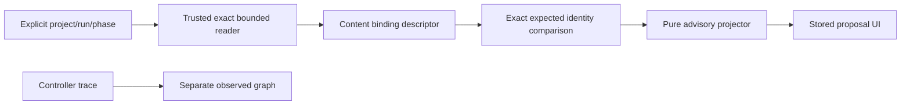

# ADR-042: Explicit Stored-run Proposal Binding

**Date:** 2026-10-23

Status: ACCEPTED. The operator explicitly approved this decision on 2026-10-23 in gate:arch `great_cto-ely5.15.2`. This permits implementation of the bounded private-state reader and stored-snapshot inspection, not execution activation or release. [Full architecture](../architecture/ARCH-bound-run-proposal.md). It does not extend the already accepted [ADR-041](ADR-041-four-domain-conditional-graphs.md) by implication.

## Context

The HTTP focus proposal remains unavailable because its adapter lacks an exact bound-plan reader. Controlled preparation and review phases each persist their plan, fingerprint and hard gates, but no distinct epoch UUID. The pure projector accepts caller evidence and cannot independently reverify it. See [controller phases](../../scripts/lib/controlled-specialists.mjs), [projector](../../scripts/lib/conditional-graph-proposal.mjs) and [board API](../BOARD-API.md).

`listCodexRuns` reads the global store before filtering membership. Reusing that helper would expose more private state to an inspection request than the operator selected. `boundedFile` offers byte/descriptor protections, but does not check trusted store ownership or establish project authorization. Existing focus-specific registry resolution and UI denial generation fencing already protect adjacent reads and must survive the addition.

## Decision

Choose two-step explicit stored-snapshot inspection: first obtain an allowlisted descriptor for project/run UUID/phase; then require its snapshot digest, content epoch digest, plan fingerprint, base and policy digest on the proposal request. Read one exact state file and one selected bounded project declaration per request. Validate private store/ancestor trust, server UID and permissions, no symlinks, regular nlink=1 files, before/after identity, strict schemas and exact canonical membership.

Only review snapshots produce a graph. Actual preparation plans use planningOnly:true, while the unchanged projector v1 requires planningOnly:false. A preparation binding can produce a descriptor, but requesting its proposal returns fixed planning-only-evidence, no graph and no fallback. Never rewrite the flag. A prebuild graph needs its own projector contract and decision. Store ancestors that are group/other writable, including sticky temporary directories, are unsupported; test fixtures must respect or simulate this policy without weakening it.

Treat epochDigest as content identity, never as unique chronological occurrence. No persisted epoch UUID exists to recover. Identical-content replacement cannot be distinguished by this design, and a same-UID hostile writer is outside its cooperative-controller assurance. A new persisted occurrence ID would require a separate controller/schema decision.

Before bootstrap or direct-dispatch project resolution, enforce an exact-origin read guard for both new routes. Reject foreign/null/malformed Origin, wrong scheme/port and cross-site browser reads; allow no-Origin CLI requests under the existing local trust model. Existing `originAllowed` allows a set of hosts rather than exact origin equality and is insufficient by itself. Suppress wildcard CORS on these new routes. Legacy GET/CORS behavior remains outside scope; host allowlisting does not authorize browser origins.

Preserve the old focus-proposal v1 API and pure projector unchanged. Add versioned binding/inspection routes, outer stored-snapshot provenance and false currentTreeAssessment/reusablePass flags. A structurally known nested assessment remains stored caller evidence. No on-click source scan, Git/subprocess, store enumeration, model/network call or scheduler/state write is permitted.

Union current declared gates with selected saved hard gates and existing proposal floors. Keep all eight core contracts, mandatory reviewers and explicit candidate pack admission intact. Mixed worker hosts inside a controlled run do not attest native host evidence. Unknown native/legacy state remains unavailable. Proposed dependencies remain separate from recorded execution topology.

## Attack on the Decision

A stable digest can make obsolete evidence look current. The envelope and adjacent UI must state stored provenance, false freshness and no reusable PASS. Cross-scope responses can resurrect a previous project after denial; full selection/binding request keys and accessGeneration must fence success and failure. If either control cannot be enforced, return unavailable instead of exposing a graph.

## Alternatives Considered

- **Attest current inputs on click:** could establish a present assessment but requires repository scanning and receipt lifecycle, violating this slice's no-scan scope. Rejected; requires a separately approved attestation seam.
- **Infer latest compatible run:** reduces selection steps but enumerates private files and binds by timing/name rather than operator intent. Rejected; no fallback uses it.

## Consequences

Positive: exact selected evidence can explain proposed dependencies while retaining current routing and approval authorities. Additive routes preserve old consumers. No state migration, service, credential or dependency is introduced.

Negative: two explicit requests may fail if the controller changes state between them. The operator must refresh the descriptor. Large or unsafe historical states stay unavailable. Current-tree correctness and unique epoch occurrence remain unproven.

Risks: cross-project disclosure, unsafe file trust, stale evidence presented as approval, private-field leakage and late-response resurrection. ARCH BRP-R1 through BRP-R5 and its privacy threat table map controls to deterministic/API/browser/security review. Cost and latency remain unknown; zero paid invocation paths does not imply zero engineering or runtime cost.

## Change map

## Migration and Rollback

No database or run-state schema change. Existing snapshots must pass all supported checks; no epoch backfill. Revert the new reader/routes/UI for compute backout and discard transient descriptors/proposals for data backout. Preserve old endpoints, private run history and recorded trace. Verify the reader ships in the packaged board runtime before a release decision.

## Validation and Approval Boundary

Fresh human gate:arch was required because a private-state/public-API boundary was outside ADR-041 approval and authoritative gates-only/devtools includes arch. The operator supplied explicit approval on 2026-10-23; root recorded it in `great_cto-ely5.15.2`. PM freezes a new acceptance file after this architecture approval; old frozen gates remain read-only. No human plan pause is added by the current approval helper. Implementation checks and independent review remain outstanding.

Reader fault tests, route membership/version tests, pure-projector regressions, real browser race/denial checks and packed-runtime verification precede independent code review, QA and security. The current mandatory reviewer/gate floor remains. No execution activation, benchmark, publication, deployment, release or installation approval follows from reading this ADR.
