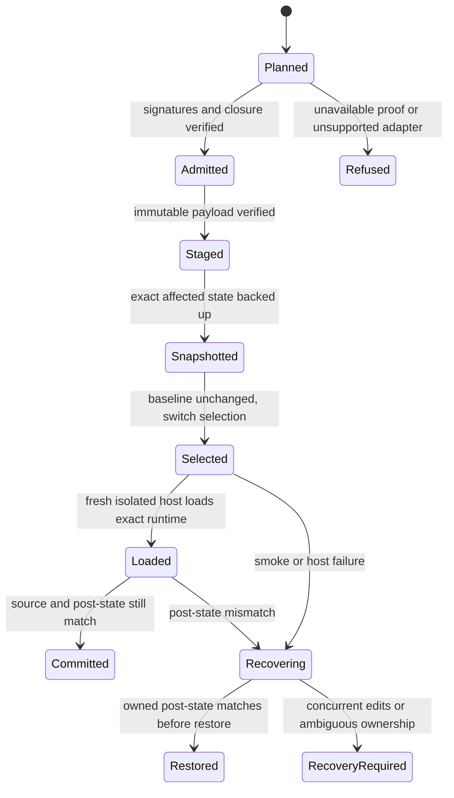

# ADR-046: Bounded native plugin activation and recovery

**Date:** 2026-10-27
Status: Proposed design; no native adapter is approved or implemented by this document
Extends: [ADR-045](ADR-045-verified-distribution.md)
Acceptance: [Native activation acceptance](../testing/native-activation-acceptance.md)

## Context and boundary

Release admission, installation, registration and a new host process loading the
selected plugin are distinct facts. A version string or an enabled flag proves
neither complete runtime bytes nor successful hook/MCP execution. Git marketplace
snapshots can omit compiled CLI files present in the signed complete archive.

Implement two deliberately bounded adapters, in order: Claude local user
registration, then Codex local marketplace registration. Preserve the enrolled
release authority, signatures, archive checks, source binding and mandatory gates
from ADR-045. Existing unsupported paths keep refusing until their adapter passes
its acceptance. This proposal does not enable companion installers, change hook
trust, publish a release, or authorize an operator installation.

## Decision: immutable payload and runtime closure

1. Admit the complete plugin archive and inventory using the existing production
   consumer. Never reconstruct it from a Git checkout or fill missing files from
   an installed package of the same version.
2. Extract only admitted regular members into an owned private staging directory.
   Validate names, bytes, modes, collisions and membership before candidate code
   or host registration commands run. An identical version with different bytes
   is a conflict, not an overwrite operation.
3. Publish an immutable version-and-index-digest directory by same-filesystem
   rename. Keep operator metadata outside the verified root. A candidate never
   supplies its own trust configuration, installer or download destinations.
4. Native execution must resolve the local admitted runtime. A future release
   must declare a plugin-root-relative Node MCP entry and ship its compiled CLI
   closure. Do not rewrite a signed old manifest from `npx` to `node`, borrow an
   unrelated global CLI, or use a network-denial error as proof of closure.
5. External plugin dependencies require independent explicit admission and an
   offline identity binding. Existing cached or enabled companions are not
   automatically trusted. If a dependency lacks that contract, return
   `UNSUPPORTED_DEPENDENCY_CLOSURE` before touching operator state. Never silently
   remove a required dependency, change its version or enable auto-installation.
6. Operator Node, Python and native host executables remain explicit toolchain
   assumptions. Bind selected canonical executable paths, versions and available
   hashes in the plan; do not claim that one entrypoint hash attests an entire
   interpreter or operating system. Refuse unaccounted dynamic fetch/import paths.

The current released npx MCP and companion declarations are therefore not made
activatable by this ADR. A compatible future signed release and independently
admitted dependencies are prerequisites. A management command exiting zero is
insufficient if its resulting cache is incomplete or dependency resolution failed.

## Transaction and concurrency model

The adapter owns only its great_cto payload, selections and explicitly inventoried
managed files. It does not own the whole host home, marketplace or plugin tree.

Persist an owner-only journal and fsync phase transitions. Journal identity binds
host adapter/version, release version, commit/index/archive digests, current
selections, exact affected paths and hashes, dependency bindings, and recovery
classification. Retain one previous installation. No prompts, credentials,
provider tokens or project documents belong in this journal.

Acquire an installation-specific lock; serialize retries and reject a second
writer. Re-read baseline hashes immediately before each selection mutation.
Native host registries may not expose atomic compare-and-swap. Do not describe a
read-then-rename sequence as atomic CAS. A first adapter may support only a
quiescent, explicitly selected user registration under a documented single-writer
precondition. It must detect observed drift, refuse if the host cannot be
quiesced within authority, and report remaining same-user filesystem races.

After a crash, recovery inspects the retained phase and exact paths before any
write. Restore previous bytes/selections only if the current state still equals
the transaction's recorded written state. Unknown or externally changed state
means `RECOVERY_REQUIRED`; never overwrite it to manufacture a clean rollback.
A legacy snapshot is recovery of operator state, not authenticated release proof.
Watermarks cannot be lowered by restoration or same-version replacement.

## Claude local adapter

Support one existing user-scoped local registration first. Preserve all other
plugins, scopes, marketplace selections and project settings. Plan the registry
entry and any globally managed roles/skills/commands separately. A managed-file
refresh is not part of the transaction unless its complete before/after inventory
and the adapter can restore every affected file in executed tests. Otherwise refuse that mode.

Use only a proven offline registration route with a complete admitted snapshot.
If native commands trigger companion acquisition, helper execution or network
access before admission, this host/command combination is unsupported. Do not
use the old source installer or marketplace upgrade as a fallback.

A fresh isolated native process must resolve the selected plugin root and local
MCP, load the expected hook configuration, and return bounded smoke evidence.
Separate process start, dependency resolution, MCP responsiveness, hook loading
and guard enforcement. No active user's conversation is terminated or silently
restarted. If operator reload is required, return `SELECTED_RELOAD_REQUIRED`,
not `ACTIVE_VERIFIED`.

## Codex adapter

After Claude acceptance, prove a local marketplace route on the selected Codex
version in an isolated host home with outbound network denied. Bind the immutable
local source, installed cache and actual MCP runtime. If Codex copies the source,
verify the destination against the admitted inventory before enablement. A
partial Git snapshot or an npx cache is not a complete installed payload.

Back up only affected great_cto registration/config keys and managed hook trust
state. Existing trust choices are preserved, never auto-accepted. New or changed
hook definitions may require native interactive review; report that boundary and
keep enforcement unknown until measured in a new host process. An enabled plugin
listing does not demonstrate a running controlled pipeline or native causal graph.

## Result contract

Keep evidence fields separate rather than compressing them into installed=true:

| Field | Allowed facts |
|---|---|
| artifact | Not checked, refused, or exact admitted index |
| payload | Not staged, complete bytes verified, or conflict |
| registration | Unchanged, selected, or recovery required |
| process | Not observed, reload required, or fresh process measured |
| MCP | Not checked, local response measured, or failed |
| hooks | Not checked, trust review required, loaded, or enforcement measured |
| recovery | Not exercised, restored exact prior state, or operator action required |

Only the conjunction of the adapter's executed required checks permits
`ACTIVE_VERIFIED`. Synthetic fixtures have authority NONE. Real isolated host
acceptance is labelled isolated and does not attest the operator's active session.
Missing observations stay unknown; they do not become zero failures.

## Rollout and authority

Land design/acceptance separately from adapter implementation. Implement Claude
and Codex in separate reviewed changes. Run real isolated-host acceptance before
requesting an operator activation plan. A subsequent explicit activation must
name the exact signed release/index, host registration, executable/runtime and
managed-file paths, expected reload boundary and retained recovery state.
No published archive or existing version directory is modified in place.

Native adapters are not prerequisites for improving the supported npm updater or
for verifying an already running admin. They must not reintroduce indefinite
human stops into ordinary reversible development; their authority checks apply
at the actual installation/selection boundary.

## Consequences and alternatives

The bounded adapters require additional disk space for one prior payload, durable
journals and isolated native-host acceptance. They delay native activation for
releases whose manifests still fetch external runtime. This is an explicit
support boundary; the existing CLI and admin can operate independently.

Reject direct Git marketplace refresh as a trusted update because it can select
bytes outside the signed complete payload. Reject editing old signed manifests
because it breaks artifact identity. A universal companion/package-manager
installer would enlarge the recovery and trust surface before either bounded
host adapter has demonstrated its contract, so it remains outside this proposal.
