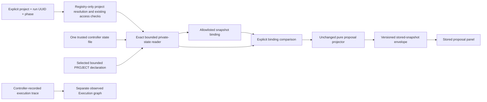

# ARCH: Explicit Controlled-run Proposal Binding

**Date:** 2026-10-23

For board implementers, API reviewers and the operator approving this slice, this proposal chooses inspection of an explicitly selected stored controlled-run snapshot without claiming a current working-tree assessment.

Status: PROPOSED. Human gate:arch `great_cto-ely5.15.2` must approve this new boundary before runtime implementation. Parent: `great_cto-ely5.15`; architecture task: `great_cto-ely5.15.1`. [ADR-042](../adr/ADR-042-explicit-run-proposal-binding.md) records the decision. [ADR-041](../adr/ADR-041-four-domain-conditional-graphs.md) approved registry, pure projector and board display only; its approval does not cover this reader.

## Signals and Depth

| Signal | Finding | Consequence |
|---|---|---|
| Input | Run UUID, phase and binding digests are caller controlled; stored JSON is untrusted | Strict syntax, bounded exact read and structural checks |
| Boundary | Private controller store to public board JSON and DOM | Membership before projection; explicit allowlist and denial fencing |
| Data | One stored plan and phase metadata; retained by existing controller policy | No copied state, new persistence or derived cache |
| Money | No model, external API or paid calls | Per-request local cost remains unmeasured |
| Control | Exact identity and fail-closed access | False denial is possible; show unavailable and permit explicit retry |
| Execution | User-triggered deterministic reads only | No scheduling, gate approval, subprocess, source assessment or retry loop |

Size: Medium. Estimated implementation touches 8–10 files across three components and tests, introduces an additive API contract and privacy boundary, and introduces no new service. Primary project policy is authoritative: devtools; compliance declarations are openssf, api-stability and soc2-type-2; approval-level gates-only. The canonical helper returns product, arch, import and ship. No human plan pause is introduced. These declarations are constraints, not a compliance certification.

## Problem and Evidence

The current HTTP proposal adapter deliberately supplies unknown assessment evidence and returns `changeIdentity:null`; it has no safe bound-plan reader. The pure projector already accepts supplied plans and declares `caller-supplied-evidence-not-reverified`. See [board API](../BOARD-API.md), [routes](../../packages/board/lib/routes.mjs) and [projector](../../scripts/lib/conditional-graph-proposal.mjs).

The controller persists `specialistPreparation.plan/fingerprint/hardGates` and `specialistReview.plan/fingerprint/hardGates` independently. Preparation before implementation records planningOnly:true; the unchanged proposal projector requires planningOnly:false. Therefore this slice permits a preparation binding descriptor but returns unavailable for its graph. Only a supported review snapshot can produce a proposal. It does not persist a distinct epoch UUID. `planFor` and `assertSpecialistEpoch` reassess the repository and must not execute during inspection. See [controlled specialist phases](../../scripts/lib/controlled-specialists.mjs).

`listCodexRuns` enumerates and reads all state files before membership filtering. `projectCodexState` intentionally omits raw plans. Neither supplies an exact private read for this adapter. [boundedFile](../../scripts/lib/domain-evidence.mjs) supplies descriptor/path consistency checks but does not establish ownership, private mode or authorization. [Execution trace](../../scripts/lib/execution-trace.mjs) and [work projection](../../packages/board/lib/work.mjs) remain the sources of observed execution topology.

No feature-specific product brief declares additional requirements. This slice follows the approved focus feature and the operator's continuation request, constrained to a new architecture decision. Local lessons support visible denial states and browser verification. Pattern lookup found no matching architecture-rework constraint. No measured throughput, latency, cost or efficacy target exists for this slice.

## Decision and Alternatives

Choose **explicit stored-snapshot inspection**: two bounded read requests bind project, controlled run UUID, selected phase and immutable content identity. The first returns a minimal descriptor; the second requires that descriptor's full binding and returns a derived proposal only for review. Preparation returns fixed `planning-only-evidence` with no graph. Every result states that tree freshness and execution authority remain unverified. A preparation graph would require a separately approved projector contract; do not rewrite its planningOnly flag.

Attack on the choice: a plan may have been valid when saved but no longer describe the working tree. A digest may make that old plan look authoritative. Therefore the outer envelope calls it `stored-snapshot`, sets `currentTreeAssessment:false`, never calls an epoch assertion, and the UI labels it Stored proposal. If users require current-tree assurance, this design cannot satisfy that requirement; a separate attestation seam and architecture decision are necessary.

Rejected **attest-current on click**. It could prove a current input boundary, but would require repository assessment, receipt lifecycle and a larger authorization surface. Source scans and subprocesses violate this slice's constraints. No latent option invokes it as fallback.

Rejected **infer latest compatible run from the store**. It avoids explicit selection but reads other private runs and cannot prove which project/phase the operator meant. Timestamps, host routes and a matching project name cannot establish that identity.

This is a reversible additive adapter decision; no contested framework or performance requirement needs skeptical triage. Deterministic comparison favors the only option satisfying all read/no-scan/no-inference constraints. No paid advisor or routing call is part of this architecture phase.

## Non-goals

Do not change the controller, persisted state schema, scheduler, role catalog, eight core contracts, reviewer quorum, pack admission, gate authorization or execution defaults. Do not rescan source, invoke Git or a shell, enumerate the run store, select the latest run, infer a phase, synthesize missing native evidence or reuse historical PASS.

Existing generic metadata alias readers remain outside this slice. Preserve focus-specific registry resolution and its server bootstrap ordering. Existing frozen acceptance files, previous approvals, release/install state and earlier feature documents are read-only. No benchmark or model-quality claim is included.

## Change map



The diagram is acyclic. No edge from UI, envelope or projector writes to controller state, gates or scheduling.

## Components and Ownership

| Component | Owner | Proposed implementation files | Responsibility |
|---|---|---|---|
| Exact reader | reader implementation task | proposed `scripts/lib/bound-run-proposal.mjs`, proposed `tests/lib/bound-run-proposal.test.mjs` | Filesystem trust, membership, binding and allowlisted adapter output |
| Board API | API implementation task | `packages/board/lib/routes.mjs`, `packages/board/server.mjs`, `docs/BOARD-API.md`, dedicated route tests | Early route classification, additive API and status contract |
| Board UI | UI implementation task | `packages/board/public/index.html`, `tests/e2e/focus-proposal.e2e.test.mjs` | Explicit selection, binding state, race/denial fencing and separate labels |

PM assigns exclusive ownership before builders start. Route test ownership must not overlap UI tests. The pure projector and observed execution projector require no changes. If packaging needs an additional manifest entry, PM assigns it exclusively to the reader task and counts the resulting scope increase. Architecture work writes only this document, ADR-042 and their paired summaries.

## API and Envelope Contracts

Keep `/api/focus-registry` and the existing `/api/focus-proposal` v1 behavior intact. Add two GET-only routes, both classified as focus reads in `isFocusReadPath` before generic alias resolution, including server bootstrap:

1. `/api/focus-run-binding?project=<registered-selector>&run=<uuid>&phase=<preparation|review>` obtains a descriptor for exactly that selection.
2. `/api/focus-run-proposal?project=<registered-selector>&run=<uuid>&phase=<preparation|review>&focus=<focus-id>&snapshot=<sha256>&epoch=<sha256>&plan=<sha256>&base=<pinned-commit>&policy=<sha256>` requests a proposal with the complete selected identity.

Require explicit project even though older focus routes allow the server project default. Accept only a lowercase canonical UUID string in 8-4-4-4-12 hexadecimal groups; bind its exact value to `state.id`. Do not restrict UUID version without evidence that all existing controller IDs use it. Require exactly one occurrence of each documented query key; reject duplicate, missing and unknown keys, overlong values and unknown phase/focus before file access. Digests are lowercase 64-hex; base accepts the pure projector's 40- or 64-hex pinned commit syntax. Neither route accepts a path, filename, store, plan JSON or caller-supplied policy. Total URL budget is 2 KiB. Methods other than GET return 405 with `Allow: GET`.

Binding response v1:

```json
{
  "schemaVersion": 1,
  "kind": "controlled-run-proposal-binding",
  "state": "available",
  "projectId": "<existing canonical project identity>",
  "controller": "codex",
  "runId": "<explicit UUID>",
  "phase": "review",
  "binding": {
    "snapshotDigest": "<sha256 exact state bytes>",
    "epochDigest": "<sha256 canonical selected phase identity>",
    "planFingerprint": "<validated stored fingerprint>",
    "base": "<validated pinned commit>",
    "policyDigest": "<sha256 selected PROJECT bytes>"
  },
  "provenance": "stored-snapshot",
  "currentTreeAssessment": false,
  "reusablePass": false
}
```

Placeholders above describe schema metavariables, not values returned by the implementation. The descriptor contains no proposal. It is not a bearer capability, approval token or existence oracle outside the selected authorized project scope.

Proposal response v1 uses `kind:controlled-run-proposal-inspection`, repeats the exact identity and binding, and adds `focusId`, `registryVersion:1`, `proposal` and `limitations`. Always include `advisory:true`, `changesExecution:false`, `currentTreeAssessment:false`, `reusablePass:false` and limitations `stored-snapshot-not-revalidated`, `content-identity-not-historical-epoch`, `proposal-not-execution-evidence`. Nested proposal remains the existing schemaVersion 1 unchanged, including its caller-evidence limitation. Its `assessmentState:known` means the supplied stored plan passed structural checks; it never upgrades the envelope's assurance. Do not populate the legacy `changeIdentity` field with a stored identity or retrofit its meaning.

Unavailable responses use the same outer kind/version with `state:unavailable`, `binding:null`, `proposal:null`, and one fixed reason code. No nodes, edges, private metadata, partial descriptor or stale last-good proposal is included. UI must clear graph and show no selective omission. A fixed floor explanation lists the unchanged mandatory code-reviewer, qa-engineer and security-officer; it does not claim full specialist requirements when evidence is missing.

All responses set JSON content type and `Cache-Control: no-store`. No localStorage, service-worker cache, shared response cache, ETag or 304 reuse. Unknown outer/nested version is unavailable in the client, never partially rendered. These routes add no approval semantics or gate:plan pause.

## Identity and State Read Algorithm

1. Apply existing host refusal and a new route-specific same-origin read guard before any project registry, metadata or state access, in both server bootstrap and direct dispatch. The board currently sets wildcard CORS and guards only writes; host allowlisting is not browser-Origin authorization. For these two routes, compare a present Origin to the exact board request origin (scheme, approved Host and port), reject `null`, malformed, duplicate, foreign and other-allowed-host origins with fixed 403. Derive scheme from trusted transport or explicit server-owned external-origin configuration; never trust caller Forwarded/X-Forwarded headers. Existing `originAllowed` checks membership in an allowed-host set and accepts either HTTP or HTTPS, so it is insufficient alone for this exact-origin contract. If Origin is absent, reject cross-site Sec-Fetch-Site and require a present Referer to have that same exact origin; allow absent Origin/Referer for CLI callers. This is browser isolation, not CLI authentication. Do not emit wildcard Access-Control-Allow-Origin for either new route. Resolve the explicit selector only after this guard with `resolveFocusProject`, require a unique canonical registered root and derive the existing projectId. Never invoke generic metadata alias scanning. Recheck canonical root identity before returning.
2. Resolve the store once from server-owned configuration using existing store-location semantics. No request may override it. Require an absolute canonical path with no symlink components. Require store and state ownership by the server's effective UID; store directory mode must be 0700 and file 0600. Relevant ancestors must be non-symlink directories owned by the server UID or root and not group/other writable. Check these facts for every request and after the read. Stores under group/other-writable ancestors, including sticky temporary directories, are unsupported: this deliberately trades availability for the declared trust boundary. Tests use injected filesystem metadata or a genuinely trusted private fixture root; a test-only production-policy bypass is forbidden. If a platform cannot establish these properties, return unavailable. Never chmod, repair, mkdir or migrate on read.
3. Construct exactly `<trusted-store>/<validated-run-UUID>.json`. Use a bounded descriptor read with the `boundedFile` regular-file, nlink=1, no-follow/non-blocking, before/after dev/ino/uid/mode/size/nlink/mtime/ctime and canonical-path checks. Add explicit ownership and mode checks; the primitive alone is insufficient. No readdir, listCodexRuns, fallback filename or store retry.
4. Accept at most 1 MiB plus the existing one-byte overflow sentinel from the state file; decode strict UTF-8, reject malformed JSON, non-object root, `version !== 1`, mismatched id or malformed root. Require canonical `state.root` equal the selected root exactly, not a child, basename, prefix or neighboring worktree. Membership checks precede any plan projection or public detail. A missing or different-root run is indistinguishable publicly.
5. Read only the selected root's `.great_cto/PROJECT.md`, bounded at 64 KiB plus overflow sentinel. Enforce the existing no-symlink/regular-file protections. Recheck file/path identity before response so a concurrent policy change discards the result. Compute its digest and require equality to stored `specialistPolicy.projectDigest`; derive current project hard-gate requirements from these bytes without importing execution code. Failure cannot downgrade to an empty gate list.
6. Select only `specialistPreparation` or `specialistReview` from the requested phase. No review/preparation fallback. Require policy with a pinned base, selected phase object, a supported v1 advisory plan with reusablePass=false, phase fingerprint equal to plan.fingerprint, and `plan.assessment.base === specialistPolicy.base`. Require complete bounded assessment/reviewer metadata, recognized role identifiers from the shipped catalog, valid unique phase roles, and supported hard gate identifiers. Preparation descriptors require planningOnly:true; review descriptors require a planned planningOnly:false plan satisfying the pure projector's schema. Reject hostile metadata before projector invocation, including arbitrary role-like slugs absent from the catalog. Validate preparation contract-stage mappings explicitly; never promote prebuild stage IDs into delivery review roles.
7. Derive `epochDigest = SHA256(canonical({phase, planFingerprint, assessmentFingerprint, base, policyDigest, roles, selected, hardGates}))`; absent `selected` is null, and canonicalization sorts object keys and preserves array order. `snapshotDigest` hashes exact raw state bytes. Changing status/reports/attempts can invalidate snapshotDigest even if epochDigest stays stable. Define canonicalization locally or reuse only the pure canonical helper, with no source reads. Fingerprints are content labels, not independently recomputed assessments.
8. For the proposal route, compare every expected binding field, phase and project/run identity before deriving a graph. A valid preparation binding returns `planning-only-evidence`, binding:null and proposal:null, without projector invocation or fallback. For review, union selected-phase hard gates, current project gates and pure-projector baseline import/ship; normalize `gate:` prefixes against a closed enum. Validate that all selected reviewer/contract requirements survive the projection. A graph or requirement overflow produces unavailable, never selective truncation. Controller policy remains unchanged.
9. Call only the pure `conditionalGraphProposal` with the selected stored plan/base and validated required gates, using controller host `codex`. Worker `hostRoutes` do not establish controller provenance; a Claude worker in a controlled Codex run does not attest native Claude state. Uninstrumented native inspection remains unavailable with no fallback to controlled evidence.
10. Revalidate selected state path/descriptor identity and project/policy identity before constructing fresh allowlisted JSON. A changed source returns snapshot-changed; do not reread automatically. Catch errors at the boundary, discard raw messages and buffers after the request and return fixed categories.

Budget: one exact state read, one selected policy read, bounded filesystem metadata operations, no directory contents, source scan, Git invocation, subprocess, network call, paid call, timer retry or persistent write. At most 1,114,114 source bytes including both sentinel bytes per request; descriptor plus proposal requires two independently bounded requests. File size, plan array limits and projector node/edge limits bound CPU/memory work. Cap a response at 96 KiB and the nested proposal at its existing 64 KiB; overflow fails closed. These are acceptance budgets, not measured latency or a hard wall-clock guarantee for a blocked filesystem.

There is no persisted epoch UUID. Content identity cannot distinguish identical-content replacement or a same-UID ABA write returning identical bytes. The UI must not call this a unique historical epoch, tamper-proof attestation, or current assessment. A controller that needs occurrence identity must persist a new epoch ID in a separately approved writer/schema change. No historical identity is fabricated here.

## Fail-closed State Matrix

| Condition | HTTP / fixed reason | Public result |
|---|---|---|
| Invalid/duplicate/oversize query | 400 / invalid-selection | No source read, no binding or graph |
| Existing host/project access refusal | 403 / access-denied | Clear all selected inspection state |
| Foreign/null/malformed/duplicate Origin, mismatched port/scheme, or cross-site browser read | 403 / access-denied | Before resolver/registry/metadata/store access; no wildcard CORS |
| Unknown/ambiguous project, missing run, other-project run | 404 / unavailable | Same shape and message; no existence or root detail |
| Unknown version, missing native/legacy phase or unsupported plan | 200 / unsupported-evidence | Unavailable; no alternate phase/run |
| Unsafe ownership, permissions, symlink, hardlink, FIFO or excessive file | 200 / unsafe-evidence | Unavailable; no repair or raw filesystem error |
| Invalid policy, role, gate, fingerprint or base relation | 200 / invalid-evidence | No partial plan or missing-gate narrowing |
| Expected binding differs or read races mutation | 409 / snapshot-changed | Clear descriptor and proposal; explicit reselect/retry |
| Valid bound stored plan | 200 / state available | Stored proposal only; tree freshness false |
| Valid preparation binding requested as graph | 200 / planning-only-evidence | Unavailable; no projector call, flag rewriting or review fallback |
| Unknown response version, malformed response, offline or network failure | client unavailable | Clear graph; show distinct fixed state and explicit retry |

Do not promise constant-time non-disclosure: filesystem timing is outside this slice's assurance. Do prevent content and reason differences from revealing another project's run.

## Security

Threat surface is local private controller data entering public JSON/HTML. The trusted boundary is the server UID and trusted store configuration, not the UUID, a hash or the bounded-read primitive. Existing board host/access checks and the new route-specific exact-origin guard are prerequisites; this slice does not add multi-tenant authentication or make claims that localhost implies user identity. Legacy CORS/read endpoints stay outside this change; their behavior cannot be cited as protection for private run reads.

| Threat / severity | Mechanism | Required control and gate |
|---|---|---|
| Cross-project disclosure / High | Valid UUID points at another root | Canonical exact membership before projection; indistinguishable 404; API/security review |
| Cross-origin browser disclosure / High | Wildcard CORS permits foreign GET to an allowed localhost Host | Exact Origin/Referer/Fetch-Site guard before both bootstrap and direct dispatch resolution; no wildcard CORS; HTTP negative controls |
| Private source leakage / High | Raw state includes prompts, paths, tokens, results and policy text | Construct allowlisted output afresh; no spread of state/plan/errors; JSON/DOM/log canary tests |
| Symlink, hardlink, FIFO or writable store / High | Attacker redirects the UUID-derived file | Trusted ancestors/store/file owner and mode, regular/nlink1/no-follow checks; fault-injected reader tests |
| Stale or swapped binding / High | State/policy changes between descriptor and proposal | Full expected tuple plus before/after path identity; 409, clear old result; race tests |
| False authority / High | UI presents saved known evidence as current PASS | Stored provenance, false freshness/reuse flags, no approval writes; browser and independent review |
| Late response resurrection / High | Delayed success follows denial or project switch | Scope/request/access generations plus full binding comparison; browser negative controls |
| Same-UID hostile writer / residual limitation | Writer can replace trusted bytes and compute consistent metadata | Explicit cooperative-controller trust statement; no tamper-proof/ABA or current-tree claim |

Only shipped allowlisted focus labels, role IDs, fixed reason enums, version fields, strict identities, hashes, gate IDs and typed proposal nodes/edges may reach JSON/DOM. Drop raw file lists, assessment/reviewer reason text, root/store paths, project names, prompt/context/result/report contents, credentials, arbitrary status strings and exception messages. Hashes are correlation labels, not secrets or authorization. Render labels with textContent or fixed templates; never inject stored strings with innerHTML. Logs may count fixed result categories; they must not record URLs, binding values, query strings or raw errors. Clear in-memory buffers and references after request completion; there is no new retention store.

## UI Integration

Preserve `prepareFleetScope`, synchronous switchProject clearing, all four existing request generations and `accessGeneration`. Extend the request key with projectId/runId/phase/full binding/focus/registry version; capture accessGeneration for each request and check it again before accepting success or failure. Clearing a project, run, phase, focus, descriptor, denial or unknown version invalidates pending requests synchronously. One denial invalidates registry/proposal/required/roster content as today and also the new binding. A late success never clears a denial; retry is explicit after the operator restores scope.

Use an explicit run UUID input or an already explicitly linked run UUID; do not populate a selector by reading the global store. Require an explicit preparation/review selection. Binding retrieval displays a short content identifier and Stored snapshot. Review permits inspection using that descriptor; preparation shows Planning snapshot: graph unavailable under projector v1. A changed binding empties the graph and requires a fresh descriptor. No automatic refresh selects a replacement snapshot.

Keep Stored proposal visually separate from the observed Execution graph. Use the existing board design tokens, compact density and accessible controls; no redesign. Present provenance and limits adjacent to the graph, not only in a tooltip. Keyboard labels, aria-busy/live status and focus-preserving retry are required. Native evidence unavailable is distinct from offline, access denied and stored snapshot changed. A design-advisor verifies this narrow component contract before UI implementation; no extra paid design service is required.

<frontend_aesthetics>
NEVER use generic AI-generated aesthetics: overused fonts (Inter, Roboto, Arial, system),
cliché schemes (purple gradients; the cream + serif + terracotta editorial default), predictable
layouts, cookie-cutter components. For regulated/operator UIs prefer dense, restrained, high-contrast,
WCAG-AA layouts with a cohesive context-specific palette and purposeful micro-interactions.
</frontend_aesthetics>

This addition reuses existing typography and tokens; the guard does not authorize a board-wide font or layout change.

## Migration, Packaging and Rollback

No state/database migration. Existing preparation/review snapshots remain readable only when every supported relation and trust check passes. Missing legacy fields remain unavailable; do not backfill or infer epochs. No new dependency, vendor, credential, service or external reachability check is required.

Package the new reader wherever the board runtime and CLI distribution consume `scripts/lib`; verify the packed artifact includes it and resolves its imports without the repository checkout. Update API documentation in the implementation slice. Freeze a new acceptance file `docs/gates/bound-run-proposal.md` before builders; do not modify prior frozen gates. PM commits that file and records its digest as the implementation baseline.

Roll out only additive routes and UI inspection after independent checks and required human gates. Backout compute by reverting this adapter/UI addition; old registry and unavailable HTTP proposal behavior stays functional. Backout data by discarding only transient descriptors/proposals; no state writes or schema changes exist to reverse. Neither rollback touches run history, installation or release state.

## Implementation Tasks and Dependencies

Architecture gate comes first. After human approval, PM freezes acceptance commands and ownership, then queues reader, API and UI work. API depends on reader; UI depends on the API envelope contract. Independent devtools/API review and design-advisor checks apply before the corresponding implementation. Independent code-reviewer, qa-engineer and security-officer retain their existing delivery floor; any further required specialists/gates remain mandatory. All eight core contracts remain available, and pack admission stays candidate/explicit-only.

Root creates implementation tasks after the architecture decision rather than this phase inventing approved work packets. Acceptance must include dedicated synthetic fixtures only, never operator private runs. A new implementation packet may not modify this decision, old acceptance gates, controller execution policy or observed trace to make tests pass.

## Definition of Done and Acceptance

PM freezes exact executable commands after confirming file names. Required new targeted commands are `node --test tests/lib/bound-run-proposal.test.mjs` and `node --test tests/e2e/focus-proposal.e2e.test.mjs`; the latter must run its real browser path, not report a skipped browser as PASS. Existing `node --test tests/lib/conditional-graph-proposal.test.mjs tests/lib/domain-evidence.test.mjs tests/lib/codex-host-state.test.mjs tests/lib/execution-trace.test.mjs` proves compatibility. Add exact route tests to the frozen command once PM assigns the new test file. Run the repository canonical full gate once after targeted checks, not a guessed npm command. Architecture completion runs document lint only; it cannot prove an unwritten adapter.

Deterministic acceptance cases:

| Case | Deciding observation |
|---|---|
| Happy review | Descriptor plus exact proposal from its saved review plan; bound base/policy/phase/fingerprints match |
| Preparation compatibility | Realistic planningOnly:true preparation returns descriptor, then planning-only-evidence with no graph; no flag mutation, projector invocation or review fallback |
| Content identity | Same plan in distinct phases yields distinct epochDigest; unrelated state mutation invalidates snapshotDigest; identical-content replacement has no false occurrence claim |
| Malformed and hostile input | Invalid UUID, traversal, duplicate keys, bad digests, wrong version and invalid roles reject without unsafe read or echo |
| Membership | Other-project UUID and absent UUID return equivalent public 404 and no source fields |
| Browser-origin boundary | Foreign Origin, null, malformed/duplicate values, wrong scheme/port and another allowed Host origin return fixed 403 in real HTTP and direct dispatch; spies prove zero registry/metadata/state reads; same-origin and no-Origin CLI cases pass; wildcard CORS absent |
| Filesystem faults | Symlink in any relevant component, nlink>1, FIFO, nonregular, unsafe owner/mode, overflow and injected mutations return unavailable |
| Missing and changed evidence | Missing phase/native/legacy metadata, base mismatch, changed policy and mismatched plan fingerprint produce no graph; no fallback |
| Invocation budget | Spies prove no readdir/store listing, source assessment, Git/subprocess, external/paid call or write; exact file and policy byte ceilings hold |
| Privacy | Canary prompts, tokens, filenames, project names, roots, errors and raw reason strings absent from JSON, DOM, headers and request/error logs |
| Projection floor | Eight contracts/catalog/pack admission, mandatory reviews and selected hard gates unchanged; no scheduler or reusable PASS mutation |
| Browser races | Project/run/phase/focus switch, A-B-A scope, denial followed by delayed success, independent request generations and offline/unknown version clear content |
| Host provenance | Mixed worker hostRoutes cannot upgrade native evidence or label configured routing as observed execution |
| Distribution and rollback | Packed runtime resolves the reader; removal restores old endpoints without modifying state |

No latency target, coverage percentage, quality uplift or benchmark threshold is invented. Required checks are contract/fault/negative controls, independent review and packaging verification.

## Safeguards

- [ ] Data integrity: full project/run/phase/snapshot/plan/base/policy binding must match; unknown evidence never narrows routing.
- [ ] Security: only one UID-owned private exact state file is read; ownership, mode and membership checks precede projection.
- [ ] API contract: existing v1 proposal stays compatible; unknown envelope versions fail to unavailable.
- [ ] Authority: saved plan/hash is not current-tree verification, approval, reusable PASS or execution proof.
- [ ] Privacy: no arbitrary private values or raw errors reach public output or logs; late responses cannot resurrect denied state.
- [ ] Execution: inspection changes no scheduler, gate, run-state, pack admission or installation/release state.

## Risks

| ID | Mechanism | Mitigation / deciding gate |
|---|---|---|
| BRP-R1 | Stored known assessment mistaken for current | Outer assurance flags and adjacent UI provenance; architecture/API/browser acceptance |
| BRP-R2 | Exact read primitive treated as authorization | Trusted store/ancestor UID/mode plus exact project membership; security review |
| BRP-R3 | Content hash misrepresented as unique epoch | Explicit content identity limit; no fabricated generation history; architecture review |
| BRP-R4 | Synchronous read stalls local server or large state denies inspection | Fixed byte ceilings, no retry loop, visible unavailable; performance remains unmeasured |
| BRP-R5 | Eager UI fallback reveals another run or stale graph | No inference, full request key, access generation and global clearing; browser negative controls |

These are proposed controls, not accepted residual-risk waivers. Root carries these risks into central tracking within its authorized scope; this architecture writer does not modify existing registers.

## Cost Estimate

No new cloud components and no new vendor cost row. Inspection performs zero model or paid API calls by construction. CPU/I/O cost, request rate, engineering lead time and end-to-end spend are unknown because this adapter does not exist yet. The existing local board process remains the deployment surface; no new service, region or measured cost tier is introduced.

Pipeline estimate: architect, PM, reader/API/UI implementation, design-advisor, applicable devtools/API reviewers, independent code review, QA and security. Token volume, dollar cost and elapsed time are unknown, not zero; this phase uses no paid model/router calls. No new production SLO is seeded because there is no new service.

## Cost Model

| Component | Assumption | Incremental monthly cost |
|---|---|---|
| Local board compute/I/O | Two explicit bounded reads per successful inspection flow | Unknown; no measurements |
| Storage/database | No persistent adapter writes | No new allocation |
| External API/model | No invocation path permitted | Zero invocations; no new vendor charge |
| Unit economics | Request volume and runtime utilization unmeasured | Unknown |

Byte ceilings, no retries and no background refresh are the cost controls. No savings, per-accepted-task cost or break-even result is claimed. Existing deployment costs are outside this slice's measured evidence.

## Gate and Handoff

Human decision: approve explicit stored-snapshot inspection and its new private-state/public-API boundary, with truthful content identity and no current-tree assurance. Gate:arch is mandatory under authoritative gates-only/devtools policy and the input/boundary/data signals. ADR-041 approval cannot substitute for this decision. Root records the gate ID and reviews/commits this planning artifact; the architecture writer does not approve the gate, commit, push or create a PR.

After approval, PM freezes the implementation acceptance and work packets. No human gate:plan pause applies under the current helper output. Mandatory reviewers, security/compliance requirements and release/installation authorities remain intact. This document is a proposal until the operator resolves the exact architecture gate.

## Requirements Checklist

- [ ] REQ-1: Inspection requires explicit unique project, run UUID and preparation/review phase, with no listing/latest/fallback inference.
- [ ] REQ-2: Bind exact snapshot and content epoch to plan fingerprint, pinned base and selected policy digest without fabricating epoch history.
- [ ] REQ-3: Enforce trusted private store, exact bounded no-follow regular-file read and exact canonical project membership.
- [ ] REQ-4: Missing, malformed, changed, legacy or native evidence stays unavailable; mismatch clears graph and binding.
- [ ] REQ-5: Preserve pure projector v1 and old HTTP envelope; allow review graphs only, preparation descriptors without graphs, and explicit false freshness/reuse.
- [ ] REQ-6: Preserve eight contracts, all mandatory reviewers/hard gates and explicit pack admission; inspection is read-only and free of live/paid calls.
- [ ] REQ-7: Redact private state and errors across JSON, DOM, headers and logs; protect against denial and cross-scope races.
- [ ] REQ-8: Keep observed Execution graph separate and controller provenance distinct from configured worker routing.
- [ ] REQ-9: Pass deterministic happy/error/edge/negative controls, independent review, real browser checks and packed-runtime verification.
- [ ] REQ-10: Obtain fresh human gate:arch before runtime changes; keep old frozen gates and release/install state unchanged.
