# ARCH: Verified distribution and update admission

**Date:** 2026-10-26
Status: Accepted design on 2026-10-26; no implementation, production signature or release claim.
Design: [ADR-045](../adr/ADR-045-verified-distribution.md).

The operator requested signed artifacts and verification before installation. This document fixes the implementation contract; source, artifact and activation evidence remain separate.

## Change map

```mermaid
flowchart LR
  S[Reviewed source commit] --> SG[Source admission]
  SG --> T[Candidate tag and SIGN_ONLY]
  T --> B[Build exact npm and full plugin archives]
  B --> I[Signed index and runtime inventory]
  I --> V[Trusted Cosign and exact identity verification]
  V --> AG[Artifact and ship admission]
  AG --> P[Publish same bytes]
  P --> D[Private consumer staging]
  D --> CV[Publisher, digest and runtime admission]
  CV --> A[Supported local activation]
  A --> SM[Installed smoke]
  SM -->|failed| R[Recover owned previous state]
  CV -->|missing proof or unsupported host| H[Leave installed selection unchanged]
```

The arrows define proposed admission order. They do not describe an executed
release, a new product orchestrator or a completed native-host capability.

## Context, scope and gates

- Input: hostile release indexes, archives, signature bundles, redirects and local installation metadata.
- Boundary: downloaded code enters global CLI/plugin state used by other projects.
- Data: retain versioned private admission/activation receipts and one previous installation; never retain credentials or source prompts.
- Money: no money movement; compromised artifacts inherit developer execution permissions.
- Control: fail-closed admission prevents substitution; unavailable verification can deny updates, so leave the selected version intact.
- Execution: replace install-latest-then-report with discover, download, verify, stage, admit, activate, smoke and recover.
- SIZE: Large, because one release job and three installation surfaces acquire a security-sensitive shared state machine.
- Gates: gate:arch fixes publisher identity and supported adapter scope; devtools + security review precede source admission; gate:ship requires exact production artifact proof. User installation/release authority remains a separate input.

## Verified current behavior

1. publish.yml builds then publishes a package directory, asks for npm provenance and supplies optional NPM_TOKEN. It does not yet build one frozen tarball, separately sign it, then publish those same bytes.
2. self-upgrade.ts invokes npm/pnpm/Volta install at latest before its version check.
3. codex.ts and codex-auto-update.sh delegate to native marketplace upgrade. An origin URL is checked by the shell helper; that does not establish exact artifact identity before activation.
4. installer.ts can fall back from a missing tag to mutable main, clones directly into an installation path, and supplies builtDist from the running CLI. This can mix two release sources.
5. install-local-cache.mjs already provides immutable version-directory publication and inventory/regular-file checks. local-install-registry.mjs backs up and compare-and-swaps Claude registration, but its receipt is an identity record, not publisher authentication.
6. Local Codex help accepts local marketplace paths; Claude help accepts a marketplace source path. These help outputs do NOT prove that the native host cannot execute an unverified helper or fetch a different source during registration. No native install was performed in this run.
7. Cosign is not installed on this workstation. Official latest release metadata reports cosign v3.1.4 (2026-10-20); cosign-installer v4.1.2. This is a version-selection input, not verification of an installed executable.
8. Official npm documentation states that provenance attestations are Sigstore-signed and transparency-logged. Do not repeat the old shorthand that provenance is unsigned metadata. Registry signatures, build/publish provenance, standalone artifact signatures and consumer admission are distinct controls.

## Decision and alternatives

### Selected: shared admission core with capability-specific activation

Implement a dependency-free ESM module under packages/cli/src, copied by the existing build/runtime closure into every delivered controller/board context that needs it. It validates policy, discovery/index structure, exact identity, digests, archive membership and transaction state. Delegate cryptographic verification to separately trusted cosign v3.1.4; do not implement X.509/Rekor verification with custom crypto.

Plain npm is the first supported CLI activation adapter. pnpm, Volta, unproven native marketplace updates and unknown managers return a typed unsupported/blocked result BEFORE installation. Never fall through to the old install-latest or marketplace-upgrade behavior. This does not fulfill all-manager compatibility, and the release documentation must state the actual supported set.

### Rejected alternatives

- Registry HTTPS/integrity plus origin/version checks only: protects transport/content corruption but does not meet the accepted explicit publisher/commit admission rule.
- Publish-then-verify or native upgrade followed by cache hashing: verification occurs after code could activate. Cannot satisfy the before-activation invariant.
- Migrate all installs to managed version slots and a new global shim now: gives a cleaner atomic selection boundary but takes ownership from npm/pnpm/Volta, changes bootstrap and uninstall behavior, and expands this release. Preserve as a future independently reviewed migration.
- Custom Sigstore verification in zero-dependency JavaScript: substantially enlarges cryptographic parsing/trust-root risk. Prefer an explicit external verifier prerequisite and a typed failure when it is unavailable.

### Risks and attack on the selected design

A signed archive can still contain malicious approved code; admission is provenance, not correctness. A malicious publisher workflow or repository compromise can produce a valid signature. Existing code-review/branch/tag protections remain required. A PATH-controlled verifier, environment-controlled trust root, mixed-source dist copy, tag fallback, archive traversal, time-of-check mutation or native-host re-fetch can invalidate the entire chain. The controls below address those mechanisms, not model confidence.

## Publisher and artifact policy

The consumer policy is compiled/shipped with trusted installed code, never accepted from the candidate's index:

- Repository: avelikiy/great_cto.
- Workflow path: .github/workflows/publish.yml.
- OIDC issuer: https://token.actions.githubusercontent.com.
- Release identity: literal https://github.com/avelikiy/great_cto/.github/workflows/publish.yml@refs/tags/v plus a validated exact stable semver.
- Certificate GitHub repository, trigger=push, workflow-ref=refs/tags/vVERSION and workflow-sha must match policy and the admitted source commit.
- No issuer regexp, organization wildcard, branch certificate or unsigned fallback.
- Trusted root: pinned reviewed Sigstore TrustedRoot data shipped as policy. Ignore candidate-supplied trust roots and scrub SIGSTORE/COSIGN/FULCIO/REKOR/TUF overrides before verifier invocation. Root rotation is a trust-policy update, not a download from the release under evaluation.
- A trusted cosign executable must be preinstalled by the operator, resolved to an absolute path outside the worker project and checked for the expected supported version. No on-demand unverified binary download. Binary ownership/permissions are hygiene, not proof of publisher authenticity; initial toolchain trust is explicit.

Use cosign verify-blob with bundle, trusted-root, certificate-identity, certificate-oidc-issuer and the exact certificate GitHub workflow claims. Invoke with argv, bounded output and deadline. Never pass insecure-ignore-tlog, insecure-ignore-sct, broad regexes or custom verification keys supplied by a release. Validate the signed timestamp and transparency proof according to cosign's supported bundle verification.

## Release outputs and non-circular manifests

Build once in a clean hosted runner with a locked Node/npm/toolchain and explicit umask 022. Normalize archive metadata and modes. Required outputs:

1. great-cto-VERSION.tgz: existing autonomous npm runtime archive.
2. great-cto-plugin-VERSION.tgz: public tracked plugin runtime allowlist plus the COMPLETE CLI dist built from the same commit. Never fill dist from a running older CLI. No private overlays, project files, secrets, Beads state, installed registrations, logs, fixtures or operator evidence.
3. plugin-inventory.json: sorted relative file paths, regular-file size, SHA-256 and permitted mode. Contains all deliverable plugin runtime files, including both host manifests/marketplaces and complete dist. Inventory does not hash itself or signature/index files, avoiding a digest cycle.
4. release-index.json with schema version, exact stable version, source commit, source tree, workflow path, artifact basenames, byte sizes, SHA-256/SHA-512 and inventory digest. Use a strict schema with no arbitrary download URLs or executable commands.
5. A separate Sigstore bundle for each blob above. Each blob is signed; the signed index binds names/digests and source identity. No self-referential signature digest.
6. Existing SBOM, generated with an exact pinned tool version, signed as its own blob and bound in the index.

Suggested index fields: schema=1, package=great-cto, version, source={repository,commit,tree,tag}, publisher={workflow}, artifacts=[{kind,filename,size,sha256,sha512}], pluginInventoryDigest. Limits and all field types are fixed by policy. Unrecognized schema or ambiguous duplicate artifact kind is a refusal.

Do not claim SLSA level 3 solely because npm provenance is requested. That needs its own builder/isolation/control assessment. Standalone blob signatures also do not establish reproducible builds.

## Release workflow order

1. Verify exact tag, clean checkout, source approval pin and source/tag identity. Do not checkout a PR head in a privileged publishing job.
2. npm ci from lock; build; construct complete plugin runtime; pack the npm directory ONCE.
3. Deterministically regenerate in an independent clean directory with the same pinned inputs and compare required output content/modes. Do not compare only --version.
4. Build strict inventory, SBOM and index. Hash final bytes.
5. Keyless sign each final artifact and the index in GitHub Actions, obtaining normal Fulcio/Rekor evidence. Verify the same bundles immediately with the production consumer policy.
6. Retain/upload signed prepared assets without overwriting a version asset with different bytes.
7. Artifact admission/approval checkpoint occurs before npm publish and user-reachable GitHub Release publication.
8. Publish the existing tarball path with scripts disabled, never repack a directory. Trusted Publisher must be configured for this repository/workflow and a hosted runner. Do not silently fall back to a local long-lived token or local interactive signing identity.
9. Read back npm dist.integrity/registry tarball and require exact prepared-byte digest. Record publish/provenance evidence separately. Release final public asset set only after the cross-channel checks succeed.

Permissions: checkout/build with contents:read; sign with id-token:write only in the job that signs admitted outputs; upload/publish writes scoped to that job. Actions and cosign installer pinned by exact reviewed commit, cosign version fixed. No secrets in bundle/receipts. No automatic announcements added by this change.

## Update state machine and local contracts

States: DISCOVERED -> DOWNLOADED -> SIGNATURE_VERIFIED -> CONTENT_VERIFIED -> STAGED -> ADMITTED -> ACTIVATING -> ACTIVE -> SMOKE_PASSED. Any pre-activation error is REFUSED and preserves installed bytes/registration. An interrupted activation is RECOVERY_REQUIRED until deterministic rollback/recovery completes. A successful archive extraction or a version check is not an admission result.

Store private per-installation transactions under the state-home resolver, owner-only directories/files and exclusive locks. Use installation identity derived from canonical target path + surface. Journal fields: schema, transactionId, installationId, previous={version,digest,selection}, candidate={version,digest,commit,policyVersion}, state, timestamps, verification result, recovery action. Never store provider credentials. An untrusted state record cannot grant verification; admission is recomputed from immutable staged bytes and trusted policy.

Downloads use fixed official release/registry endpoint construction and validated version/asset basename. Permit only the required GitHub release CDN redirects, with no bearer tokens forwarded across origins. Refuse loopback/private-network targets, arbitrary index URLs, unbounded redirects, oversized/mismatched content and truncated bodies. Proposed caps: index 256 KiB, bundle 2 MiB each, archive 128 MiB, expanded total 512 MiB, 10000 entries. These are NEW acceptance bounds, not alterations of any existing frozen threshold.

After verified bytes arrive, extract into a fresh owned directory with no lifecycle execution. Reject absolute paths, .., duplicate names, symlinks/hardlinks, devices/FIFOs, unexpected modes, path collisions, over-limit counts and expansion. Validate exact allowlisted inventory, manifests/version, zero production npm dependencies for the first CLI adapter and complete imports. Rehash staged bytes immediately before activation. Use no mutable current-working-directory config for registry, verifier, trust policy or target prefix.

## Activation adapters

### Plain npm CLI

Resolve and validate the actual installed prefix before any mutation. Fail if the running binary is not attributable to a supported plain npm prefix. Back up only the previous great-cto package directory and its exact bin selection, not the whole shared npm prefix, into a private immutable recovery location and hash them; preserve one previous admitted version. Record ACTIVATING before invoking npm with the LOCAL verified tarball, --ignore-scripts, --offline and the exact prefix. Use a sanitized npm environment and a private empty user/project config; candidate or worker .npmrc, scripts, registry helpers, prefix overrides and environment configuration must not alter the resolved operation. No @latest, package name re-resolution, remote dependency resolution or git URL. The first supported artifact must declare no production dependencies; nonempty dependencies require a separately admitted dependency graph or an explicit unsupported result.

This retains package manager ownership but does not make npm's multi-file replacement atomic. On failure/interruption, recover the exact previous package/bin selection using the journal and verify its digest before restoring. Report RECOVERY_REQUIRED rather than success when recovery cannot be completed. Never run a postinstall warning/helper before admission. Run an inert new-process --version and codex-host list against the selected installed path after activation; failure triggers rollback. Existing active processes and lazily imported code are a compatibility risk; CLI update should be a dedicated short-lived operation, not run inside a long-lived worker.

### Claude managed local plugin

Use the verified COMPLETE plugin snapshot, not git clone/main fallback. Reuse immutable cache publication and compare-and-swap registration patterns only after publisher admission. Verify contents immediately before managed commands/roles sync and again before registration. Backup selected registry and every managed file that will change; retain journal ownership of those exact paths and restore only if still equal to the transaction's writes, never overwrite concurrent operator changes. Keep existing hook/guard definitions and normal host trust. A local developer snapshot remains a separately explicit development operation; it cannot produce a released/admitted receipt.

Native Claude marketplace auto-update is not represented as protected by this managed updater. If it can bypass admission, its great_cto update route must be disabled or replaced by a proven verified-local-marketplace route before a claim of managed automatic safety is made. Do not globally alter other plugins' update settings.

### External runtime admission boundary

The current Codex MCP manifest resolves a pinned npm package through npx, and the Claude manifest declares companion plugin dependencies. Signing a plugin snapshot alone does not authenticate those later downloads. Before native activation is supported, prove a local no-fetch MCP entrypoint and either an already-admitted dependency closure or an explicit refusal. No rewriting after signature verification, importing from an older running CLI or silently fetching companions is allowed.

### Codex and native marketplace capability

Never call marketplace upgrade on a mutable Git source as the verified path. The integration spike must prove that a private verified immutable local marketplace is the sole input to plugin add, that plugin code/MCP/helpers cannot execute before that selection has been verified, and that host-owned cache/registration behavior preserves the same contents. Use isolated CODEX_HOME/CLAUDE_CONFIG_DIR, canary helpers, denied network and explicit child-process tracing. Help/config parsing is insufficient. Do not write native cache internals or fabricate hook trust hashes.

Until that capability is proved, native automatic refresh returns BLOCKED/unsupported BEFORE calling the host updater; it must not use the old upgrade as a fallback. Disable/refuse scheduling an unsafe automatic refresh without changing unrelated LaunchAgents. An already installed timer can still point to an older cached script: detect and report that separately; migrate/replace that one owned timer only in the later explicitly authorized installed-update phase, never claim a source fix changed the active old timer. Status distinguishes verified bytes staged from host activated. Supported plain npm/Claude managed-local paths do not imply native marketplace support. pnpm/Volta likewise remain refused until their own staging/rollback contract is proved.

## Version, rollback and replay rules

- Stable exact semver only in this slice. No main, latest branch fallback, ranges or tag-name traversal.
- Reject candidate older than current/highest admitted. Same version + same digest is idempotent. Same version + different digest is a refusal even if signed again.
- Keep one previous selected installation and its proof. Recovery of an in-flight transaction is not an authorization to fetch arbitrary older code.
- User-initiated rollback is an explicit operation to a retained known-admitted digest; it does not lower the highest-admitted watermark and does not enable background downgrade.
- First-activation recovery may restore a pre-mutation hashed private snapshot of the existing installation, labelled LEGACY_LOCAL_RECOVERY with authority limited to restoring preexisting state. It is not an admitted release, cannot be fetched remotely or lower the highest-admitted watermark. Failure to capture it refuses activation.
- First transition from legacy installed 3.70.1 is a declared bootstrap from reviewed trusted source/toolchain. Existing old clients cannot be retroactively forced to verify their own first upgrade. Document that boundary; do not claim npm/npx native direct installs are secured before this code runs.
- Journals/data schema remain versioned; no database migration. Rollback changes installed artifact selection and managed-file writes, never deletes graph journals, source evidence or user project state.

## Required acceptance matrix

The executable gate must be a new frozen file, not a relaxation of graph or existing upgrade gates.

| Area | Required behavior |
|---|---|
| Crypto integration | Real cosign verifies a checked-in non-production fixture; altered blob, identity, issuer, tag, source SHA, missing bundle/root/transparency proof and verifier absence refuse. A fake verifier only tests argv/state routing, never satisfies crypto integration. |
| Hostile environment | Worker PATH/root overrides, malicious SIGSTORE/COSIGN env, alternate registry/download URL, candidate-provided command/key and shell metacharacters cannot alter policy or execute a helper. |
| Download | Redirect substitution, private address, oversized/truncated bodies, wrong filename/size/digest and index schema ambiguity refuse before extraction or lifecycle. |
| Archive | Traversal, aliases, hardlink/symlink/FIFO/device, duplicate entries, executable-mode surprises, extra private files and omitted dist/import fail. No outside file changes. |
| Order | Instrumented candidate lifecycle/helper marker never appears before ADMITTED; any failed verification yields zero package-manager/native-host install calls. |
| Transaction | Concurrent updater locks, target drift, crash at every durable boundary, corrupted recovery metadata, restore conflicts and smoke failure preserve/recover the previous exact version or report RECOVERY_REQUIRED. |
| Version | Replay old release, same-version new digest, invalid stable version, missing exact tag and mutable main fallback refuse; same digest replay is idempotent. |
| CLI | Exact local archive + exact prefix + ignore-scripts; no @latest, remote re-resolution or unsupported-manager fallback. Inert installed version/controller smoke and actual rollback in isolated prefix. |
| Claude | Verified immutable full runtime, compare-and-swap registry and managed-file backup/recovery. No changes to unrelated plugins/registrations. |
| Codex native | Real isolated host proof with canary/no-network tracing before enabling supported activation. If unsupported, assert zero host upgrade/install calls and truthful status. Normal hooks trust remains a separate runtime step. |
| Publisher | Exact tag source, signed per-blob outputs + signed index, index/commit/certificate binding, same tarball published, no re-pack, npm read-back equality. Branch/test certificates fail production policy. |
| Regression | Existing graph gate, frozen checks, independent QA/devtools/CSO and final canonical gate run unchanged against the final combined candidate. |

A synthetic test signature never grants release eligibility. Production keyless job evidence and installed version uptake are separate checks.

## Bootstrap, external prerequisites and the actual remaining decision

The production identity is publish.yml at an exact vVERSION tag. A branch workflowdispatch certificate is therefore not equivalent. No local script, invented OIDC token, personal Google/GitHub interactive cosign identity or self-signed key can satisfy the accepted production policy.

If publish workflow is disabled_manually, a repository owner must re-enable it. Hosted-runner execution must be available. npm Trusted Publisher must authorize owner avelikiy, repository great_cto, workflow publish.yml, with the approved protected publishing environment. Current remote settings were NOT CHECKED by this child. npm docs require npm >=11.5.1 and Node >=22.14.0 for Trusted Publishing; pin a supported toolchain meeting both, rather than assuming bundled npm is sufficient.

There is a real ordering constraint: exact-tag keyless proof cannot exist before an actual trusted job runs on that tag. Use SOURCE_ADMITTED -> candidate tag + SIGN_ONLY stage (no npm, JSR, GitHub Release, announcements or installation) -> ARTIFACT_ADMITTED -> protected publishing approval. If existing approval forbids even creating the candidate tag before full ship-gate, primary must obtain narrowly scoped permission for this bootstrap/sign-only phase or keep publication blocked. Do not widen the issuer/identity to avoid that decision. Protected environment approval must be after artifacts are frozen and signed. Every tag-triggered route, including jsr-publish.yml, must be gated or disabled so a sign-only tag cannot publish through a parallel workflow.

Routine implementation decisions already covered by the selected direction: strict manifest schema, local transaction data, download bounds, explicit unsupported manager status, no unsafe fallback, packaging allowlist and normal mock/negative tests. Decisions requiring actual operator authority: changing publisher/issuer/production identity, editing npm publisher settings, enabling paid/unavailable hosted execution, candidate-tag/sign-only bootstrap if not already authorized, production publish and global host activation. Parent retains these actions.

## Components and ownership proposal

| Owner | Files/responsibility |
|---|---|
| Admission builder | packages/cli/src/release-trust.mjs (shared pure contract + bounded verifier broker), policy data under shared/, focused hostile-input tests |
| Publisher builder | release packaging/signing helpers, publish.yml, cd-local/release refusal of unsigned direct publish; exact archive/index/inventory contract |
| Activation builder | self-upgrade.ts, installer.ts, codex.ts, codex-auto-update.sh and shared transaction helper; no alternative native fallback |
| Architect/QA | New ADR/acceptance/architecture source files only after parent adopts this proposal; preserve all existing frozen tests |
| Independent reviewers | Every changed trust boundary, actual crypto fixture, native capability evidence and final signed artifact chain |

Keep these writes sequential when a shared helper or main.ts dispatch overlaps. This child owns only this private proposal and its summary; parent owns Beads reconciliation and source/PR operations.

## Cost and observability

No new paid application service, database or storage deployment. GitHub-hosted runner availability/account cost remains an external prerequisite; do not infer that an inaccessible runner is free/healthy. Public Sigstore signing and existing GitHub release assets add external availability dependencies. Exact monthly operating cost is not measured; do not invent an uplift or dollar saving.

Record discover/verification/staging/activation/smoke/recovery states with version, digest, source commit, policy and classified failures. No credentials, private paths or raw candidate helper output in public telemetry. A stale/absent proof is unknown/refused, never zero risk or successful admission.

## Safeguards

1. No candidate code, lifecycle, hook/MCP or mutable remote install before trusted publisher + exact bytes are admitted.
2. One artifact version cannot acquire different contents; no main/latest fallback or source/dist mixing.
3. Unsupported native/manager capability fails before mutation and does not report an update.
4. Keep previous selection and journal; rollback never deletes graph observations or evidence.
5. No change to graph gates, existing checks, normal hook trust or source privacy controls.

## Requirements checklist

- REQ-1: Sign exact complete npm/plugin/runtime/index artifacts under the fixed hosted-workflow identity.
- REQ-2: Verify publisher, tag/commit, digest and complete inventory before lifecycle/activation.
- REQ-3: Implement supported plain npm and managed Claude activation with preserved previous state and recovery.
- REQ-4: Refuse pnpm/Volta/unproven native updates without old unsafe fallback.
- REQ-5: Prove or explicitly block native marketplace capability using actual isolated host traces.
- REQ-6: Exercise altered artifact/identity, replay/downgrade, interruption, rollback and concurrent-target drift.
- REQ-7: Preserve synthetic-vs-production evidence, graph gates and release/install approval boundaries.

## Sources checked 2026-10-26

- Sigstore v3.1.4 verify-blob options: https://raw.githubusercontent.com/sigstore/cosign/v3.1.4/doc/cosign_verify-blob.md
- Sigstore v3.1.4 sign-blob options: https://raw.githubusercontent.com/sigstore/cosign/v3.1.4/doc/cosign_sign-blob.md
- CI identity/keyless example: https://docs.sigstore.dev/quickstart/quickstart-ci/
- Verification model: https://docs.sigstore.dev/cosign/verifying/verify/
- Official npm provenance: https://docs.npmjs.com/generating-provenance-statements/
- Trusted Publisher prerequisites/configuration: https://docs.npmjs.com/trusted-publishers/
- Publish an existing tarball/integrity semantics: https://docs.npmjs.com/cli/v11/commands/npm-publish/
- ignore-scripts contract: https://docs.npmjs.com/cli/using-npm/config/

No source ADR, executable acceptance, gate approval, signing call, provider/model call, installation or release was performed by this architecture child. This proposal must be adopted and independently reviewed before implementation is represented as meeting the distribution contract.
