# ARCH: Verified distribution and update admission

**Date:** 2026-10-26
Status: Accepted design, amended for local release authority on 2026-10-26; implementation and real artifact admission must be verified separately.
Design: [ADR-045](../adr/ADR-045-verified-distribution.md).

For release implementers and reviewers, this document selects local CI/CD with an independently enrolled Ed25519 release authority and verification before activation. The operator approved this amendment on 2026-10-26. Source, artifact and installed-runtime evidence remain separate; no key creation, enrollment, publication or activation follows from design approval.

## Change map

```mermaid
flowchart LR
  S[Reviewed source commit] --> SG[Source admission]
  SG --> B[Two clean builds and exact archive comparison]
  B --> I[Frozen index and artifacts signed by selected authority]
  I --> V[Pinned local Ed25519 key or explicit hosted OIDC policy]
  V --> AG[Artifact and ship admission]
  AG --> P[Publish same bytes]
  P --> D[Private consumer staging]
  D --> CV[Publisher, digest and runtime admission]
  CV --> A[Supported local activation]
  A --> SM[Installed smoke]
  SM -->|failed| R[Recover owned previous state]
  CV -->|missing proof or unsupported host| H[Leave installed selection unchanged]
```

The arrows define proposed admission order. They do not describe an executed
release, a new product orchestrator or a completed native-host capability.

## Context, scope and gates

- Input: hostile release indexes, archives, signature bundles, redirects and local installation metadata.
- Boundary: downloaded code enters global CLI/plugin state used by other projects.
- Data: retain versioned private admission/activation receipts and one previous installation; never retain credentials or source prompts.
- Money: no money movement; compromised artifacts inherit developer execution permissions.
- Control: fail-closed admission prevents substitution; unavailable verification can deny updates, so leave the selected version intact.
- Execution: replace install-latest-then-report with discover, download, verify, stage, admit, activate, smoke and recover.
- SIZE: Large, because one release job and three installation surfaces acquire a security-sensitive shared state machine.
- Gates: gate:arch fixes publisher identity and supported adapter scope; devtools + security review precede source admission; gate:ship requires exact production artifact proof. User installation/release authority remains a separate input.

## Historical baseline and implementation evidence

These are the pre-implementation baseline observations, not claims about current installed uptake. Source fixes, real signature admission and installed behavior require separate evidence.

1. publish.yml builds then publishes a package directory, asks for npm provenance and supplies optional NPM_TOKEN. It does not yet build one frozen tarball, separately sign it, then publish those same bytes.
2. self-upgrade.ts invokes npm/pnpm/Volta install at latest before its version check.
3. codex.ts and codex-auto-update.sh delegate to native marketplace upgrade. An origin URL is checked by the shell helper; that does not establish exact artifact identity before activation.
4. installer.ts can fall back from a missing tag to mutable main, clones directly into an installation path, and supplies builtDist from the running CLI. This can mix two release sources.
5. install-local-cache.mjs already provides immutable version-directory publication and inventory/regular-file checks. local-install-registry.mjs backs up and compare-and-swaps Claude registration, but its receipt is an identity record, not publisher authentication.
6. Local Codex help accepts local marketplace paths; Claude help accepts a marketplace source path. These help outputs do NOT prove that the native host cannot execute an unverified helper or fetch a different source during registration. No native install was performed in this run.
7. The optional hosted design selected Cosign v3.1.4 and cosign-installer v4.1.2. A separately verified private toolchain was later prepared; that upstream proof is not a great_cto release signature. The local profile uses trusted Node crypto instead.
8. Official npm documentation states that provenance attestations are Sigstore-signed and transparency-logged. Registry signatures, build/publish provenance, standalone artifact signatures and consumer admission are distinct controls.
9. Local CI/CD was introduced by dc90600c on 2026-06-28; 3b281937 deliberately omitted local --provenance because GitHub OIDC was unavailable. ci-local.sh is the executable correctness gate. The historical cd-local --publish path still needs admission enforcement; clean-tree/npm-login checks alone do not meet this amended contract.
10. Hosted SIGN_ONLY run 40295947201 for immutable candidate v3.71.0 failed before build due to account billing lock and produced no artifacts. Changed source needs a fresh version/tag; never retarget v3.71.0.

## Decision and alternatives

### Selected: shared admission core with capability-specific activation

Implement a dependency-free ESM module under packages/cli/src, copied by the existing build/runtime closure into every delivered controller/board context that needs it. It validates policy, discovery/index structure, exact identity, digests, archive membership and transaction state. Verify the selected local profile with standard Node Ed25519 crypto and an independently enrolled public-key fingerprint. Retain separately trusted Cosign v3.1.4 only for the optional hosted profile; never implement X.509/Rekor verification with custom crypto or fall back across authorities.

Plain npm is the first supported CLI activation adapter. pnpm, Volta, unproven native marketplace updates and unknown managers return a typed unsupported/blocked result BEFORE installation. Never fall through to the old install-latest or marketplace-upgrade behavior. This does not fulfill all-manager compatibility, and the release documentation must state the actual supported set.

### Rejected alternatives

- Registry HTTPS/integrity plus origin/version checks only: protects transport/content corruption but does not meet the accepted explicit publisher/commit admission rule.
- Publish-then-verify or native upgrade followed by cache hashing: verification occurs after code could activate. Cannot satisfy the before-activation invariant.
- Migrate all installs to managed version slots and a new global shim now: gives a cleaner atomic selection boundary but takes ownership from npm/pnpm/Volta, changes bootstrap and uninstall behavior, and expands this release. Preserve as a future independently reviewed migration.
- Custom Sigstore verification in zero-dependency JavaScript: substantially enlarges cryptographic parsing/trust-root risk. Prefer an explicit external verifier prerequisite and a typed failure when it is unavailable.

### Risks and attack on the selected design

A signed archive can still contain malicious approved code; admission is provenance, not correctness. Compromise of the dedicated release key can produce a valid local signature; a compromised trusted Node runtime can falsify verification. The optional hosted profile instead trusts its publisher workflow and repository controls. Local key signatures prove release authority, not independent build isolation or hosted provenance. Existing code-review/branch/tag protections remain required. A PATH-controlled verifier, environment-controlled trust root, mixed-source dist copy, tag fallback, archive traversal, time-of-check mutation or native-host re-fetch can invalidate the entire chain. The controls below address those mechanisms, not model confidence.

## Publisher and artifact policy

The default operational route is local CI/CD, selected through an explicit
`local-ed25519` trust profile. The candidate never chooses or replaces authority.

### Local production authority

- Repository: `avelikiy/great_cto`; exact stable version, commit, tree and tag remain bound in the signed index.
- Algorithm: Ed25519, verified with the standard `node:crypto` primitive using the trusted installed Node runtime. Reject every other key type or algorithm.
- Public key: canonical PEM SubjectPublicKeyInfo; fingerprint is lowercase SHA-256 of canonical SPKI DER. An independently enrolled policy/configuration binds the public-key path and fingerprint outside candidate staging. No release-provided key or environment override grants authority.
- Configuration schema 2 is exactly `{schema:2,profile:'local-ed25519',publicKey:{path,fingerprint},npm:{path,sha256}}`. Enrollment needs explicit independent-trust acknowledgement and private owner-only storage; refuse overwrite or implicit rotation. A candidate cannot supply configuration, verifier commands or private keys.
- The dedicated release private key remains outside source, archives, staging and logs. Architecture approval does not create, choose, export or enroll one. Never silently repurpose the Git signing key. Signing and public-key enrollment are separate operator actions.
- Local signatures prove that the enrolled owner authority signed the bytes. They do not prove GitHub OIDC, Rekor transparency, independent builder isolation, a secure workstation or a SLSA level. Trusted Node/OpenSSL and npm closure remain operator toolchain assumptions.

In-place rotate/revoke commands are currently unsupported. Production
key-lifecycle acceptance remains NOT_RUN; the following is a required future
contract, not shipped lifecycle support. Trust replacement/removal requires an
independently authenticated fingerprint and a reviewed explicit operator action,
without automatic migration. Existing-key possession or a candidate-supplied
next key cannot authorize that change. Future policy must refuse revoked keys
for new admissions without lowering the version watermark or replacing installed
code implicitly. Current retained tickets recheck the trusted key file on use,
but do not consult a configuration revocation registry: removing configuration
does not revoke a previously held ticket. Active-code/held-ticket compromise
remediation needs separate reviewed authority. Recovery remains recovery, never
new artifact admission.

### Optional hosted authority

The existing schema-1 profile remains explicitly selected and distinct:

- Repository `avelikiy/great_cto`, workflow `.github/workflows/publish.yml`, issuer `https://token.actions.githubusercontent.com`.
- Literal certificate identity `https://github.com/avelikiy/great_cto/.github/workflows/publish.yml@refs/tags/vVERSION`; certificate repository, trigger=push, workflow-ref and workflow-sha match exact policy and source commit.
- Fixed reviewed Sigstore root and Cosign v3.1.4 executable/digest outside candidate staging. Scrub candidate SIGSTORE/COSIGN/FULCIO/REKOR/TUF overrides.
- Verify normal signature, certificate and transparency evidence through Cosign. No issuer wildcard, branch certificate, insecure-ignore-tlog/SCT or artifact-provided roots.

Failure of either selected profile is refusal. An unavailable hosted runner
cannot switch the consumer to an unconfigured local key, and a local signature
cannot be relabelled as hosted provenance. Initial authority changes require
explicit operator action through trusted code.

## Release outputs and non-circular manifests

Build once from reviewed source in a clean local worktree with a locked Node/npm/toolchain and explicit umask 022. The optional hosted profile uses its clean runner with the same artifact contract. Normalize archive metadata and modes. Required outputs:

1. great-cto-VERSION.tgz: existing autonomous npm runtime archive.
2. great-cto-plugin-VERSION.tgz: public tracked plugin runtime allowlist plus the COMPLETE CLI dist built from the same commit. Never fill dist from a running older CLI. No private overlays, project files, secrets, Beads state, installed registrations, logs, fixtures or operator evidence.
3. plugin-inventory.json: sorted relative file paths, regular-file size, SHA-256 and permitted mode. Contains all deliverable plugin runtime files, including both host manifests/marketplaces and complete dist. Inventory does not hash itself or signature/index files, avoiding a digest cycle.
4. release-index.json with schema version, exact stable version, source commit/tree/tag, selected publisher profile, artifact basenames, byte sizes and SHA-256/SHA-512. The inventory is one of the indexed artifacts. Use a strict schema with no arbitrary download URLs or executable commands.
5. A separate detached signature sidecar for each of the four deliverables and the index. Each blob is signed and the signed index binds names/digests and source identity. No self-referential signature digest. Local sidecars use .signature.json; the optional hosted schema-1 route retains .sigstore.json bundles.
6. Existing SBOM, generated with an exact pinned tool version, signed as its own blob and bound in the index.

Local index fields are exactly `schema=2`, `package=great-cto`, `version`,
`source={repository,commit,tree,tag}`,
`publisher={profile:'local-ed25519',keyFingerprint}`, and
`artifacts=[{kind,filename,size,sha256,sha512}]`. The same outer/source/artifact
shape is retained by hosted schema 1, with its existing `publisher={workflow}`.
Unknown schema/profile, extra fields, duplicate decoded JSON keys, ambiguous
artifact kinds and profile mismatch refuse admission.

For each local blob the sidecar is `<filename>.signature.json`, with exactly
`{schema:1,profile:'local-ed25519',keyFingerprint,filename,indexDigest,signature}`.
The fingerprint is 64 lowercase hex characters, `indexDigest` is SHA-256 of the
final index bytes, and `signature` is canonical base64 of exactly 64 bytes.
Ed25519 signs the concatenation of UTF-8 `great-cto-release-v1\n`,
`JSON.stringify({filename,indexDigest})`, UTF-8 newline, then the unmodified blob
bytes. The fixed namespace, filename and complete index digest prevent cross-file
and cross-release substitution. Signing the index uses its already final digest;
sidecars are not included in the index, so no digest cycle is introduced.

Do not claim SLSA level 3 solely because npm provenance is requested. That needs its own builder/isolation/control assessment. Standalone blob signatures also do not establish reproducible builds.

## Release workflow order

1. Run unchanged local canonical gates and independent QA/security/devtools review on the exact clean source commit/tree. Freeze source approval before signing; source success alone grants no artifact or ship authority.
2. Install locked build tools without lifecycle, build complete runtimes and pack the npm directory once. Generate inventory, SBOM and the selected-profile index.
3. Regenerate in a second clean worktree using the same locked inputs and compare all five outputs byte for byte. Freeze the resulting set; no candidate-provided tools or old installed dist may fill missing runtime.
4. After separate approved key selection and public-key enrollment, sign each final blob and index under local-ed25519. Immediately verify through the production consumer using the separately pinned public key. Signing-only preparation publishes or activates nothing.
5. Preserve immutable signed outputs; never overwrite an existing version/asset with different bytes. Artifact admission and final ship approval precede publication.
6. Require explicit approval pins for the exact commit and index digest. Recheck the exact current public tag and candidate ancestry in main before any registry mutation; missing/unavailable metadata refuses. Publish the existing admitted tarball path with lifecycle disabled. Require an explicitly selected canonical owner-only 0600 npm auth file; copy only its registry-scoped _authToken into private temporary config and strip ambient npm tokens/config and Node preloads. Never log credentials or expose them in argv. No directory repack, rebuild, implicit registry/helper selection or legacy direct-publish route. cd-local --publish and release.sh legacy real-release entrypoints must refuse early before mutation; default local CI remains available.
7. Read back npm metadata and tarball bytes, require exact prepared-byte equality, and publish immutable signed GitHub assets only under release approval. Record npm authorization/publication and local signature evidence separately. Do not claim OIDC provenance for this route.
8. Activate only supported installations under separate authority, preserving transaction recovery and checking actual installed-runtime uptake.

The optional hosted route retains exact-tag source checks, clean runner builds,
GitHub keyless SIGN_ONLY and protected owner-review resume against the immutable
successful signing artifact. Its Hosted Actions availability, npm Trusted
Publisher and protected environment are prerequisites of that route only.
Explicit local authority is not a fallback taken by an unsuccessful hosted job.
Tag-triggered parallel workflows cannot publish during signing-only preparation.

The immutable v3.71.0 tag already names the earlier candidate; changed source
requires a fresh candidate version/tag after its gates. Never move the old tag.
No automatic announcements, credentials or enrollment are added by this design.

## Update state machine and local contracts

States: DISCOVERED -> DOWNLOADED -> SIGNATURE_VERIFIED -> CONTENT_VERIFIED -> STAGED -> ADMITTED -> ACTIVATING -> ACTIVE -> SMOKE_PASSED. Any pre-activation error is REFUSED and preserves installed bytes/registration. An interrupted activation is RECOVERY_REQUIRED until deterministic rollback/recovery completes. A successful archive extraction or a version check is not an admission result.

Store private per-installation transactions under the state-home resolver, owner-only directories/files and exclusive locks. Use installation identity derived from canonical target path + surface. Journal fields: schema, transactionId, installationId, previous={version,digest,selection}, candidate={version,digest,commit,policyVersion}, state, timestamps, verification result, recovery action. Never store provider credentials. An untrusted state record cannot grant verification; admission is recomputed from immutable staged bytes and trusted policy.

Downloads use fixed official release/registry endpoint construction and validated version/asset basename. Permit only the required GitHub release CDN redirects, with no bearer tokens forwarded across origins. Refuse loopback/private-network targets, arbitrary index URLs, unbounded redirects, oversized/mismatched content and truncated bodies. Proposed caps: index 256 KiB, bundle 2 MiB each, archive 128 MiB, expanded total 512 MiB, 10000 entries. These are NEW acceptance bounds, not alterations of any existing frozen threshold.

After verified bytes arrive, extract into a fresh owned directory with no lifecycle execution. Reject absolute paths, .., duplicate names, symlinks/hardlinks, devices/FIFOs, unexpected modes, path collisions, over-limit counts and expansion. Validate exact allowlisted inventory, manifests/version, zero production npm dependencies for the first CLI adapter and complete imports. Rehash staged bytes immediately before activation. Use no mutable current-working-directory config for registry, verifier, trust policy or target prefix.

## Activation adapters

### Plain npm CLI

Resolve and validate the actual installed prefix before any mutation. Fail if the running binary is not attributable to a supported plain npm prefix. Back up only the previous great-cto package directory and its exact bin selection, not the whole shared npm prefix, into a private immutable recovery location and hash them; preserve one previous admitted version. Record ACTIVATING before invoking npm with the LOCAL verified tarball, --ignore-scripts, --offline and the exact prefix. Use a sanitized npm environment and a private empty user/project config; candidate or worker .npmrc, scripts, registry helpers, prefix overrides and environment configuration must not alter the resolved operation. No @latest, package name re-resolution, remote dependency resolution or git URL. The first supported artifact must declare no production dependencies; nonempty dependencies require a separately admitted dependency graph or an explicit unsupported result.

This retains package manager ownership but does not make npm's multi-file replacement atomic. On failure/interruption, recover the exact previous package/bin selection using the journal and verify its digest before restoring. Report RECOVERY_REQUIRED rather than success when recovery cannot be completed. Never run a postinstall warning/helper before admission. Run an inert new-process --version and codex-host list against the selected installed path after activation; failure triggers rollback. Existing active processes and lazily imported code are a compatibility risk; CLI update should be a dedicated short-lived operation, not run inside a long-lived worker.

### Claude managed local plugin

Use the verified COMPLETE plugin snapshot, not git clone/main fallback. Reuse immutable cache publication and compare-and-swap registration patterns only after publisher admission. Verify contents immediately before managed commands/roles sync and again before registration. Backup selected registry and every managed file that will change; retain journal ownership of those exact paths and restore only if still equal to the transaction's writes, never overwrite concurrent operator changes. Keep existing hook/guard definitions and normal host trust. A local developer snapshot remains a separately explicit development operation; it cannot produce a released/admitted receipt.

Native Claude marketplace auto-update is not represented as protected by this managed updater. If it can bypass admission, its great_cto update route must be disabled or replaced by a proven verified-local-marketplace route before a claim of managed automatic safety is made. Do not globally alter other plugins' update settings.

### External runtime admission boundary

The current Codex MCP manifest resolves a pinned npm package through npx, and the Claude manifest declares companion plugin dependencies. Signing a plugin snapshot alone does not authenticate those later downloads. Before native activation is supported, prove a local no-fetch MCP entrypoint and either an already-admitted dependency closure or an explicit refusal. No rewriting after signature verification, importing from an older running CLI or silently fetching companions is allowed.

### Codex and native marketplace capability

Never call marketplace upgrade on a mutable Git source as the verified path. The integration spike must prove that a private verified immutable local marketplace is the sole input to plugin add, that plugin code/MCP/helpers cannot execute before that selection has been verified, and that host-owned cache/registration behavior preserves the same contents. Use isolated CODEX_HOME/CLAUDE_CONFIG_DIR, canary helpers, denied network and explicit child-process tracing. Help/config parsing is insufficient. Do not write native cache internals or fabricate hook trust hashes.

Until that capability is proved, native automatic refresh returns BLOCKED/unsupported BEFORE calling the host updater; it must not use the old upgrade as a fallback. Disable/refuse scheduling an unsafe automatic refresh without changing unrelated LaunchAgents. An already installed timer can still point to an older cached script: detect and report that separately; migrate/replace that one owned timer only in the later explicitly authorized installed-update phase, never claim a source fix changed the active old timer. Status distinguishes verified bytes staged from host activated. Supported plain npm/Claude managed-local paths do not imply native marketplace support. pnpm/Volta likewise remain refused until their own staging/rollback contract is proved.

## Version, rollback and replay rules

- Stable exact semver only in this slice. No main, latest branch fallback, ranges or tag-name traversal.
- Reject candidate older than current/highest admitted. Same version + same digest is idempotent. Same version + different digest is a refusal even if signed again.
- Keep one previous selected installation and its proof. Recovery of an in-flight transaction is not an authorization to fetch arbitrary older code.
- User-initiated rollback is an explicit operation to a retained known-admitted digest; it does not lower the highest-admitted watermark and does not enable background downgrade.
- First-activation recovery may restore a pre-mutation hashed private snapshot of the existing installation, labelled LEGACY_LOCAL_RECOVERY with authority limited to restoring preexisting state. It is not an admitted release, cannot be fetched remotely or lower the highest-admitted watermark. Failure to capture it refuses activation.
- First transition from legacy installed 3.70.1 is a declared bootstrap from reviewed trusted source/toolchain. Existing old clients cannot be retroactively forced to verify their own first upgrade. Document that boundary; do not claim npm/npx native direct installs are secured before this code runs.
- Journals/data schema remain versioned; no database migration. Rollback changes installed artifact selection and managed-file writes, never deletes graph journals, source evidence or user project state.

## Required acceptance matrix

The executable gate must be a new frozen file, not a relaxation of graph or existing upgrade gates.

| Area | Required behavior |
|---|---|
| Crypto integration | Real Node Ed25519 checks cover local blobs, namespace/filename/index binding, wrong/unenrolled key, malformed SPKI/base64, substituted profile and actual signature corruption. Fixture keys remain authority NONE. Hosted Cosign checks retain altered identity/issuer/tag/source SHA, bundle/root/transparency failures and verifier absence. No fake verifier satisfies production admission. |
| Hostile environment | Worker PATH/root overrides, malicious SIGSTORE/COSIGN env, alternate registry/download URL, candidate-provided command/key and shell metacharacters cannot alter policy or execute a helper. |
| Download | Redirect substitution, private address, oversized/truncated bodies, wrong filename/size/digest and index schema ambiguity refuse before extraction or lifecycle. |
| Archive | Traversal, aliases, hardlink/symlink/FIFO/device, duplicate entries, executable-mode surprises, extra private files and omitted dist/import fail. No outside file changes. |
| Order | Instrumented candidate lifecycle/helper marker never appears before ADMITTED; any failed verification yields zero package-manager/native-host install calls. |
| Transaction | Concurrent updater locks, target drift, crash at every durable boundary, corrupted recovery metadata, restore conflicts and smoke failure preserve/recover the previous exact version or report RECOVERY_REQUIRED. |
| Version | Replay old release, same-version new digest, invalid stable version, missing exact tag and mutable main fallback refuse; same digest replay is idempotent. |
| CLI | Exact local archive + exact prefix + ignore-scripts; no @latest, remote re-resolution or unsupported-manager fallback. Inert installed version/controller smoke and actual rollback in isolated prefix. |
| Claude | Verified immutable full runtime, compare-and-swap registry and managed-file backup/recovery. No changes to unrelated plugins/registrations. |
| Codex native | Real isolated host proof with canary/no-network tracing before enabling supported activation. If unsupported, assert zero host upgrade/install calls and truthful status. Normal hooks trust remains a separate runtime step. |
| Publisher | Exact tag/commit/tree source, all blobs plus index signed under the independently selected local authority, same tarball published without repack and exact npm readback. Legacy cd-local/release paths refuse unadmitted input before external mutation. Hosted certificate binding stays separate; branch/test certificates cannot impersonate it. |
| Regression | Existing graph gates, independent QA/devtools/CSO and the final complete canonical inventory run against the final candidate. The explicitly approved test-only scorer clock revision is recorded in acceptance v3; the 1000/2000/10000 ms caps and PID/SIGKILL/cleanup checks remain. |

A generated fixture signature never grants release eligibility. Real production local-key admission, optional hosted proof and installed-version uptake are separate checks. Frozen [v1](../../tests/acceptance/distribution-trust-v1.json) and [v2](../../tests/acceptance/distribution-trust-v2.json) remain retained. [Acceptance v3](../../tests/acceptance/distribution-trust-v3.json) records the operator-approved scorer fixture phase clocks; it does not change production deadlines or conceal earlier failures.

## Bootstrap and explicit remaining authority

The operator approved the local pinned-key architecture on 2026-10-26. Selecting
or generating the dedicated production key, independently verifying its public
fingerprint and enrolling it remain separate explicit operator steps. Until
then the local profile refuses production admission; tests cannot auto-enroll a
fixture key. A valid Git commit signature does not enroll that key for releases.

Local bootstrap is SOURCE_ADMITTED -> two clean builds -> frozen output set ->
local SIGN_ONLY -> ARTIFACT_ADMITTED -> ship/release approval -> exact-byte
publication -> separately authorized installation. Local npm authentication
must be explicitly available; no token is read from a candidate or logged.
Existing old clients require a declared reviewed first-upgrade bootstrap, and
cannot retroactively secure the code performing that initial transition.

The optional hosted profile still requires current exact-tag workflow identity,
Cosign/root trust, an available runner, npm Trusted Publisher for the fixed
workflow and protected owner-review environment. Its billing failure remains
recorded; the local amendment does not make that old run pass. No invented OIDC
tokens, automatic authority fallback, key replacement or implicit ship approval.
The immutable v3.71.0 tag is not a release and must never be retargeted.

## Components and ownership proposal

| Owner | Files/responsibility |
|---|---|
| Admission builder | packages/cli/src/release-trust.mjs (shared pure contract + bounded verifier broker), policy data under shared/, focused hostile-input tests |
| Publisher builder | release packaging/signing helpers, publish.yml, cd-local/release refusal of unsigned direct publish; exact archive/index/inventory contract |
| Activation builder | self-upgrade.ts, installer.ts, codex.ts, codex-auto-update.sh and shared transaction helper; no alternative native fallback |
| Architect/QA | Preserve versioned acceptance and existing checks; only the separately approved v3 scorer fixture clock correction changes the test phases, retaining all caps and process assertions |
| Independent reviewers | Every changed trust boundary, actual crypto fixture, native capability evidence and final signed artifact chain |

Keep these writes sequential when a shared helper or main.ts dispatch overlaps. This architecture amendment owns only the declared design documents; parent owns Beads reconciliation, source/PR operations and any production authority steps.

## Cost and observability

No new paid application service, database or storage deployment. Local CPU/disk/key custody and operator trust are the default route assumptions; exact workstation cost is not measured. npm and GitHub release assets remain publication availability dependencies. Hosted runner/account, Fulcio and Rekor availability are dependencies only of the optional hosted profile. No dollar saving or quality uplift is measured.

Record discover/verification/staging/activation/smoke/recovery states with version, digest, source commit, policy and classified failures. No credentials, private paths or raw candidate helper output in public telemetry. A stale/absent proof is unknown/refused, never zero risk or successful admission.

## Safeguards

1. No candidate code, lifecycle, hook/MCP or mutable remote install before trusted publisher + exact bytes are admitted.
2. One artifact version cannot acquire different contents; no main/latest fallback or source/dist mixing.
3. Unsupported native/manager capability fails before mutation and does not report an update.
4. Keep previous selection and journal; rollback never deletes graph observations or evidence.
5. No change to graph gates, existing checks, normal hook trust or source privacy controls.

## Requirements checklist

- REQ-1: Sign the exact complete npm/plugin/runtime/index set under an explicitly selected independently pinned local Ed25519 authority; preserve hosted OIDC as a distinct opt-in profile without fallback.
- REQ-2: Verify publisher, tag/commit, digest and complete inventory before lifecycle/activation.
- REQ-3: Implement supported plain npm and managed Claude activation with preserved previous state and recovery.
- REQ-4: Refuse pnpm/Volta/unproven native updates without old unsafe fallback.
- REQ-5: Prove or explicitly block native marketplace capability using actual isolated host traces.
- REQ-6: Exercise altered artifact/identity, replay/downgrade, interruption, rollback and concurrent-target drift.
- REQ-7: Preserve synthetic-vs-production evidence, graph gates and release/install approval boundaries.
- REQ-8: Require separate key creation/selection and independent fingerprint enrollment; reject implicit trust/rotation. In-place rotation/revocation remains unsupported with production lifecycle acceptance NOT_RUN; do not claim revocation of held tickets by configuration removal.
- REQ-9: Block every legacy direct-publish path until the immutable signed set passes admission; publish and read back the same tarball bytes.

## Sources checked 2026-10-26

- Node Ed25519 sign/verify and SPKI formats: https://nodejs.org/docs/latest-v22.x/api/crypto.html
- Sigstore v3.1.4 verify-blob options: https://raw.githubusercontent.com/sigstore/cosign/v3.1.4/doc/cosign_verify-blob.md
- Sigstore v3.1.4 sign-blob options: https://raw.githubusercontent.com/sigstore/cosign/v3.1.4/doc/cosign_sign-blob.md
- CI identity/keyless example: https://docs.sigstore.dev/quickstart/quickstart-ci/
- Verification model: https://docs.sigstore.dev/cosign/verifying/verify/
- Official npm provenance: https://docs.npmjs.com/generating-provenance-statements/
- Trusted Publisher prerequisites/configuration: https://docs.npmjs.com/trusted-publishers/
- Publish an existing tarball/integrity semantics: https://docs.npmjs.com/cli/v11/commands/npm-publish/
- ignore-scripts contract: https://docs.npmjs.com/cli/using-npm/config/

This amendment records the operator-approved direction. It does not assert completed implementation, production key enrollment, real release-signature admission, ship approval, publication, installation or native-host completeness. Existing failures remain historical evidence. New local-profile acceptance and independent security review must pass before the implementation can claim this contract.
