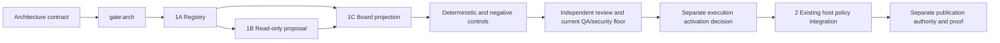

# ARCH: Four Domain Focus and Conditional Graph Proposals

For implementers and independent reviewers, this design introduces four visible focus directions and an advisory change graph while preserving the existing execution authority and review floor.

Date: 2026-10-23. Status: Proposed, pending gate:arch. Tracking: great_cto-ely5; architecture task great_cto-ely5.1. Source baseline: `709bdfd9`. Decision: [ADR-041](../adr/ADR-041-four-domain-conditional-graphs.md).

## Depth and Signals

**Medium.** The first slice contains three components, approximately 8–12 implementation/test files plus architecture, plan and gate artifacts. It adds no service or database. File count is an estimate, not a completed diff. Catalog filtering is reversible; routing omissions can remove preventive controls, so size does not waive approval.

| Signal | Evidence and consequence |
|---|---|
| Input | Explicit focus selection, project declaration and pinned change metadata. Repository text and candidate knowledge remain untrusted data. |
| Boundary | Shared proposal contract crosses native Claude and controlled Codex presentation adapters. It does not admit private context or publish source. |
| Data | Registry metadata and bounded proposals; public projection excludes source text, absolute paths, prompts, credentials and private overlay bindings. |
| Money | Financial/signing changes require existing specialist selection. The focus label cannot establish custody, payment authority or investment correctness. |
| Control | Conditional selection can omit a required reviewer. Unknown evidence must widen or refuse selective routing, never imply low risk. |
| Execution | Slice 1 observes and proposes. Later omission of preparation stages requires explicit architecture approval and negative controls. |

`gate:arch` is required before runtime/default changes because the control and execution signals affect safety routing. The primary checkout declares `approval-level: gates-only`; product approval does not approve this architecture. The isolated worktree has no local `.great_cto/PROJECT.md`, so helper output based on missing local configuration is not gate authority.

## Discovery: Five Questions

1. **Problem:** A catalog of 72 roles obscures which contracts apply to a concrete change. The operator wants four useful domain entry points and shorter task-dependent execution paths.
2. **Users:** The operator using native Claude or controlled Codex and the board; implementers and reviewers consuming the same declared contracts.
3. **Success:** Four directions map deterministically to existing packs; proposal output explains selected stages and why they apply; all existing mandatory reviews, gates and admission rules remain intact. No measured latency, cost or quality target has yet been established.
4. **Constraints:** Preserve all 72 roles, eight core identifiers, existing controller ownership, explicit-only candidate packs, host differences and separate publication approval. First slice has at most three components. No private project source reads, paid model trials, installation or release in this slice.
5. **Non-goals:** No three-model-call execution policy activation, clinical claim, compliance certification, expertise claim, production financial execution or new orchestrator.

There is no feature-specific product brief in this worktree. This document traces requirements to the approved operator request supplied in the task handoff; older unrelated briefs are not substituted for it.

## Current Topology and Authority

| Surface | Source | Existing responsibility |
|---|---|---|
| Stage contracts | `shared/pipeline.toml` | Product → architect → PM → implementation; declared artifacts, joins and gates. Native hook dispatcher consumes this map. |
| Risk evidence | `scripts/lib/runtime-gate-policy.mjs` | `assessChange` requires pinned base, examines visible changes and returns unknown/T2 when evidence is unavailable. Adaptive pause policy is separately opt-in. |
| Specialist selection | `scripts/lib/specialist-plan.mjs` | Advisory selection from project requirements and changed artifacts, dependency fingerprint and conservative unknown fallback. |
| Controlled scheduling | `scripts/lib/controlled-specialists.mjs` | Validates selected roles, preparation/review epochs, report scope and unchanged project policy. |
| Mandatory floor | `scripts/lib/review-graph-floor.mjs` | Implementation fan-out includes code-reviewer, qa-engineer and security-officer; symmetric review quorum; ship/security/compliance boundaries. |
| Domain candidates | `scripts/lib/domain-evidence.mjs` | Five v0.1.0 candidate packs with three descriptive invariants each, explicit-only activation and no reviewer-routing authority. |
| Private admission | `scripts/lib/domain-admission.mjs` | Explicit private policy, frozen digests, source validation and shared context cap. Focus selection cannot invoke this path. |
| Execution evidence | `scripts/lib/execution-trace.mjs`, `scripts/lib/codex-pipeline.mjs` | Controller records actual causal transitions in existing run state; proposal edges cannot become observed edges. |
| Board projection | `packages/board/lib/fleet.mjs`, `packages/board/public/index.html` | Installed catalog and project focus; existing core list and missing/unknown policy presentation. |

ADRs [032](../adr/ADR-032-domain-evidence-pilot.md), [033](../adr/ADR-033-explicit-domain-host-admission.md), [034](../adr/ADR-034-focused-domain-experience.md) and [040](../adr/ADR-040-recorded-execution-graph.md) remain constraints. This decision extends presentation and proposal vocabulary; it does not supersede their authority boundaries.

The eight core contracts remain `product-owner`, `architect`, `pm`, `senior-dev`, `code-reviewer`, `qa-engineer`, `security-officer`, `devops`. Availability is not an instruction to invoke all eight for every change. Existing declaration, project reviewer requirements and risk evidence determine applicability.

```text
Explicit focus ----> shared registry ----> board focus presentation
Pinned change ----> existing risk/specialist assessment ----> advisory proposal
Project policy -------------------------------------------> advisory proposal

Existing dispatcher/controller ----> real run ----> recorded trace ----> execution view
                    ^
         no new proposal-to-dispatch edge in slice 1
```

## Decision and Alternatives

Choose a shared metadata registry, a pure advisory proposal layer and a board projection. Reuse the existing risk/specialist assessment rather than inventing domain-specific risk authority. Keep actual execution in the existing native dispatcher and controlled controller.

**Attack on the choice:** a shared contract can create false parity if one host merely displays what the other enforces. A low-risk proposal can also be misread as authorization. Every proposal therefore carries `advisory: true`, `changesExecution: false`, evidence availability and explicit host enforcement limits. Native sessions without causal receipts retain partial/unavailable topology. Version and source mismatch prevents selective omission.

**Alternative A: remove non-focus agents and hardcode a three-node path.** Rejected because catalog compatibility would break and the current three-role delivery quorum would be bypassed. A three-node diagram is not evidence that checks and independent security review were preserved.

**Alternative B: add a domain orchestrator and duplicate each host's scheduling policy.** Rejected because two authorities would disagree on gates, stale evidence and retries. Existing controller and hook dispatch already own those transitions.

**Alternative C: presentation-only labels with no risk proposal.** Reversible but insufficient for the requested explanation of ordinary, architecture, sensitive and publication paths. The chosen slice adds explicit advisory reasons without scheduling authority.

## Components and File Ownership

These are proposed file allocations for PM to freeze before implementation. Owners are responsibilities; concrete agent task identifiers come from the root backlog. Shared files have one writer per phase.

| Phase / component | Exclusive implementation ownership | Dependencies | Result |
|---|---|---|---|
| 0 / architecture | Architect: this ARCH and `docs/adr/ADR-041-four-domain-conditional-graphs.md` | Source inspection | Reviewable contract; no runtime mutation |
| 1A / shared focus registry | Registry builder: `scripts/lib/focus-registry.mjs`, `tests/lib/focus-registry.test.mjs` | gate:arch | Four directions, core identifiers and explicit pack mapping |
| 1B / advisory proposal | Proposal builder: `scripts/lib/conditional-graph-proposal.mjs`, `tests/lib/conditional-graph-proposal.test.mjs` | 1A; existing assessment | Versioned proposal, evidence status, typed proposed edges and preserved floor |
| 1C / board projection | Board builder: `packages/board/lib/fleet.mjs`, `packages/board/server.mjs`, `packages/board/public/index.html`, board focus/proposal tests | 1A and 1B | Read-only focus and advisory route display |
| 2 / execution policy | Separately scoped builder: runtime policy, dispatcher/controller integration and their tests | Architecture approval for activation; frozen baseline and negative controls | Conditional preparation entry, with all required delivery roles and gates retained |
| 3 / publication | Existing publication owner and devops contracts | Independent review, QA/security, applicable artifact/access/runtime proof, explicit release authority | Publication according to existing mechanism |

No parallel task may edit the same server/page file. Phase 1B and registry API revisions serialize at their contract boundary. Deterministic tests are verification work, not a fourth runtime component.



This is the proposed implementation dependency DAG. It is not a historical execution graph and must never be inserted into ADR-040 trace state as observed causality.

## Focus Registry Contract

Registry schema version 1 defines stable focus IDs and English labels:

| Focus ID | Label | Candidate pack IDs |
|---|---|---|
| `fintech-crypto` | Fintech + crypto | `money`, `crypto-execution` |
| `telemedicine` | Telemedicine | `telemedicine-workflow` |
| `venture-pipeline` | Venture Pipeline | `venture-evidence` |
| `mental-care` | Mental Care | `mental-wellbeing-safety` |

Each entry contains `id`, `label`, `packIds`; the registry also exposes the eight `coreRoles`. It reads existing pack metadata through `listDomainPacks`, preserving pack version, digest, maturity, activation and exactly three invariant descriptions per pack. Pack references do not activate private policies, rewrite PROJECT.md, select jurisdiction or replace required reviewers. Fintech + crypto has six descriptions across two packs, not a new merged pack.

Unknown focus IDs return an unavailable projection reason; no guessed aliases, keyword inference or automatic project discovery. No new editable user configuration or persistence format is required in slice 1. The full catalog remains available; required reviewers remain visible even if outside focus, missing or retired. The observed 72-role catalog is a baseline inventory, not a future hardcoded count that would reject legitimate additive roles.

## Proposal and Versioning Contract

The internal proposal envelope includes `schemaVersion: 1`, `kind: conditional-graph-proposal`, `advisory: true`, `changesExecution: false`, `focusId`, `registryVersion`, `assessmentState`, `assessmentFingerprint`, `routeClasses`, `nodes`, `edges`, `requiredRoles`, `requiredGates`, `reasons`, and `limitations`. Arrays are sorted deterministically where order has no semantics. Role lists deduplicate by stable ID; node and edge identities must be unique.

`assessmentState` is `known` or `unavailable`. Known proposals bind the assessment fingerprint and pinned base supplied by the existing assessment. Unavailable proposals use a null fingerprint, retain mandatory roles and declared requirements, and explicitly prohibit selective omission. If the upstream specialist plan offers a conservative superset, preserve that superset. Empty diff, missing project policy, malformed evidence and unsupported versions are unavailable, never low risk.

Node kinds distinguish `contract`, `implementation`, `deterministic-check`, `independent-review`, `specialist`, `gate`, and `publication-proof`. Edges have `kind: proposed-dependency`, source/target IDs and a reason. They declare conditions only. They have no attempt/result IDs, running/succeeded status, approval receipts or fake timestamps. Projection validation rejects dangling edges, duplicates, unknown kinds and unbounded collections. Maximum 128 nodes, 256 edges and 64 KiB serialized envelope; overflow returns unavailable rather than truncating mandatory stages.

Breaking field/enum semantics require a new schema version. Consumers reject unknown versions to unavailable. Additive fields are accepted only through the owning validated projector; raw envelopes are never reflected into HTML. Registry changes invalidate proposal identity; existing runs retain their original policy and trace. No proposal is reusable PASS evidence.

The proposal uses four composable route classes, rather than a mutually exclusive classifier that lets architecture hide money risk:

| Class | Proposed behavior | Constraint |
|---|---|---|
| Ordinary | Implementation → deterministic checks → independent delivery review | Current reviewer, QA and security roles remain in the delivery boundary. It is not a three-LLM-call claim. |
| Architecture | ADR/architecture and plan before implementation | Active gates follow existing approval policy; product approval cannot satisfy gate:arch. |
| Sensitive | Add required financial/auth/PII/migration and other specialists from existing policy | Sensitive classification widens ordinary or architecture routes; unknown evidence never narrows them. |
| Publication | Artifact identity, access authorization and relevant runtime proof before existing publication action | Internal completion is separate from release, installation and live deployment. |

No path automatically treats filename-only classification as complete semantic assurance. Existing `assessChange` conservatively treats shared scripts, prompts, policy, lockfiles and infrastructure as sensitive; this feature itself is therefore policy-sensitive. The proposal may explain these reasons, not redefine them.

## Preserving the Review Floor While Shortening Plans

Shortening means avoiding unnecessary re-discovery and repeated ADR/PM drafting for a known ordinary change, and selecting additional specialists from current evidence. It does not merge reviewer identities or drop QA/security. Existing contracts may be represented as available but not selected preparation stages; current active gates still apply.

`assertReviewGraphFloor` remains authoritative for controlled execution: code-reviewer, qa-engineer and security-officer stay in implementation fan-out, join each other before devops and retain gate:ship. Security/compliance boundaries remain on security-officer. Required selected specialists extend the quorum. `assertPreparationGraphFloor` and review epoch checks remain unchanged.

The requested conceptual implementation → checks → independent review path is satisfied as an explanation of work, with delivery review explicitly expanded into its current mandatory roles. A literal three-LLM-node runtime conflicts with the present floor. Activation is deferred until a separate decision demonstrates an equivalent enforceable contract and explicitly approves any policy change; this ADR grants no waiver.

## Host Parity Limits

Both hosts consume the same registry and proposal schema. They do not acquire identical operating-system permissions, hooks, receipts or execution guarantees. Controlled Codex retains run leases, frozen policy, host profiles and independently verified results in its existing controller. Native Claude retains its actual hook dispatcher and available observations. Missing native causal instrumentation remains partial/unavailable as ADR-040 requires.

The UI must distinguish focus, proposed dependencies, observed execution and pending decisions. A focus click cannot queue a role, inject a domain packet, approve a gate or generate a publication ticket. Unknown enforcement capability is shown explicitly and blocks any future selective activation for that host.

## Security and Privacy

The new proposal layer introduces no shell execution, model invocation, external requests, private source reads or write endpoint. Existing project-scoped server authorization and read mechanisms remain responsible for access. A selected project and request-generation fence must prevent a slow response from replacing another project's focus/proposal.

Public output is allowlisted: focus labels and IDs, role IDs, bounded reason codes, proposed graph structure, evidence availability and limits. Internal source fingerprints are identity bindings, not secrets or correctness attestations; expose them only if the existing project visibility contract permits it. Do not return private overlay roots, source file bytes, absolute paths, tokens, raw prompts or reports. Render labels and reasons as text with existing escaping, never arbitrary HTML/Mermaid code.

Domain candidates remain data-only and explicit-only. Descriptive counterexamples are not executable checks or clinical validation. Mental Care cannot infer diagnosis/treatment readiness, Telemedicine cannot infer regulatory compliance, and finance packs cannot infer custody guarantees or investment performance.

## UI Direction

Reuse the current dense board layout, bundled Geist/Geist Mono typography, existing neutral surface tokens and green focus tokens (`#00d97e` dark, `#047857` light). Keep existing radii and spacing; no new palette or font dependency. Use a text status line and small existing controls, with keyboard Enter/Space and `aria-pressed`. Respect reduced motion; no automatic graph animation. A list/details fallback must expose the same proposed stages at mobile widths and without diagram rendering.

<frontend_aesthetics>
NEVER use generic AI-generated aesthetics: overused fonts (Inter, Roboto, Arial, system),
cliché schemes (purple gradients; the cream + serif + terracotta editorial default), predictable
layouts, cookie-cutter components. For regulated/operator UIs prefer dense, restrained, high-contrast,
WCAG-AA layouts with a cohesive context-specific palette and purposeful micro-interactions.
</frontend_aesthetics>

## Migration and Rollback

No database schema or stored-run migration. Registry and proposal are additive versioned read models. Existing run JSON, pipeline map, domain policy and approval receipts retain their formats. No importable business entities are introduced, so migration provenance columns do not apply.

Compute rollback: revert the registry/proposal consumers and board projection commit; existing controller and dispatcher continue on their current code paths. Data rollback: there is no new authoritative data to reverse; discard derived proposals, retain recorded run traces and private evidence unchanged. If a future cache is added, key it by schema/registry/project/change identity and delete only that cache during rollback. Do not rewrite historical runs to imitate new routing.

Required credentials and accounts: none added. External APIs, MCP services and CLIs: none added. No network-facing service is introduced, so there is no new service SLO. Existing board availability and response tests continue to apply.

## Acceptance and Negative Controls

PM must freeze executable acceptance commands in `docs/gates/four-domain-conditional-graphs.md` before builders start; builders must not edit that file. Targeted proposed commands are `node --test tests/lib/focus-registry.test.mjs tests/lib/conditional-graph-proposal.test.mjs packages/board/fleet-focus.test.mjs`, plus board proposal tests allocated by PM. Existing regression commands are `node --test tests/lib/review-graph-floor.test.mjs tests/lib/specialist-plan.test.mjs tests/lib/controlled-specialists.test.mjs` and `node --test packages/board/execution-graph.test.mjs`. Run the repository canonical final gate once after the final implementation diff; root verification owner resolves its current command and records the receipt. These commands are acceptance design, not a claim that they ran.

| Control | Required result |
|---|---|
| Four explicit focus IDs | Exact mapping above; every candidate remains explicit-only with unchanged pack digests and three descriptive invariants |
| Full catalog/core preservation | Eight stable core IDs and all baseline catalog entries survive focus changes; out-of-focus required roles remain visible |
| Unknown base/project/risk/version | Unavailable state, null evidence identity, no selective omission or inferred approval |
| Ordinary and architecture | Distinct preparation proposals; mandatory delivery review still present in both |
| Financial/auth/PII/migration fixture | Existing required specialists and security/compliance floors preserved; architecture class cannot mask sensitive class |
| Floor mutation | Removing QA, security or code-reviewer, altering quorum or skipping gates fails existing floor tests |
| Proposal/trace confusion | No new nodes/edges in stored execution trace after proposal read or focus click |
| Project race | Late project A response cannot overwrite project B selection |
| Malicious metadata | Injection-like labels/reasons render as inert text; paths/secrets are absent from public JSON and DOM |
| Host parity | Shared proposal semantics; unsupported native enforcement stays visibly unavailable/partial |
| Publication | A proposal/check/PASS without artifact/access/runtime proof cannot claim publication or create approval |
| Execution neutrality | Before/after snapshots of scheduling map, run queue, approval state and domain admission remain identical |

Before phase 2, freeze matched baseline and candidate inputs, model/host policy, acceptance and negative controls. Measure calls, total token/spend, active time, rework, serious regressions and cost per accepted task, including failed attempts. Missing outcomes stay null. Synthetic tests prove routing contracts only. No quality uplift, call reduction or safety equivalence is currently measured.

## Safeguards

- [ ] Data integrity: unavailable/stale risk evidence cannot narrow required roles or reuse a previous PASS.
- [ ] Security: focus and proposals cannot change permissions, inject context, approve gates or authorize publication.
- [ ] Contract: mandatory reviewer/QA/security quorum and existing hard gate floors remain intact.
- [ ] Provenance: proposed edges remain separate from controller-recorded causal edges and observed attempts.
- [ ] Privacy: public output contains no private source text, absolute roots, prompts, tokens or overlay bindings.

## Risks

| ID | Failure mechanism | Mitigation and deciding gate |
|---|---|---|
| R-1 | User reads proposal as executed/approved graph | Explicit proposed-dependency type and read-only labels; board acceptance and independent review |
| R-2 | Missing evidence silently yields ordinary route | Unavailable fallback retains/widens current floor; negative controls before gate:arch activation |
| R-3 | Native and controlled hosts display equal assurance with unequal enforcement | Host capability limits and separate evidence states; parity checks before runtime activation |
| R-4 | Four focus labels are presented as proven domain expertise | Preserve candidate maturity and descriptive-only invariant status; no outcome claims without matched observations |
| R-5 | Faster path removes mandatory QA/security to reach three calls | Floor remains unchanged; defer true reduction rather than bypass; separate policy approval |

## Cost Estimate

No new cloud components; no infrastructure cost delta. Slice 1 makes no paid model calls. Engineering effort is estimated at 1–2 working days for three components and focused verification, plus independent review and the canonical gate; this is not a measured lead time. Gate wait and later experiments are excluded.

Rough estimate: baseline tier, single region. Actual cost depends on traffic. Existing board runtime costs remain governed by the current deployment.

## Cost Model

Runtime addition: local deterministic metadata projection, no new vendor, database, network transfer service or model request. Per accepted task LLM cost, latency and total-call delta remain unknown until matched controlled observations. Existing model rates are not copied into this proposal and no spend cap is inferred from a UI focus. There is no new third-party runtime cost row requiring a vendor register entry.

## Gate and Handoff

**Gate question:** Approve registry + read-only proposal + board projection with the current mandatory review floor preserved, while keeping runtime/default policy reduction and any literal three-LLM-node path deferred?

The root pipeline owner creates and resolves gate:arch using existing approval mechanics. This document does not create an approval token or approve itself. PM then freezes file ownership, executable acceptance commands and implementation packets. Actual execution policy activation, merge/release/installation and publication retain their separate required authority.

## Requirements Checklist

- [ ] REQ-1: Show exactly four named directions with deterministic mapping to the five existing packs.
- [ ] REQ-2: Preserve all baseline 72 roles and eight core contract identifiers.
- [ ] REQ-3: Explain ordinary, architecture, sensitive and publication paths as composable advisory proposals.
- [ ] REQ-4: Preserve existing mandatory reviewer/QA/security roles, selected specialists, joins and hard gate floors.
- [ ] REQ-5: Missing/stale/malformed evidence or unknown schema prohibits selective omission.
- [ ] REQ-6: Reuse shared proposal semantics across hosts while reporting enforcement and causal evidence limits honestly.
- [ ] REQ-7: Keep proposed dependencies separate from observed trace nodes/edges and scheduling state.
- [ ] REQ-8: Protect private source, overlay bindings, credentials and cross-project response isolation.
- [ ] REQ-9: Keep domain maturity explicit-only/candidate and outcome/cost/clinical/compliance claims unmeasured.
- [ ] REQ-10: First implementation slice contains at most three components and changes no execution defaults.
- [ ] REQ-11: Architecture approval precedes runtime/default changes; publication requires separate proof and authority.
- [ ] REQ-12: Exercise happy, unavailable, stale, malicious, cross-project, floor-mutation and publication negative controls.
