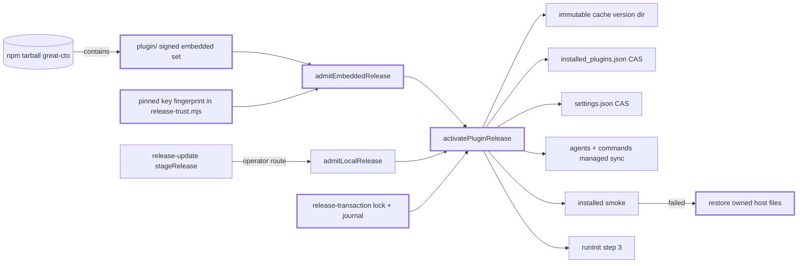

# ARCH: Verified managed activation of the Claude Code plugin

**Date:** 2026-11-10
Status: Proposed for gate:arch. No key enrollment, release, publication or activation follows from reading this.
Design: [ADR-050](../adr/ADR-050-managed-plugin-activation.md). Extends [ADR-045](../adr/ADR-045-verified-distribution.md) and its contract [ARCH-distribution-trust](ARCH-distribution-trust.md).

For the implementer and the reviewer of `npx great-cto init`: this selects **where the
plugin bytes come from and how they become active**, so that `init` works for a new user
without weakening ADR-045. The decision is that the signed plugin snapshot travels inside
the npm tarball the user already installed, is verified against a key fingerprint pinned in
source, and is activated by one journalled transaction that owns every host file it touches.

Every claim about current behaviour below carries `file:line` against this worktree
(plugin manifest version 3.76.1; `main` is already at 3.77.0, so line numbers are for the
worktree, not for `main`).

## Problem

`install()` in `packages/cli/src/installer.ts:72-77` throws unconditionally:

> Plugin installation refused: a signed complete runtime and verified managed activation are
> required. Mutable Git/main fallback and supplying dist from the running CLI are disabled.

`runInit` calls it at `packages/cli/src/main.ts:1105`, at step 3 of 5, before enabling the
plugin, before bootstrapping `PROJECT.md`, before the board. So **`npx great-cto init` fails
for every user**, and has since ADR-045 removed the git-clone route.

The refusal is correct. What it replaced was genuinely unsafe: a clone that could fall back
from a missing tag to mutable `main`, cloned straight into the installation path, and filled
the missing build by copying `dist/` out of the running CLI — three release sources in one
directory (`ARCH-distribution-trust.md:49`, and the surviving comment at
`installer.ts:79-103` explains why the clone alone could not work at all: five of thirty-two
`dist` files are in git by accident, so the board never started for anyone who installed the
documented way).

What is missing is the replacement. ADR-045 authorised the shape —

> Managed Claude registration may select only a verified immutable complete snapshot with
> compare-and-swap and managed-file recovery. (`ADR-045:68-69`)

— and nothing implements it. `proposeManagedPluginActivation`
(`release-activation.mjs:394-406`) is a stub that returns `UNSUPPORTED` three different ways
and never writes a file.

## Non-goals

This design does not:

1. **Make Codex activation work.** `runInitCodex` (`main.ts:911-914`) stays refused. The
   `npx` MCP entry (`.codex-plugin/mcp.json:4-9`) is named here only because it is inside the
   plugin snapshot and the existing refusal trips over it.
2. **Support pnpm, Volta or the native marketplace as an activation route.** They stay
   refused before mutation (`ARCH-distribution-trust.md:202`).
3. **Secure the first `npx` install cryptographically.** It cannot: see
   § First-install trust statement. ADR-045 already concedes this
   (`ARCH-distribution-trust.md:211`).
4. **Install companion plugins.** `installAllCompanions()` keeps refusing
   (`companion.ts:38-44`).
5. **Implement key rotation or revocation.** Still unsupported, acceptance still `NOT_RUN`
   (`ADR-045:120-131`).
6. **Change graph gates, telemetry defaults, or any other plugin's registration.**
7. **Relax any frozen acceptance row.** The matrix is extended, never loosened.

## Change map

## Decision

### Q1 — Source of plugin bytes

**Selected: (a′) the signed plugin snapshot travels inside the admitted npm tarball, verified
against a key fingerprint pinned in source.** No network call, no git, no second download.

What "signed complete runtime" means concretely, today, unchanged:

| Piece | Where it is defined | Contents |
|---|---|---|
| Plugin runtime allowlist | `scripts/build-release-artifacts.mjs:18-31` | 889 tracked files under `agents/ agents-full/ types/ hooks/ commands/ skills/ shared/ scripts/ assets/ mcp-servers/ packages/board/` plus eleven named files, minus eight named release scripts, minus test/fixture/private/dot paths |
| Complete CLI build | `build-release-artifacts.mjs:148-168` | 45 files of `packages/cli/dist/`, asserted byte-identical to the `dist/` inside the npm tarball (`:155-162`) |
| Archive | `build-release-artifacts.mjs:186` | `great-cto-plugin-<v>.tgz`, USTAR regular files only, modes 644/755 only (`release-archive.mjs:26`, `:116`) |
| Admitted inventory | `build-release-artifacts.mjs:185` → `plugin-inventory.json` | sorted unique `{path,size,sha256,mode}` for every member; does not hash itself or any signature |
| Index | `build-release-artifacts.mjs:191` | `release-index.json`: schema, version, `source{repository,commit,tree,tag}`, publisher, and the four artifacts with size + sha256 + sha512 |
| Signature | `sign-local-release-artifacts.mjs` | one `<filename>.signature.json` per blob and for the index: `{schema,profile,keyFingerprint,filename,indexDigest,signature}` (`release-trust.mjs:243-247`) |

The admitted inventory lives **inside the archive set**, never beside the installation: after
activation it is copied into the private transaction record, so
`great-cto distribution verify-installed` can recompute the cache directory against it.

**The digest cycle, and the schema that breaks it.** `validateReleaseIndex` requires exactly
four artifacts including the `npm` kind with the npm tarball's own size and digests
(`release-trust.mjs:88-96`). That index is written *after* `npm pack`
(`build-release-artifacts.mjs:139-147`, `:191`), so it cannot be packed into the tarball it
describes. The fix is a **second, narrower index**: `plugin/release-index.json`, schema 3,
exactly three artifacts (`plugin`, `inventory`, `sbom`), no `npm` kind, written and signed
*before* pack. Its sidecars bind to its own digest. The outer schema-2 index then covers the
npm tarball that contains the signed embedded set, so the embedded digests are bound
transitively, with no self-reference. Member allowlists need one line each:
`plugin\/.+` in `build-release-artifacts.mjs:154` and `"plugin/"` in
`packages/cli/package.json` `files`.

**Why the pin is a fingerprint and not a digest.** A content digest of the plugin archive
cannot be pinned in CLI source, because the plugin snapshot *contains*
`packages/cli/dist/release-trust.mjs` (`build-release-artifacts.mjs:163-168`,
`tsconfig.json` `allowJs: true` copies `.mjs` through) — pinning the archive's digest inside
the archive is a cycle. A **key fingerprint** is a constant, stable across releases, and the
codebase already carries exactly this pattern: `RELEASE_TRUST_ROOT_SHA256` and
`COSIGN_PLATFORM_SHA256` with the comment *"Rotation is a reviewed source change, not a value
accepted from release metadata"* (`release-trust.mjs:9-16`). One more constant,
`EMBEDDED_RELEASE_KEY_FINGERPRINT`, with the same rule. A concurrent untracked draft for the
desktop app reaches the same conclusion independently (`docs/rfc/ADR-DRAFT-app-updater.md`,
decision 3: *"The pinned key fingerprint is compiled into the app"*).

**Why not (b), a separate signed plugin archive downloaded and admitted by the existing
`release-update` core.** It cannot make `init` work for a new user, and the reason is in the
code. `runVerifiedSelfUpgrade` calls `readTrustedToolchain` (`release-update.mjs:189`), which
reads `~/.great_cto/distribution-trust/toolchain.json`; that file is created only by
`configureTrustedToolchain`, which demands `acknowledged === true` plus a canonical
owner-authenticated public-key path and its fingerprint, and refuses to overwrite
(`release-update.mjs:74-85`). A fresh `npx` user has no key, no fingerprint, and no way to
authenticate either before running the code that would ask. Route (b) therefore requires
every new user to enrol the owner's release key out of band — which is not an install, it is
a key ceremony. (b) stays as the **operator and upgrade route**, unchanged: it is already
built, and both routes converge on the same admission shape.

**Other options rejected:** fetching a tagged git archive (mutable-ref fallback is the exact
ADR-045 defect, `installer.ts:30-46`); `claude plugin install` from the git marketplace (the
measured bypass, see Q6); an unsigned in-tarball inventory only (integrity against local
tampering, no publisher authority — so the signature is in slice 1, not deferred).

#### First-install trust statement

Written plainly, because the alternative is implying a guarantee that does not exist:

> On a first `npx great-cto init`, the npm registry is the only origin. The plugin bytes, the
> code that verifies them, and the pinned fingerprint all arrive in the same tarball. Their
> authenticity rests on npm registry integrity, the publisher's account controls, and npm
> provenance where present — **not** on the great_cto release key, because nothing on the
> machine yet knows that key. What the embedded signature does buy from the first install
> onward: an attacker who can write `~/.claude/plugins` or `~/.great_cto` but cannot replace
> the npm package cannot substitute plugin bytes, and every later activation checks a
> fingerprint that a previously admitted CLI pinned.

This is ADR-045's own bootstrap boundary (`ARCH-distribution-trust.md:211`), applied to the
new-user case instead of the legacy-client case. It goes in `init` output, `README.md` and
`docs/reference/verified-updates.md`, in the same words.

### Q2 — Managed registration

**Reused from `release-activation.mjs` as-is** (extracted into `release-transaction.mjs`, no
behaviour change): `privateInstallationState` (exclusive `mkdir` lock with pid + token,
orphan-lock recovery guard, `:180-204`), `releaseLock` (`:206-213`), `writeRecord` (temp →
fsync → rename → fsync dir, `:52-57`), `backupSnapshot` (`:215-224`), `packageSnapshot`
(`:61-87`), `syncAncestors` (`:45-50`), the phase/journal/watermark discipline
(`:300-315`, `:328-329`, `:358`) and the `outcome` vocabulary (`:126-133`).

**Where it does not fit.** Everything target-shaped: `resolveNpmInstallation` (`:98-115`)
knows one layout, `/lib/node_modules/great-cto/index.mjs`; `binSelection` (`:89-95`) expects
a symlink; the mutation is one `npm install --global` (`:343-344`) and recovery is one
directory rename. A plugin activation has **five targets, not one**, and no package manager
performs the write. So `activatePluginRelease` is a sibling adapter, not a parameterisation.

Targets, each validated before anything is written:

| Target | Path | Write |
|---|---|---|
| Cache version dir | `~/.claude/plugins/cache/local/great_cto/<version>` | create, immutable |
| Host registry | `~/.claude/plugins/installed_plugins.json` | CAS one key |
| Host settings | `~/.claude/settings.json` | CAS one key in `enabledPlugins` |
| Local marketplace | `~/.claude/plugins/marketplaces/local/.claude-plugin/marketplace.json` | CAS the `great_cto` entry source |
| Managed dirs | `~/.claude/agents`, `~/.claude/commands` | `sync-managed` writes + prunes |

Sequence, with the durable boundary after each numbered step:

1. **Resolve and validate.** Every path absolute, canonical, no symlink in any ancestor,
   owned by the caller — the `canonicalDirectory` rule (`release-activation.mjs:19-30`).
   Registry readable as schema 2 (`local-install-registry.mjs:7-18`). Settings parseable.
   Refuse before mutation if any check fails.
2. **Lock.** `installationId = sha256(cache version dir)`. A second `init` gets
   `installation-busy-lock` and writes nothing (`release-activation.mjs:198`).
3. **Re-admit.** `getAdmittedArtifact` + `inspectPluginPayload` re-read and re-hash the
   archive and re-walk the inventory, manifest references and import closure
   (`release-trust.mjs:269-275`, `:340-360`). Nothing is trusted from step 1.
4. **Journal `SNAPSHOTTED`.** Back up registry, settings, marketplace file and the exact
   managed files that will change, with a digest for each, into
   `~/.great_cto/distribution-trust/transactions/<id>/previous/`. Record the pre-state digest
   of every one. Backups go **here**, not beside the target: the current
   `local-install-registry.mjs:52-55` writes a uniquely-named `.bak` next to the registry on
   every run and never removes it, and this machine has **45**
   `installed_plugins.json.great-cto-*.bak` files as a result.
5. **Publish the cache directory.** Extract admitted members into
   `<cacheRoot>/.stage-<uuid>` at mode 0700, apply inventory modes, recompute the staged
   inventory and compare it to the admitted one, then `rename` into `<version>`. If
   `<version>` already exists: equal inventory → idempotent; different → refuse
   (`local-install-cache.mjs:118-128` already states exactly this rule — reuse the rule, not
   that code, which reads a git checkout).
6. **Journal `ACTIVATING`.**
7. **CAS the registry.** Read → assert byte-equal to the backup → write temp `wx` 0600 →
   read the temp back and confirm the entry → re-read the original and confirm it still
   matches → rename. This is `registerLocalPlugin` (`local-install-registry.mjs:21-72`) with
   three changes: the receipt is the admitted inventory digest rather than a git commit; the
   plugin key is a parameter rather than the hard-coded `great_cto@local` (`:34`); backups go
   to the transaction dir.
8. **CAS the settings.** `enablePlugin` (`settings.ts:25-75`) writes `tmp` then `rename`
   (`:63-66`) **without re-reading the original** — a host write between read and rename is
   lost. Replace with the read → digest → write → re-read → compare → rename shape, and
   refuse rather than continue when the file is unparseable JSON (today it warns and carries
   on, `settings.ts:37-41`).
9. **CAS the local marketplace entry** so its `great_cto` source names the version just
   published. On this machine that entry still points at `cache/local/great_cto/3.70.1` —
   seven releases stale — which is how a directory marketplace silently serves old bytes.
10. **Managed sync, journalled.** Run `sync-managed.mjs` from the newly published directory
    with `--strict`, with a new `--journal <file>` that records every path written and every
    path pruned. Its existing rules are correct and stay (`sync-managed.mjs:39-72`): a missing
    or empty source deletes nothing; a file without the marker that differs from the
    plugin's is the user's and is never overwritten.
11. **Journal `ACTIVE`. Smoke, in fresh processes, against the published directory:**
    `node <dir>/packages/cli/index.mjs --version` equals the admitted version;
    `node -e "import('<dir>/scripts/lib/gate-plan.mjs')"` resolves — this is the exact
    failure the old installer shipped (`installer.ts:85-94`); `node <dir>/packages/board/server.mjs --check`.
    Any failure rolls back.
12. **Journal `SMOKE_PASSED`, write the watermark.** Only now does `init` continue.

**Crash at each durable boundary:**

| Crash after | Host state | Recovery |
|---|---|---|
| 1-2 | nothing written | release lock; nothing to undo |
| 4 | orphan transaction dir | delete the transaction; host untouched |
| 5 | a new immutable version dir nothing points at | inert; keep it (content-addressed, idempotent) unless no registry/settings/marketplace entry names it and no live process holds it — the `prune-versions.mjs --keep` rule |
| 7 | registered but not enabled | restore the registry **only if it still equals what we wrote**; else `RECOVERY_REQUIRED` |
| 8 | enabled, managed dirs stale | restore registry + settings, same conditional |
| 10 | active with partly-synced commands | restore from the sync journal; a user file we did not write is never restored over |
| 11 smoke fails | fully active on bad bytes | full rollback of all four host files; the cache dir stays (another session may hold it) |

Every restore is conditional on the target still matching this transaction's own write — the
rule ADR-045 states as *"restore only if still equal to the transaction's writes, never
overwrite concurrent operator changes"* (`ARCH-distribution-trust.md:190`).

**Idempotency.** Same version, same inventory digest, registry + settings + marketplace
already naming it → `ALREADY_ACTIVE`, zero writes, exit 0. `init` re-run is free.

**Concurrency, honestly.** The lock serialises *our* writers. A Claude Code session is not a
participant: it can read `~/.claude/commands` between steps 10 and 11. Mitigation is
ordering — the immutable, additive cache write lands first, and the host-file swap is the last
and shortest part — not exclusion. Window is sub-second and is stated, not hidden.

### Q3 — Companions

Measured, on this machine, 2026-11-10:

| | Version | License | Manifest |
|---|---|---|---|
| superpowers | 6.2.0 at `~/.claude/plugins/cache/superpowers-marketplace/superpowers/6.2.0` | `LICENSE` reads `MIT License`; manifest `license: MIT` | present |
| beads | 1.0.0 at `~/.claude/plugins/cache/local/beads/1.0.0` | `LICENSE` reads `MIT License` | **unverified** — no `.claude-plugin/plugin.json` at that root |

What actually breaks without each:

- **superpowers — nothing executes; prompts degrade.** 80 textual mentions across
  `agents/ commands/ skills/`, resolving to 8 distinct skill invocations dominated by
  `superpowers:receiving-code-review` (30 of them). These are *prompt-level* references: the
  agent names a skill, the host cannot resolve it, the agent proceeds without it. No script
  or hook imports superpowers code. The only code coupling runs the other way:
  `overlay.ts:188-258` **writes into** superpowers, copying four critic prompts and patching
  three upstream `SKILL.md` files in place.
- **beads — the dependency is the `bd` binary, not the plugin.** `bd` is invoked by 11 runtime
  modules including `scripts/hooks/pipeline-dispatcher.mjs`, `scripts/hooks/gate-expiry.mjs`,
  `scripts/lib/gate-check.mjs`, `gate-state.mjs`, `receipt.mjs`, `trace.mjs`, `outcomes.mjs`,
  `flow-metrics.mjs`, `impl-brief.mjs`, `finding-beads.mjs`, `agent-posture.mjs`, plus 15
  skills and 11 agents. Every one of those call sites is already written `|| true` or with a
  documented `.great_cto/tasks.md` fallback. The `beads@local` plugin is a wrapper around a
  binary on `PATH`; installing the plugin does not install `bd`.

**Selected: remove the hard dependency, document as optional, degrade with a named capability
report.** Three parts:

1. Delete `dependencies: ["superpowers@superpowers-marketplace", "beads@local"]` from
   `.claude-plugin/plugin.json:33-36`. **This is not optional for this design**: the project's
   own code refuses managed activation while a non-empty `dependencies` array is present
   (`release-activation.mjs:401`).
2. `installAllCompanions()` keeps refusing (`companion.ts:38-44`), and `init` prints an
   accurate optional-install block instead of the current one, which emits
   `github.com/obra/` with an empty tail for beads (`main.ts:1178`) and names
   `superpowers@local` (`companion.ts:16`) where the manifest named
   `superpowers@superpowers-marketplace` (`plugin.json:34`) — two keys, both enabled on this
   machine, neither matching the other.
3. A capability line in `/doctor` and in `init`'s closing output: which of `bd` / superpowers
   skills is present, and the named degradation for each absence.

**Rejected: bundling pinned snapshots in our signed archive.** MIT permits redistribution
with notice, so licence is not the blocker. Two other things are: it makes great_cto the
publisher-of-record for someone else's code, with a second supply chain to verify, patch and
CVE-track; and `overlay.ts` *patches* superpowers' skill files, so we would be shipping a
silently diverging fork of an actively developed upstream.

### Q4 — Every network and exec side effect in `runInit`, in order

| # | Step | Effect | Verdict |
|---|---|---|---|
| 1 | `detect(args.dir)` `main.ts:945` | filesystem read | **keep** |
| 2 | `suggestArchetypeFromLlm` `main.ts:1003` | HTTPS to Anthropic, only when `ANTHROPIC_API_KEY` is set and confidence is low | **keep** — no code executes, the result is one label, and the user confirms. Tighten one thing: under `--yes` it is taken silently (`main.ts:1029-1034`); record the provenance in `PROJECT.md` |
| 3 | `install()` `main.ts:1105` | throws (`installer.ts:72-77`) | **replace** with admitted activation (Q1, Q2) |
| 4 | `restartBoardAfterUpgrade` `main.ts:1115`, `:290-327` | SIGTERM/SIGKILL a board pid, spawn `server.mjs` detached | **keep, move after** activation, and resolve the server from the newly admitted directory instead of `findBoardServerPath` heuristics |
| 5 | `enableGreatCto()` `main.ts:1120` | writes `~/.claude/settings.json` | **replace** with the CAS in the transaction |
| 6 | legacy command cleanup `main.ts:1131-1161` | `unlink`s up to 18 named files in `~/.claude/commands`, outside any transaction, no backup | **drop.** It targets installs older than 1.0.104. If kept, it must be journalled like any other managed write |
| 7 | `applyOverlays()` `main.ts:1184`, `overlay.ts:188-258` | writes four files into, and patches three files of, **another plugin's** installed bytes | **drop from `init`.** Ship `great-cto overlay apply` / `revert` with a backup |
| 8a | `mkdirSync ~/.great_cto` `main.ts:1197` | directory | **keep** |
| 8b | `~/.great_cto/secrets.env` template `main.ts:1203-1215` | creates a commented template only when absent | **keep** — the `existsSync` guard is what stops it destroying a stored key |
| 8c | two `git clone --depth=1` of `anthropics/skills` and `avelikiy/ai-agent-skills` `main.ts:1217-1234` | unverified clones of mutable `main` during install | **drop from `init`** → opt-in `great-cto skills sync`. These are read by agents as instructions, so they are a prompt-injection surface, not just bytes. The SessionStart hook clones the same two plus `davila7/claude-code-templates` (`plugin.json:63`) — same finding, separate decision |
| 8d | `spawnSync("bash", [skill-discover.sh])` `main.ts:1267-1271` | executes a plugin script | **keep, fix the resolution**: it picks the highest semver in `cache/local/great_cto`, which need not be the version just activated. Run it from the exact admitted directory |
| 9 | `bootstrap()` `main.ts:1282` | writes `.great_cto/PROJECT.md`, `FLOW.md` | **keep** |
| 10 | `installPrePushHook` `main.ts:1292` | writes a git hook into the user's repo | **keep**, and say so in the output |
| 11 | telemetry `main.ts:1295-1302` | prompt (default off); ping only when already enabled | **keep** |
| 12 | `offerBoardAfterInit` `main.ts:1305`, `:597-649` | asks, then may install a launchd/systemd unit, start the board, open a browser | **keep** — it asks and has `uninstall-daemon`. One defect to file separately: the unit pins `cliEntryPath()`, so after an upgrade a login-start daemon can run old cached code — the clause at `ADR-045:77-78` |

### Q5 — External runtime boundary

| Declared runtime | Where | Bytes outside the inventory | No-fetch route |
|---|---|---|---|
| `great_cto_llm_router` MCP | `plugin.json:37-50`: `python3 ${CLAUDE_PLUGIN_ROOT}/mcp-servers/llm-router/server.py` | the **interpreter** — `python3` from host `PATH`. The script is in the inventory | It fetches nothing at startup, so ADR-045's `npx` concern does not apply; it is an *un-pinned interpreter*. Interim: declare `python3` an operator toolchain assumption, the same class as the trusted Node runtime (`ADR-045:46-47`), and note the server only runs when `OPENROUTER_API_KEY` is set. Target: rewrite in Node so the interpreter is the already-trusted `process.execPath` |
| `user-prompt-submit.py` hook | `plugin.json:393` | same host `python3` | same |
| Codex MCP | `.codex-plugin/mcp.json:4-9`: `npx -y great-cto@3.76.1 mcp` | **fetches a package at run time** | Replace with `node ${CLAUDE_PLUGIN_ROOT}/packages/cli/index.mjs mcp`. Codex activation stays refused either way |
| `bd prime` | `plugin.json:63` | a binary on `PATH` we do not own | Already `|| true`; covered by Q3's capability report |
| three `git clone`s | `plugin.json:63` | network at SessionStart | Q4 row 8c |
| `PLUGIN_DIR` fallback | `plugin.json:58`, `:63` and ~40 more hook strings: `ls -d ~/.claude/plugins/cache/*/great_cto/*/ \| sort -V \| tail -1` | **the highest version in *any* marketplace cache** | This is the sharpest finding. On this machine `cache/great-cto/great_cto/3.77.0` sits beside `cache/local/great_cto/3.77.0`, so a hook in a session registered to the admitted local copy can execute bytes the host pulled from mutable `main`. Fix: one resolver that prefers `CLAUDE_PLUGIN_ROOT`, then the admitted registration, and **refuses** rather than guessing. Generate the hook strings; do not hand-edit forty of them |
| `hooks/hooks.json` → `./gates-pane.tsx` | `hooks/hooks.json` | none — in the inventory | — |

One gap in the existing guard: `proposeManagedPluginActivation` greps only
`.codex-plugin/mcp.json` for `npx|npm|pnpm|bunx|uvx` (`release-activation.mjs:402-403`), so the
Claude `python3` MCP entry is not caught at all, while a Codex-only file refuses a Claude
activation. The replacement check is **per host**: for a Claude activation, read
`.claude-plugin/plugin.json`'s `mcpServers` and `hooks`, classify each command as
*admitted* (`node`/`bash` on an inventory path), *host toolchain* (`python3`, `git`, `bd`) or
*fetching* (`npx`, `uvx`, `curl`, `pip`), and refuse only on *fetching*.

### Q6 — Native marketplace auto-update

**It bypasses admission, and it did so today.** Measured on this machine, 2026-11-10:

- `~/.claude/plugins/known_marketplaces.json` → `great-cto` =
  `{source:{source:'git',url:'https://github.com/avelikiy/great_cto.git'}, installLocation:'~/.claude/plugins/marketplaces/great-cto', lastUpdated:'2026-11-10T15:18:15Z'}`.
- That install location is a **git clone on branch `main`**, at commit `c7e1b2f`
  ("Merge pull request #269 from avelikiy/release/3.77.0").
- `~/.claude/plugins/installed_plugins.json` (schema 2) holds **both**
  `great_cto@local` → `cache/local/great_cto/3.77.0` (`lastUpdated 15:17:03Z`) and
  `great_cto@great-cto` → `cache/great-cto/great_cto/3.77.0` (`lastUpdated 15:18:21Z`), both
  with `gitCommitSha c7e1b2f…`.
- `~/.claude/plugins/cache/` also holds 20 `temp_git_*` directories — the host's own clone
  staging.
- `~/.claude/settings.json` has **no** plugin auto-update key
  (`cleanupPeriodDays, env, attribution, includeCoAuthoredBy, hooks, enableWorkflows,
  statusLine, enabledPlugins, extraKnownMarketplaces, modelSettings, tui,
  skipWorkflowUsageWarning, theme, switchModelsOnFlag, inputNeededNotifEnabled,
  agentPushNotifEnabled`). There is no switch to turn off.

So the host refreshes a mutable-`main` git marketplace and publishes plugin bytes into its own
cache with no signature check. ADR-045 anticipated this (`ARCH-distribution-trust.md:192`);
this is the first time it is observed on a real host rather than inferred.

**What the design does, without touching other plugins:**

1. **Register under a source the host cannot refresh.** `~/.claude/plugins/marketplaces/local`
   already exists as a *directory* marketplace with a `great_cto` entry. Register
   `great_cto@local` and point that entry at the exact admitted version directory (step 9).
   A directory marketplace has nothing to pull.
2. **Detect and report divergence, do not resolve it.** If `installed_plugins.json` holds
   `great_cto@<anything but local>`, `init` prints both install paths, both `gitCommitSha`
   values, and states that the machine is not running admitted bytes in every session. It
   **does not** remove that registration: the file is shared with 30 other plugins and the
   choice is the user's. With an explicit confirmation it may set
   `enabledPlugins['great_cto@<other>'] = false` — one key, nothing else.
3. **Never write** `known_marketplaces.json`, never touch another plugin's entry, never set a
   global update preference (there is none to set).
4. **Narrow the `PLUGIN_DIR` fallback** (Q5), because without that, step 1 buys nothing: a
   session registered to the local copy can still execute the git-marketplace cache.

The honest limit: if the user keeps the git marketplace, the host will keep refreshing it, and
this design cannot stop it. It can make the admitted registration unrefreshable and the
divergence visible.

## Error paths

| Path | Failure | Handled? | Test? | User sees | Logged? |
|---|---|---|---|---|---|
| `admitEmbeddedRelease` | `plugin/` absent from the package | refuse before any write | `embedded-admission.test.mjs#missing-set` | "this package carries no plugin set — reinstall great-cto" | yes |
| `admitEmbeddedRelease` | sidecar signature invalid / fingerprint mismatch / profile substituted | refuse before any write | `embedded-admission.test.mjs#tampered` | refusal naming the blob | yes |
| `admitEmbeddedRelease` | archive member tampered after inventory | digest mismatch → refuse | `embedded-admission.test.mjs#member-digest` | refusal naming the path | yes |
| `inspectPluginPayload` | manifest version ≠ CLI version | refuse | `embedded-admission.test.mjs#version-skew` | "plugin and CLI versions disagree" | yes |
| path validation (step 1) | `~/.claude/settings.json` is invalid JSON | refuse before mutation | `plugin-activation.test.mjs#bad-settings` | names the file and the one key to add | yes |
| path validation (step 1) | registry schema ≠ 2 | refuse | `plugin-activation.test.mjs#registry-schema` | "run `claude plugin install` once first" | yes |
| lock (step 2) | a second `init` running | refuse, zero writes | `plugin-activation.test.mjs#concurrent` | "another install is in progress" | yes |
| cache publish (step 5) | same version, different bytes | refuse | `plugin-activation.test.mjs#same-version-drift` | "bump the version; the active cache is not overwritten" | yes |
| cache publish (step 5) | disk full mid-extract | stage discarded, nothing renamed | `plugin-activation.test.mjs#enospc` | refusal; host untouched | yes |
| registry CAS (step 7) | host rewrote the file between read and rename | refuse, restore nothing (nothing written) | `plugin-activation.test.mjs#registry-race` | "retry after the host update" | yes |
| settings CAS (step 8) | same race | restore the registry if still ours, else `RECOVERY_REQUIRED` | `plugin-activation.test.mjs#settings-race` | `RECOVERY_REQUIRED` + the recover command | yes |
| managed sync (step 10) | a managed file is unwritable | roll back from the sync journal | `plugin-activation.test.mjs#managed-rollback` | refusal naming the path | yes |
| managed sync (step 10) | **slice 1 only:** no journal exists yet | **no** — managed dirs are not rolled back | `plugin-activation.test.mjs#managed-not-reverted` asserts the refusal text says so | "commands/agents were refreshed and are NOT rolled back — re-run init" | yes |
| smoke (step 11) | `gate-plan.mjs` import fails | full rollback of the four host files | `plugin-activation.test.mjs#smoke-import` | rollback report | yes |
| smoke (step 11) | `--version` ≠ admitted version | full rollback | `plugin-activation.test.mjs#smoke-version` | rollback report | yes |
| crash, any boundary | process killed | journal replay via `great-cto distribution recover-plugin` | `plugin-recovery.test.mjs#each-phase` (6 cases) | `RECOVERY_REQUIRED` + the command | yes |
| rollback | a target no longer matches our write | `RECOVERY_REQUIRED`, nothing overwritten | `plugin-recovery.test.mjs#target-drift` | names both digests | yes |
| marketplace divergence | `great_cto@<other>` registered | report only, continue | `plugin-activation.test.mjs#divergence` | both paths + both commits | yes |
| skills registry | `skill-discover.sh` fails | ignored; agents fall back to no catalog | `init.test.mjs#discover-fails` | one dim line | yes |
| LLM fallback | network blocked / no key | skipped; heuristic kept | existing `llm-fallback` tests | "(LLM call failed, keeping heuristic)" | no |
| offline `init` | no network at all | completes; zero network on the activation path | `init-offline.e2e.mjs` | normal success | n/a |

## Security

**Trust boundaries.** Two, and they are different in kind. (1) The npm registry → the
machine: authenticated by TLS, registry signatures and npm provenance where present, **not**
by the great_cto key, and stated as such (§ First-install trust statement). (2) Admitted
bytes → global host state read by every project's agents in every session: authenticated by
the embedded Ed25519 signature against a source-pinned fingerprint, enforced before any
write, and transactional.

**The strongest attack on this design, named by me.** The pinned fingerprint lives in
`packages/cli/dist/release-trust.mjs`, and that file is **inside the plugin snapshot**
(`build-release-artifacts.mjs:163-168`). So the admitted plugin carries the pin that the next
admission would use. If one bad plugin activation ever succeeds, it can change the pin for any
later run that imports verification code *from the plugin cache*. Therefore an invariant,
enforced by test and not by discipline:

> **Verification code is resolved from the npm installation, never from the plugin cache.**
> `installer.ts`, `release-trust.mjs`, `release-activation.mjs` and the new
> `plugin-activation.mjs` are imported by relative specifier from the CLI's own `dist/`.
> No code path may resolve them through `CLAUDE_PLUGIN_ROOT`, a cache glob, or
> `findBoardServerPath`.

**Other controls.** No candidate input chooses policy: the fingerprint is a source constant
(`release-trust.mjs:9`), the paths are derived from `homedir()`, and no environment variable
may redirect the registry, the settings file or the trust pin. Archive expansion is bounded —
10,000 entries, 512 MiB expanded, regular files only, modes 644/755 only, no links, no
traversal, no duplicate or case-colliding members (`release-archive.mjs:92-126`,
`:17-33`). Private paths are refused as archive members (`release-archive.mjs:5`:
`.git .beads .great_cto .codex .claude node_modules .env* .npmrc CLAUDE.md AGENTS.md`).
Nothing from the candidate executes before `SMOKE_PASSED`, and the smoke runs in fresh
processes with no inherited plugin environment. No credential is read, written or logged by
any step. The journal records paths, digests, versions and classified failure reasons — never
file contents, never a token.

**The inverse risk of this control.** Fail-closed admission is also a denial vector against
the user's own install: an unparseable `~/.claude/settings.json` that today produces a warning
and a working install (`settings.ts:37-41`) will now refuse. That is the right trade — a
half-registered plugin is worse — but the refusal must name the file and the single key to
add, or it converts a working install into a support ticket.

## Acceptance

New frozen file `tests/acceptance/distribution-trust-v4.json`: `revision: 4`,
`supersedes: distribution-trust-v3.json`, `authority: NONE`,
`syntheticEvidenceCanAuthorizeRelease: false`. Every v3 row is retained verbatim, including
`claude_registration`, `native_capability`, the 1000/2000/10000 ms scorer clocks and the
PID/SIGKILL/cleanup checks. Nothing is relaxed. New rows:

| id | Required behaviour |
|---|---|
| `embedded_plugin_set` | Schema-3 embedded index with exactly three artifacts; sidecars bind namespace, filename and the embedded index digest; fingerprint pinned in source and never read from the set; tampered member, inventory, sidecar, index or substituted profile refuse before any write |
| `verifier_resolution` | Verification modules resolve from the npm installation only; a planted copy under a plugin cache or `CLAUDE_PLUGIN_ROOT` is never imported |
| `bootstrap_trust_statement` | First install prints what is and is not authenticated; no output claims OIDC provenance, transparency-log inclusion or release-key authority for a bootstrap install |
| `plugin_cache_publication` | Immutable version directory; same-version-different-bytes refuses; inventory modes reproduced exactly; staged directory discarded on any failure |
| `registry_cas` | Concurrent host write between read and rename refuses; other plugins' entries byte-unchanged; backups bounded to the transaction, one previous kept |
| `settings_cas` | Same for `enabledPlugins`; unparseable settings refuse before mutation; no other key altered |
| `managed_file_journal` | Every write and prune recorded; rollback restores exactly those; an unmarked user file differing from the plugin's is never touched or restored over |
| `plugin_transaction_recovery` | Crash at each of the six durable boundaries recovers or reports `RECOVERY_REQUIRED`; target drift never overwrites a concurrent change |
| `concurrent_init` | Second concurrent `init` refuses with zero writes to cache, registry, settings, marketplace or managed dirs |
| `offline_init` | Zero network calls on the activation path; a blocked network does not fail `init`; no git clone is attempted |
| `no_pre_admission_exec` | Instrumented candidate marker never appears before `SMOKE_PASSED`; a failed admission yields zero spawns of plugin bytes |
| `marketplace_divergence` | A `great_cto@<non-local>` registration is detected and reported; it is not modified without explicit confirmation; `known_marketplaces.json` is never written |
| `external_runtime_scope` | Per-host classification: a Codex-only `npx` entry does not refuse a Claude activation; a *fetching* command in the activated host's manifest does refuse; `python3` is classified and reported as host toolchain |
| `companion_absence_degrade` | `init` completes and a pipeline runs with neither companion present; each degradation is named |
| `plugin_byte_equality` | The release chain proves the embedded `plugin/great-cto-plugin-<v>.tgz` is byte-identical to the standalone signed asset, and that the installed cache directory recomputes to the admitted inventory |

**Isolated-HOME E2E** (`tests/e2e/plugin-activation/`). The harness points `HOME` at a temp
directory and builds a real signed fixture set with an ephemeral key whose authority is
`NONE` — the constraint `fixtureMode` already enforces, requiring the fixture root to live
under `os.tmpdir()` (`release-activation.mjs:117-124`). Scenarios: fresh machine; upgrade from
an older admitted version; crash at each of the six boundaries, driven by the existing
`onPhase` hook (`release-activation.mjs:328`); two concurrent `init` processes; a tampered
snapshot (one flipped byte in the archive, then in the inventory, then in the sidecar); and
offline, with a `fetchFn` that throws.

**How the release chain proves the installed bytes equal the signed ones.** Four checks, each
an equality rather than an inference: the builder asserts the embedded archive is
byte-identical to the standalone asset; `compareReleaseArtifactSets`
(`build-release-artifacts.mjs:200-211`) is extended over the embedded set so two clean builds
must agree on it; the transaction records the published inventory digest and the smoke step
recomputes the cache directory against `plugin-inventory.json`; and
`great-cto distribution verify-installed` recomputes it again on demand, so later drift is
detectable rather than assumed absent.

## Decomposition matrix

| Stream | Write-zone | Depends on | Why parallel-safe | Days |
|---|---|---|---|---|
| S1 Embedded admission | `packages/cli/src/release-trust.mjs`, `packages/cli/tests/embedded-admission.test.mjs` | — | sole writer of `release-trust.mjs` | 3 |
| S2 Transaction primitives | new `packages/cli/src/release-transaction.mjs`, `packages/cli/src/release-activation.mjs` | — | sole writer of `release-activation.mjs`; disjoint from S1 | 2 |
| S3 Plugin activation adapter | new `packages/cli/src/plugin-activation.mjs` | S1, S2 | new file; the one edit to `release-activation.mjs` (delete the stub, re-export) is sequenced after S2 | 5 |
| S4 Host-file CAS + sync journal | `packages/cli/src/settings.ts`, `scripts/lib/local-install-registry.mjs`, `scripts/lib/sync-managed.mjs`, `scripts/lib/local-install-cache.mjs` | — | disjoint from S1-S3; S3 consumes the interfaces | 4 |
| S5 `runInit` rewiring | `packages/cli/src/main.ts`, `installer.ts`, `companion.ts`, `overlay.ts` | S3, S4 | sole writer of all four | 3 |
| S6 Release chain + packaging | `scripts/build-release-artifacts.mjs`, `scripts/sign-local-release-artifacts.mjs`, `scripts/publish-local-release.mjs`, `packages/cli/package.json`, `docs/reference/verified-updates.md` | S1 (index schema) | disjoint from S2-S5 | 4 |
| S7 Acceptance + isolated-HOME E2E | new `tests/acceptance/distribution-trust-v4.json`, new `tests/e2e/plugin-activation/**`, `tests/lib/*.test.mjs` additions | S3, S6 | new files only | 5 |
| S8 External runtime + divergence | `.claude-plugin/plugin.json`, new `scripts/lib/plugin-dir.sh`, `.codex-plugin/mcp.json`, `mcp-servers/llm-router/**` | — for the manifest edits; S3 for the report | sole writer of the manifests; the ~40 hook strings are generated, not hand-edited | 4 |

**Total 30 engineer-days**, about six calendar weeks solo. No two streams share a file.

**Smallest safe slice that makes `init` work — Slice 1, 9 days:**

- S1 in full (3 d) — without the signature there is integrity but no publisher authority.
- The subset of S3 + S4 that publishes the cache directory and performs the registry and
  settings CAS, with the lock, journal and the six crash boundaries (4 d).
- The S5 rewiring of steps 3-4 plus the removal of the two git clones, `applyOverlays` and
  the legacy cleanup (2 d).
- **Mandatory regardless:** delete `dependencies` from `.claude-plugin/plugin.json:33-36`.
  The project's own code refuses activation while they are declared
  (`release-activation.mjs:401`), so this is a precondition, not a preference.

Deliberately deferred inside slice 1, each with the refusal text that says so: managed-sync
journalling (so `~/.claude/agents` and `~/.claude/commands` are **not** rolled back, and the
output states it); the `python3` and `npx` rewrites (documented as toolchain assumptions); the
marketplace divergence report (reduced to a printed warning); S7's full E2E matrix (slice 1
ships the six crash-boundary tests, tampered, offline and concurrent — the irreducible set).

## Cost

No new cloud component, service, database or storage. No new paid dependency. The costs are
size, effort and one changed release step.

| Item | Measured / estimated |
|---|---|
| Plugin runtime today | 889 tracked files + 45 `dist` files = 10.8 MiB uncompressed, ≈3.6 MiB gzipped |
| npm package today | `great-cto@3.77.0`: 296 files, 4,353,595 B unpacked |
| npm package with the embedded set | ≈15 MB unpacked, download ≈+3.6 MiB. The inner `.tgz` is already compressed, so the outer gzip does not shrink it |
| Optional reduction | Drop `board/` from `packages/cli/package.json` `files` (3.9 MiB unpacked) and derive the board from the embedded snapshot: ≈−1.3 MiB download. Cost: `npx great-cto board` would require `init` first, which `packages/cli/scripts/bundle-board.mjs:1-8` exists specifically to avoid |
| Release chain | One extra signing invocation per release (embedded set before `npm pack`, outer set after), and one extra byte-comparison. Both local, both seconds |
| Effort | 30 engineer-days total; 9 days to a working `init` |

Observability: every activation records state, version, inventory digest, source commit,
installation id, transaction id and a classified failure reason into
`~/.great_cto/distribution-trust/`. An absent or stale record is `unknown`, never "no risk"
and never "activated".

## Risks

- **R1 — the bootstrap is still npm's.** A compromised registry replaces the CLI, the pinned
  fingerprint and the signed set together. No local design fixes this; 2FA, Trusted Publisher
  and provenance are the mitigations and they live outside this slice. Mitigation: say it
  (§ First-install trust statement) instead of implying the signature covers first install.
- **R2 — the pin travels inside the artifact it protects.** Addressed by the
  verifier-resolution invariant in § Security and the `verifier_resolution` acceptance row.
  This is the risk most likely to be re-introduced by a later convenience refactor.
- **R3 — the host is not a participant in the lock.** A session can read a half-swapped
  `~/.claude/commands`. Mitigated by ordering, not eliminated. Stated.
- **R4 — rollback is not byte-reversible for managed directories.** `sync-managed` prunes
  marker-bearing files whose source is gone (`sync-managed.mjs:50-56`), so rolling back to a
  version with fewer agents removes the newer ones. Correct behaviour, irreversible without
  the journal. Slice 1 does not journal; the refusal text must say so.
- **R5 — the git marketplace keeps refreshing.** Measured in Q6. We can make the admitted
  registration unrefreshable and the divergence visible; we cannot stop the host.
- **R6 — fail-closed is a denial vector** against the user's own install (see § Security).
- **R7 — two signing passes per release** is a change to a reviewed chain
  (`ARCH-distribution-trust.md:148-157` step 4). It is an amendment needing explicit owner
  approval, with the digest-pin variant as the fallback if declined.
- **R8 — `init` gets slower and larger.** +3.6 MiB download and a real transaction where
  there used to be a throw. Acceptable; the alternative is a command that does not work.

## Safeguards

- [ ] No plugin byte reaches `~/.claude` before the embedded signature verifies against the
      source-pinned fingerprint and the inventory matches the archive.
- [ ] Verification code is resolved from the npm installation, never from the plugin cache,
      never through `CLAUDE_PLUGIN_ROOT` or a cache glob.
- [ ] Every host file the transaction writes is backed up with its digest first, and restored
      only while it still equals this transaction's own write.
- [ ] One version directory can never acquire different contents; same version + different
      bytes refuses.
- [ ] No other plugin's registration, cache, settings key or marketplace entry is read for
      decisions or written at all.
- [ ] `init` performs no network fetch on the activation path, and no git clone anywhere.
- [ ] No frozen acceptance row is relaxed; v1, v2 and v3 are retained and v4 only adds.
- [ ] No credential, token or file content enters a journal, a log or any output.

## Requirements checklist

- [ ] REQ-1: `npx great-cto init` completes on a machine with no prior great-cto, with no
      network on the activation path and no key enrolment.
- [ ] REQ-2: The plugin snapshot is admitted by Ed25519 signature against a source-pinned
      fingerprint, with inventory, manifest-reference and import-closure checks, before any
      write.
- [ ] REQ-3: Cache publication is immutable; registry, settings and marketplace writes are
      compare-and-swap; every managed write is backed up and conditionally restorable.
- [ ] REQ-4: A crash at any of the six durable boundaries recovers the previous host state or
      reports `RECOVERY_REQUIRED`; a concurrent `init` refuses with zero writes.
- [ ] REQ-5: `init` performs no unverified fetch, no clone, and no write into another plugin's
      installed bytes.
- [ ] REQ-6: Companion plugins are optional; the hard `dependencies` declaration is removed
      and each absence has a named degradation.
- [ ] REQ-7: Declared external runtime is classified per host; a *fetching* entrypoint refuses
      activation for that host, and `PLUGIN_DIR` resolution cannot select a non-admitted cache.
- [ ] REQ-8: A `great_cto` registration from a refreshable marketplace is detected and
      reported, and never modified without explicit confirmation.
- [ ] REQ-9: The release chain proves by equality that the embedded archive, the standalone
      signed asset and the installed cache directory are the same bytes.
- [ ] REQ-10: The first-install trust statement appears in `init` output, `README.md` and
      `docs/reference/verified-updates.md`, and claims no provenance the route does not have.

## Open questions

Q: Approve a second signing invocation per release (embedded set before `npm pack`, outer set
after)?
   a) Two passes — one stable source-pinned fingerprint, no per-release generated constant,
      no build-order coupling; costs a second key use per release.
   b) One pass, pin the plugin archive's sha256 in a file excluded from the plugin snapshot
      (the precedent exists at `build-release-artifacts.mjs:20`) — one key use; costs a
      regenerated constant every release and a build-order dependency.
   → I would take (a): a constant that changes every release is a constant someone will
     forget, and the exclusion list is one more thing that can silently drift.

Q: Accept the npm download growing by ≈3.6 MiB?
   a) Accept — `npx great-cto board` keeps working without `init`.
   b) Drop `board/` from the npm `files` and derive it from the embedded snapshot: ≈−1.3 MiB,
      but the board then needs `init` first, undoing the fix `bundle-board.mjs` exists for.
   → I would take (a). 3.6 MiB once is cheaper than a regression in the thing a new user
     opens first.

Q: What happens to the existing `great_cto@great-cto` registration on this machine?
   a) Report only — the user decides.
   b) Offer, on explicit confirmation, to set `enabledPlugins['great_cto@great-cto'] = false`.
   → I would take (a) as the default and ship (b) behind a confirmation, because the file is
     shared with 30 other plugins and a surprise disable is worse than a warning.

## Sources checked 2026-11-10

Repository, this worktree: `packages/cli/src/{installer,companion,settings,overlay,main}.ts`,
`packages/cli/src/release-{trust,activation,update,archive}.mjs`,
`packages/cli/package.json`, `packages/cli/scripts/bundle-board.mjs`,
`packages/cli/tsconfig.json`, `scripts/build-release-artifacts.mjs`,
`scripts/{install-local,cd-local,release}.sh`,
`scripts/lib/{local-install-cache,local-install-registry,sync-managed}.mjs`,
`.claude-plugin/{plugin,marketplace}.json`, `.codex-plugin/mcp.json`, `hooks/hooks.json`,
`tests/acceptance/distribution-trust-v3.json`, `docs/adr/ADR-045-verified-distribution.md`,
`docs/architecture/ARCH-distribution-trust.md`, `docs/reference/verified-updates.md`,
`docs/rfc/ADR-DRAFT-app-updater.md` (untracked draft, not accepted).

Host state, read-only, this machine: `~/.claude/settings.json`,
`~/.claude/plugins/{installed_plugins.json,known_marketplaces.json}`,
`~/.claude/plugins/marketplaces/{local,great-cto}`, `~/.claude/plugins/cache/`,
companion `LICENSE` files. Registry: `npm view great-cto dist.unpackedSize dist.fileCount`.
