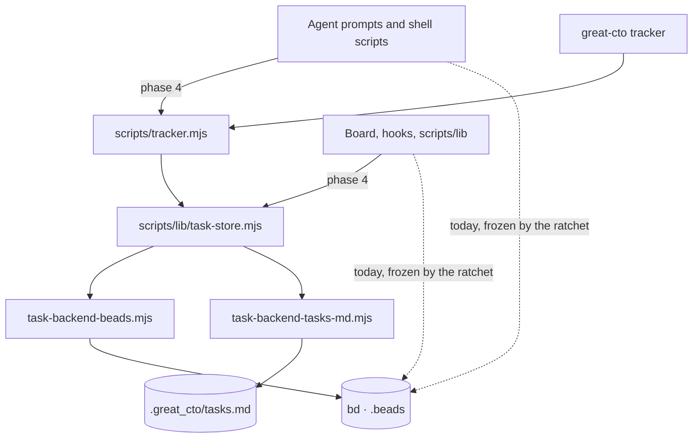

# ARCH: Task API — one door to the task store

- Status: **approved by the owner at gate:arch on 2026-11-11** (`great_cto-6jyt.1`), with the recommended answers: the CLI is `great-cto tracker`; phase 1 moves no caller; read speed is decided in phase 6. **Built on 2026-11-11 (section 6); not committed, full local gate not yet run.**
- **Date:** 2026-11-11
- Issue: `great_cto-6jyt`
- Source: [RFC-task-tracker-and-kanban.md](../rfc/RFC-task-tracker-and-kanban.md), phase 1
  (option B accepted by the owner on 2026-11-11)
- Related: [ADR-028 task cockpit](../adr/ADR-028-task-cockpit.md),
  [ADR-009 gates follow reversibility](../adr/ADR-009-gates-follow-reversibility.md),
  [ADR-048 board local API guards](../adr/ADR-048-board-local-api-guards.md)

## Summary

- One module, `scripts/lib/task-store.mjs`, owns every read and write of tracker tasks.
  Beads is its first backend, `.great_cto/tasks.md` the second. A small CLI on top of it
  serves agents, shell scripts and people.
- Phase 1 **adds** the module, the CLI and their tests. It moves **no existing caller**:
  the board, the hooks and the agent prompts keep calling `bd` until phase 4. Nothing in a
  running pipeline changes behaviour in phase 1.
- Reads have three outcomes — `found`, `absent`, `unread` — and `unread` is never returned
  as an empty list.
- Every write names an actor. In phase 1 the actor is **recorded, not enforced**.
- Three findings since the RFC change its details; they are listed first.

## Change map



Solid arrows are what this change adds. Dotted arrows are the direct `bd` calls that stay
until phase 4; `tests/lib/raw-bd-ratchet.test.mjs` keeps them from growing.

## Error paths

| Path | Failure | Handled? | Test? | User sees | Logged? |
|---|---|---|---|---|---|
| read | `bd` exits non-zero | yes — `TaskReadFailed{store_refused}` | `task-store-contract`: "unread: bd exits non-zero" | `NOT READ — …`, exit 4 | stderr of the caller |
| read | `bd` prints non-JSON, or a JSON error object | yes — `bad_output` / `store_refused` | `task-store-contract`: two "unread" cases | `NOT READ — …`, exit 4 | stderr |
| read | `bd` is not installed | yes — `not_installed` | `task-store-contract`: "bd is not installed" | `NOT READ` with the install hint, exit 4 | stderr |
| read | no store in the project | yes — `not_initialized` | `task-store-contract`, `tracker-cli`: "no task source" | `NOT READ — no task source`, exit 4 | stderr |
| read | `bd` hangs | yes — killed with SIGKILL at the cap, `timeout` | `task-store-contract`: "a hung read is a timeout" | `NOT READ — did not answer in 20 s`, exit 4 | stderr |
| read one | the task is not there | yes — `{ state: 'absent' }` | `task-store-contract`, `tracker-cli`: "3: absent" | `no such task`, exit 3 | stderr |
| write | `bd` hangs, and the look afterwards cannot tell | yes — `TaskWriteUnknown`, no second write | `task-store-contract`: "a hung write is unknown" | `NOT CONFIRMED — …`, exit 4 | stderr |
| write | `bd` hangs, but the write landed | yes — one look, `recovered: true` | `task-store-contract`: "timed out but landed" | the id, with a note that the create timed out | stdout |
| write | the store refuses, or the id is missing | yes — `TaskWriteFailed` | `task-store-contract`: "writes to a missing task"; `tracker-cli`: "5: refused" | the store's first line, exit 5 or 3 | stderr |
| write | no actor, bad status, empty title | yes — `TaskUsageError` before `bd` runs | `tracker-cli`: "2: usage — nothing reaches the store" | the usage message, exit 2 | stderr |
| `tasks.md` | file unreadable or unparseable | yes — `TaskReadFailed{store_refused}` from the parser's recorded reason | no — only the healthy file and the missing file are tested | `NOT READ — tasks.md could not be …`, exit 4 | stderr |
| `tasks.md` | create, link, note | yes — `TaskWriteFailed{unsupported}` | `task-store-contract`: "unsupported writes say so" | names the backend, exit 5 | stderr |
| `tasks.md` | the board's parser module cannot be loaded | yes — `TaskReadFailed{backend_unavailable}` | no | `NOT READ — the tasks.md reader could not be loaded`, exit 4 | stderr |

Nothing is written to a log file of its own: the module reports to its caller, and the CLI
prints to stderr. Two rows are handled but have no test yet; both fail closed.

## 1. Findings since the RFC

### 1.1 Fresh measurements (2026-11-11, this repository's store, `bd` 1.3.1)

The RFC could not run `bd` (sandbox). These were taken outside the sandbox, once each, on a
machine other sessions were also using — treat them as one sample, not a benchmark.

| Call | Time |
|---|---|
| `bd list --all --json --brief` (1132 issues) | 8.1 s |
| `bd show <id> --json` (one issue) | 6.7 s |
| three `bd list --json --brief` started together | 31.9 s in total |

Store contents: 1132 issues — 889 closed, 148 open, 78 in progress, 9 deferred, 8 blocked;
593 are top-level, 118 of those not closed; no open gate.

What this means:

- **The cost is per process, not per query.** Reading one issue costs almost as much as
  listing all of them. An agent that runs five `bd` commands waits about half a minute.
- **`bd` already queues callers across processes.** Three reads took the sum of three, and
  `bd` prints "workspace gate acquisition" when it cannot take its lock file. So the RFC's
  claim that agents "race for the Dolt lock" is out of date for this version: they wait in
  line. A second lock of our own would add nothing. The pain is the length of the line.
- **The RFC's phase-6 threshold is probably already crossed.** It says: move to a built-in
  store if the median write through the API is above 1 s. A read is 6.7 s today. The
  threshold stays as written (it must be measured through the API, with three sessions), but
  the owner should expect phase 6 to say "move".
- **A fifth status exists.** Nine issues are `deferred`. The board maps anything unknown to
  `backlog` (`mapStatus` in `packages/board/lib/beads.mjs`), so they show as backlog today.

### 1.2 The name `great-cto task` is taken twice

`packages/cli/src/main.ts` already routes `great-cto task add | ls | status | cancel` to the
worker queue (`worker.ts`, `task-queue.ts`) and `great-cto task work …` to Work tasks
(`work-task.ts`). The RFC proposed `great-cto task create / list / …`; that would be a third
meaning under one word. This document uses **`great-cto tracker …`** (owner's question 1).

### 1.3 Existing scripts already turn a failed read into "nothing there"

- `scripts/bd-create-if-new.sh`: `bd search … 2>/dev/null | grep …` — if the search fails,
  the script concludes there is no duplicate and creates one.
- `scripts/phase-task.sh`: lookups and updates end in `2>/dev/null … || true`.

These are phase-4 work (moving callers), but they set the error contract below.

## 2. Scope

| In phase 1 | Not in phase 1 |
|---|---|
| `scripts/lib/task-store.mjs` and two backends | moving the board, hooks, scripts or prompts to it (phase 4) |
| `scripts/tracker.mjs` (entry for agents and shell) and `great-cto tracker` (same code) | task keys, allocator, backfill (phase 2) |
| contract tests against real `bd`, against `tasks.md`, and against a failing `bd` | hooks and the merge guard (phase 3) |
| a ratchet test that counts raw `bd` calls outside the backend | any screen (phase 5) |
| `docs/reference/task-api.md` | a built-in store (phase 6), a shared read snapshot (section 7) |

## 3. Design

### 3.1 Layers

```
agents · shell scripts · people        board · hooks · scripts/lib (phase 4)
            │                                        │
   scripts/tracker.mjs  ── great-cto tracker         │
            └──────────────┬─────────────────────────┘
                 scripts/lib/task-store.mjs      rules: vocabulary, actor, results
                           │
          ┌────────────────┴───────────────┐
 task-backend-beads.mjs         task-backend-tasks-md.mjs
   (the only file that              (parser moved here in phase 4;
    spawns `bd`)                     phase 1 wraps the existing one)
```

The module lives in `scripts/lib/` because the board already imports from there
(`packages/board/lib/work.mjs` imports `scripts/lib/work-tasks.mjs`) and the plugin ships it,
so agents can reach it without the npm CLI on `PATH`.

### 3.2 Operations

| Operation | Returns |
|---|---|
| `list({ status, label, parent, text, includeClosed })` | `{ state: 'read', tasks }` or throws `TaskReadFailed` |
| `get(id)` | `{ state: 'found', task }` · `{ state: 'absent' }` · throws `TaskReadFailed` |
| `create({ title, type, priority, labels, parent, description, actor })` | `{ id }` |
| `move(id, status, { actor, reason })` | `{ id, from, to }` |
| `close(id, { actor, reason })` | `{ id }` |
| `link(id, dependsOn, { actor })` | `{ ok }` |
| `note(id, text, { actor })` | `{ ok }` |
| `findOpen({ label, text })` | as `list`; replaces the search in `bd-create-if-new.sh` |

Task shape is what `getTasks` returns today (`id`, `title`, `status`, `raw_status`,
`priority`, `labels`, `is_gate`, timestamps …) so phase 4 can swap the board's reader
without touching the page. Gate approval is **not** an operation here: it stays on the
board's token path (`packages/board/lib/gate-tokens.mjs`, `POST /api/gates/:id`).

### 3.3 Status vocabulary

`open · in_progress · blocked · deferred · closed`. `deferred` is first-class because it
exists in the store. Anything else from a backend is an error, not "backlog".

### 3.4 Reads: three outcomes

- `absent` only when the backend answered and the task is not there.
- `TaskReadFailed` (with `cause`: `timeout`, `not_installed`, `not_initialized`,
  `store_refused`, `bad_output`) for everything else. No function returns `[]`, `null` or
  `{}` for a failed read.
- CLI exit codes: `0` ok · `2` usage · `3` absent · `4` unread. A shell caller can no longer
  confuse the last two; `tracker find-open` exits `4`, and `bd-create-if-new.sh` will then
  refuse to create rather than create a duplicate.
- A scan test allows `catch` returning an empty collection in these files only with a
  `display-only:` note, and is proven on a deliberately bad sample.

### 3.5 Writes and the actor

- Every write requires `actor`: `human`, `agent:<role>` or `system:<name>`. The CLI takes
  `--actor`; an agent session passes its role.
- The actor and the reason are written to the task's notes as one structured line, so the
  history survives in the store itself. No side file.
- **The actor is self-declared.** Any process with a shell can pass `--actor human`. This
  module is therefore not an authorization boundary, for the same reason
  `scripts/lib/gate-state.mjs` gives for the store. What proves a human stays what proves it
  today: a board-issued gate token over a loopback, same-origin request (ADR-048).
- Phase 1 **records** who moved what and refuses only an unknown status. The move table from
  the RFC (who may move a card where) is enforced after phase 4, when no caller bypasses the
  module; enforcing it earlier would be a rule with 33 files walking around it.

### 3.6 Concurrency

- No lock of our own in phase 1. `bd` 1.3.1 serialises callers itself (1.1); the module
  keeps the existing bounds — 20 s per call, `SIGKILL` on timeout — and
  `tests/lib/bd-timeout-floor.test.mjs` covers the new file because it lives in
  `scripts/lib`.
- A timeout is `TaskReadFailed{cause: timeout}` for a read and `TaskWriteUnknown` for a
  write: after a killed write the module does **not** retry blindly, because the write may
  have landed. It re-reads and reports what it finds. (`create` is the hard case: it looks
  for a task with the same title created in the last minute before creating again.)

### 3.7 CLI

```
great-cto tracker list   [--status …] [--label …] [--parent …] [--all] [--json]
great-cto tracker show   <id> [--json]
great-cto tracker create "<title>" [--type …] [--priority …] [--label …] [--parent …] --actor …
great-cto tracker move   <id> <status> --actor … [--reason "…"]
great-cto tracker close  <id> --actor … [--reason "…"]
great-cto tracker link   <id> --depends-on <id> --actor …
great-cto tracker note   <id> "<text>" --actor …
great-cto tracker find-open [--label …] [--text …] [--json]
```

`node scripts/tracker.mjs …` is the same program and is what agents and shell scripts call.
`great-cto tracker check` (the PR check) is phase 3.

## 4. Delivery

| # | Step | Files | Done when |
|---|---|---|---|
| 1 | Contract tests first: one suite, run against a real `bd` in a temp project, against a `tasks.md` project, and against a stub `bd` that fails, hangs or prints garbage (`GREAT_CTO_BD_BIN`) | `tests/lib/task-store-contract.test.mjs`, `tests/fixtures/` | suite red for the right reason |
| 2 | Module and Beads backend | `scripts/lib/task-store.mjs`, `scripts/lib/task-backend-beads.mjs` | contract green on `bd` and on the stub |
| 3 | `tasks.md` backend (wraps the existing parser, read + status write) | `scripts/lib/task-backend-tasks-md.mjs` | contract green on `tasks.md`; unsupported writes fail loudly |
| 4 | CLI entry and dispatch | `scripts/tracker.mjs`, `packages/cli/src/tracker.ts`, one branch in `packages/cli/src/main.ts`, help text | exit codes 0 / 2 / 3 / 4 proven by test |
| 5 | Ratchet: count of raw `bd` call sites outside the backend is frozen and may only shrink | `tests/lib/raw-bd-ratchet.test.mjs` | red on a planted new call |
| 6 | Reference page | `docs/reference/task-api.md` | linked from the RFC |
| 7 | Measure through the API: `show`, `list`, `create`, alone and with three sessions | numbers added to this document | recorded with date and method |

### Decomposition

| Stream | Write-zone | Depends on | Why parallel-safe |
|---|---|---|---|
| A. Store and backends (steps 1–3) | `scripts/lib/task-store.mjs`, the two `scripts/lib/task-backend-*.mjs` files, `tests/lib/task-store-contract.test.mjs` | — | — |
| B. CLI (step 4) | `scripts/tracker.mjs`, `packages/cli/src/tracker.ts`, `packages/cli/src/main.ts` | A | touches no file of A |
| C. Ratchet and docs (steps 5–6) | `tests/lib/raw-bd-ratchet.test.mjs`, `docs/reference/task-api.md` | A (names) | touches no file of A or B |

A is first; B and C can run side by side after it. Step 7 is last. One developer in one
worktree is enough; the split matters only if the work is handed to agents.

### What is checked before "done"

- The new tests and the full local gate (`scripts/ci-local.sh`), on a quiet machine.
- Core scenarios unchanged, by fact: the board lists tasks and approves a gate in a browser
  run; `phase-task.sh open / close` still works. Phase 1 touches none of their code, so this
  is a regression check, not new behaviour.
- No screen changes, so no Claude Design mockup is needed for phase 1.

## 5. Decision record (draft — gets an ADR number when the owner accepts it)

**Context.** Tracker tasks are read and written by `bd` commands in 33 prompt files, 16
scripts and 5 board modules. Each call starts a process that takes about seven seconds on
this repository; failures are swallowed in at least two scripts; no caller is identified.

**Decision.** All tracker access goes through `scripts/lib/task-store.mjs`. Backends are
replaceable. Reads are three-valued. Writes carry a declared actor. Callers move in phase 4;
until then a ratchet keeps the number of raw `bd` calls from growing.

**Alternatives.** Keep calling `bd` and add rules to prompts (rejected: a prompt is not a
rule). Wrap `bd` with a shim named `bd` on `PATH` (rejected: hides the real tool, breaks its
own hooks, and surprises anyone debugging). Go straight to a built-in store (deferred by the
owner's decision; this module is its prerequisite).

**Reversibility (ADR-009).** Cheap to undo: additive code, no data migration, nothing leaves
the machine, no new network call, no telemetry. It needs no gate of its own beyond
gate:arch and gate:ship.

**Consequences.** One more layer between an agent and its tasks until phase 4 finishes; two
ways to do the same thing during the move, held by the ratchet. The seven-second cost is not
fixed by this phase.

## 6. As built (2026-11-11)

Reference: [task-api.md](../reference/task-api.md).

### Differences from the design above

| Design said | Built | Why |
|---|---|---|
| backends in a `task-backends` subdirectory of `scripts/lib` | flat files `scripts/lib/task-backend-beads.mjs`, `task-backend-tasks-md.mjs` | `tests/lib/bd-timeout-floor.test.mjs` does not look into subdirectories; a backend in one would have escaped the timeout rule |
| the actor is a line in the task's notes | `bd --actor` (its own audit trail) **and** a stamped note line for moves and notes; for a close the actor goes into the close reason | `bd` has a native actor field; one process per operation is kept |
| `move` returns `{ id, from, to }` | `{ id, to }` | `from` needs a second read, about seven seconds on this store |
| the task has the board's UI `status` plus `raw_status` | `status` is the store's own status | the UI mapping belongs to the board and moves in phase 4 |
| an unknown status from a backend is an error | writes accept the five statuses; a read passes through whatever the store holds | `bd` also has `pinned` and `hooked`; one such task must not make the whole list unreadable |
| exit codes 0 / 2 / 3 / 4 | plus `5` refused | "the store said no to a write" is neither absent nor unread |
| `tasks.md` parser wrapped | wrapped through a lazy import of `packages/board/lib/beads.mjs` | a temporary upward import; phase 4 moves the parser down |

### Found while building

- **`bd update --notes` replaces the notes.** The board's gate route and
  `scripts/phase-task.sh` use it, so a gate approved or rejected with a reason loses what was
  written on it before. The store uses `--append-notes`. Not fixed in the callers here
  (phase 1 moves none); filed as a task.
- **`bd list` prints 50 rows by default in text mode.** With `--json` the list was complete
  on this store (243 rows either way); the store passes `--limit 0` regardless. Callers that
  count text lines (`scripts/hooks/session-end.mjs`) may be capped — not verified.

### Measured through the API

2026-11-11, this repository's store (1132 issues), `node scripts/tracker.mjs`, one run each,
load average 95–157 (other sessions were working) — a loaded machine, not a benchmark:

| Call | Time |
|---|---|
| `show` (three runs) | 14.8 s, 11.4 s, 5.9 s |
| `list` (243 open) / `list --all` (1132) | 4.3 s / 4.8 s |
| `show` of a missing id (exit 3) | 3.0 s |
| `note` (a write) | 5.2 s |
| three `show` started together | 20.4 s |

`create` was not measured on the real store, to avoid leaving probe tasks in it; in a fresh
temporary store every operation is well under a second, so the cost follows store size.
The phase-6 rule (median write above 1 s) holds on this one sample.

### Tests

| File | Holds |
|---|---|
| `tests/lib/task-store-contract.test.mjs` (14) | the contract on a real `bd`, on `tasks.md`, and on a `bd` that fails, hangs or prints garbage |
| `tests/lib/tracker-cli.test.mjs` (8) | exit codes 0 / 2 / 3 / 4 / 5 through the real program, and through `great-cto tracker` |
| `tests/lib/raw-bd-ratchet.test.mjs` (5) | raw `bd` calls outside the backend: 12 code launch points, 36 shell lines, 155 prompt lines — may only shrink |

Both guards were proven on a planted defect: a failed read swallowed into `[]` turns seven
tests red; a new `spawnSync('bd', …)` in `scripts/lib` turns the ratchet red.

## 7. Risks and what is deliberately left out

| Risk | Answer |
|---|---|
| The module ships and nobody uses it | phase 4 is planned; the ratchet makes new raw calls fail the gate from day one |
| Agents still wait seven seconds per call | true in phase 1. The fix is either a shared read snapshot or the phase-6 store. A snapshot is a cache that can disagree with the store, and its safety depends on a change marker (`.beads/interactions.jsonl`, `last-touched`) that I have not verified is touched by every writer. Not designed here; owner's question 3 |
| `TaskWriteUnknown` after a killed `create` produces a duplicate | look-before-retry; the contract suite has a hung-`bd` case for it |
| Notes fill up with actor lines | one line per move; measured in step 7, revisited if a task's notes pass a size we set then |
| `tasks.md` projects get a smaller API | stated in the reference page; unsupported writes return an error naming the backend |

## Questions for the owner (gate:arch)

1. **CLI name.** `great-cto tracker …` (recommended), since `great-cto task` already means
   the worker queue and Work tasks — or another word?
2. **Scope.** Phase 1 adds the module and CLI and moves no caller (recommended), or should
   it also move the first callers (`phase-task.sh`, `bd-create-if-new.sh`) in the same
   change?
3. **The seven seconds.** Accept that phase 1 does not make agents faster and decide speed
   in phase 6 (recommended), or add a shared read snapshot now, after a spike proves the
   change marker?
4. **Approve this architecture** so implementation can start.
