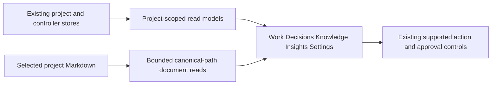

# ARCH: Task-first admin v2

For the board implementer and reviewer, this document fixes how the approved five-section design reuses the existing project-scoped read models without becoming another controller.

**Date:** 2026-10-21. Feature: `great_cto-ejgk`. Size: Medium. Archetype: devtools.
Authority: user approval of the isolated `admin-graph-design-v2` prototype; implementation does not authorize merge, release, installation or deployment.

## Signals and gate

Input is author-controlled Markdown, diagram text, task metadata and host observations. The boundary is selected-project files to browser. Stored state remains in the existing project/controller stores; this change adds no retention store. Incorrect cost figures can mislead budget decisions but do not initiate charges. Existing approval controls must not gain broader authority through relocation. GET requests remain observational and must not execute tools, models or pipeline transitions.

Required gate: project-isolation/security regression tests, browser integration tests and independent read-only review before any delivery approval. The input, boundary and control signals force this gate. Existing gates-only policy applies; approval of the visual design is not permission to bypass verification. No new architecture choice requires a user decision in this read-only slice.

## Context, scope and approved intent

The operator should find a task, its recorded execution/evidence and the next supported action without reconstructing them from Fleet, Harness and Usage. Five primary entries are Work, Decisions, Knowledge, Insights and Settings. The approved prototype is visual intent, not evidence that its fictional metrics or sample graph are available from the product.

The v2 README explicitly leaves dark theme details, expanded graph-node detail and complete settings/mobile-document navigation for subsequent design. Implement responsive access and preserve current theme behavior; do not invent additional approved screen designs. The source already has document browsing, source maps and project-scoped usage readers. Reuse these before introducing new components.

## Change map



This is an architecture map, not evidence of causal task execution. Existing controllers retain write and approval authority; navigation adds no new execution path.

## Decision and alternatives

Selected: an additive navigation/presentation layer over ADR-028's existing read-only cockpit and authoritative task/controller state. Keep native task identity, revision and supported capabilities intact. Extend read safety where the newly prominent Knowledge surface exposes a pre-existing gap.

Rejected: a new graph orchestration service, because it would introduce competing leases, state transitions and approval authority. Rejected: copying the prototype's fictional graph/metrics into production, because unavailable observations would become false execution and quality claims. Rejected: a second document database, because it would split Git provenance and require synchronization/migration without a user need.

Attack on the selected approach: legacy APIs do not all enforce the same selected-project boundary, and the monolithic frontend can reuse stale asynchronous responses after a project switch. Countermeasures are canonical root validation for all Knowledge reads, project-bound request generations/caches and explicit degradation states. A presentation-only label change is insufficient if these mechanisms are absent.

## Components and reuse contracts

| Surface | Authoritative existing contracts | Integration rule |
| --- | --- | --- |
| Work | `GET /api/work`; `packages/board/lib/work.mjs` | Render `entries`, `sources`, `health`, `revision`, capabilities and evidenceSections. Keep `execution.enabled=false` and Copy launch/resume command semantics. |
| Decisions | Existing inbox/gate briefs, gate tokens, task decision capabilities | Relocate, do not reimplement approvals. Preserve revision/content binding, scoped authority and stale-state rejection. |
| Knowledge | `GET /api/docs`, `/api/doc?path=…`, `/api/docs/search?q=…`; `lib/docs.mjs` | Reuse groups/title/freshness/inbound metadata and document viewer. Keep unclassified documents discoverable. |
| Insights: Outcomes | `/api/work` measurement; `/api/outcomes`; `/api/metrics` | Separate task-stage progress, role verdicts, gate approvals and task acceptance. Every denominator needs its real entity and coverage label. |
| Insights: Consumption | `GET /api/usage?days=…`; existing usage-report readers | Preserve project-first aggregation, host attribution and missing/cache/estimate distinctions. |
| Settings | Existing Fleet, Harness and Skills readers/UI | Executors, Runtime and Capabilities are presentation groups. Moving a control cannot change its write contract. |

`projectWork()` has explicit run/session links and bounded activity windows. Do not join by title, role, similar paths or timing. Its stable content revision is distinct from `observedAt`. Preserve both. Task phase `completed`, an issue closed, a successful process exit and `verified` are not interchangeable.

The existing `/api/outcomes` classifies role verdicts and Beads bugs, not accepted tasks. `acceptanceMetrics()` currently counts APPROVED verdicts and derives window cost per approval; present it only under that actual definition, never as cost per accepted task. `measureWork()` measures task-stage progress, interruption reasons and verification rework, not production defect rate or time to user acceptance. Unsupported task-level metrics remain Unavailable with the reason. Do not derive them from log counts or closed timestamps.

## Data flow and state

```text
registered project + canonical root
    -> existing task/host stores -> /api/work -> Work + Decisions
    -> existing docs files      -> /api/docs + /api/doc -> Knowledge
    -> existing usage/verdicts   -> /api/usage + /api/outcomes -> Insights
existing controller <- existing explicitly authorized mutation endpoints only
```

No schema migration, graph store or new event bus. Imports, source_ref and import_batch_id are not applicable because this slice creates no imported domain entities. Keep taskId/runId/source IDs supplied by existing stores. Each new fetch carries selected project and a client request generation; a late response for project A must not overwrite project B. Load Insights and Knowledge only when selected, independently of Work's first render. Cache identity includes canonical project and relevant range/filter; failures must not poison another project's cache.

Execution graphs may show only recorded nodes/dependencies and explicitly declared templates. A declared pipeline from `shared/pipeline.toml` is a workflow template, not a trace. If per-node attempts/dependencies are not available, show recorded stages/activity plus the limitation rather than fabricating edges or parallelism. No retry/resume editor or arbitrary graph mutation is introduced.

## Knowledge security prerequisite

Fresh inspection found that `/api/docs`, `/api/doc` and `/api/docs/search` resolve projects independently of the stricter `scopedReadProject` used by Usage. `/api/doc` checks lexical path containment, then `statSync`/`readFileSync`, which follow symlinks. `listDocs()` can also follow Markdown file symlinks. Making Knowledge prominent requires fail-closed containment first.

Resolve an explicit project only through the registered-project/server-root policy. Unknown projects return a clear unavailable/404 response, never documents from the server fallback. Canonicalize candidate file and root with realpath and require strict descendant containment. Reject external directory/file symlinks in both listing and search; use the same safe-read helper rather than reopening a listed path without validation. Preserve the existing 1 MiB single-document ceiling and bounded 500-document listing. Bound total scanned bytes and return explicit truncation/partial health instead of silently omitting work. Do not expose absolute private paths in errors.

Render document text as hostile data: escaped raw text or the existing sanitized Markdown path; no executable HTML, inline event handlers or active URLs. Diagram source is never eval input. The approved mockup's Mermaid panel uses static SVG and is not an installed renderer. Initial implementation may preserve the source view and existing narrow declared-pipeline renderer; arbitrary Mermaid rendering requires a separately verified local, bounded renderer with secure configuration and no CDN. No new library is selected by this architecture.

Document modified time does not imply freshness or acceptance. Use existing declared freshness evidence and preserve null (undeclared) versus unreadable. Display declared document status only if parsed from explicit source metadata, not inferred from location or filename. Source revision is Unavailable unless actually obtained for those bytes. Related tasks require explicit links; a classifier label or file mention is not verified implementation evidence. Preserve original document/task language while application chrome and formatting stay English.

## UI direction and compatibility

Use the approved v2 restrained green/white operator layout and existing light/dark tokens, typography, density and accessible focus-ring token. No rebrand, gradients, decorative dashboards or card-count inflation. The five entries share project selection. Collapse secondary settings/insights routes without removing access to diagnostic functions or mandatory-reviewer failures.

Keep the existing legacy hashes and detail links resolvable: Work/History, Ledger/Usage, Fleet/agent detail, Harness and Skills. Map their user-visible location to the appropriate new group while preserving filters, query project and deep-link identity. Browser back/forward, refresh and direct URL entry must agree. The Settings group must not shadow unrelated existing settings dialogs. Decisions display exact scope and current evidence; draft-PR permission never implies merge/release/deploy.

<frontend_aesthetics>
NEVER use generic AI-generated aesthetics: overused fonts (Inter, Roboto, Arial, system), cliché schemes (purple gradients; the cream + serif + terracotta editorial default), predictable layouts, cookie-cutter components. For regulated/operator UIs prefer dense, restrained, high-contrast, WCAG-AA layouts with a cohesive context-specific palette and purposeful micro-interactions.
</frontend_aesthetics>

## Safeguards

1. No GET triggers execution, publication, approval or state transitions; unsupported capabilities remain visibly unsupported.
2. Unknown project, unreadable source, loading, partial scan and measured zero remain distinct across screens.
3. Knowledge listing, direct document read and search enforce the same registered canonical root, including symlinks.
4. Existing gate tokens, local-origin checks, revision binding and publication tickets remain authoritative and unchanged in meaning.
5. No fictional prototype metrics, run links, graph dependencies, source revisions or host quality rankings ship as real data.

## Implementation packets

The parent implementer owns scheduling and exclusive file allocation in Beads `great_cto-ejgk`; this assessment does not create duplicate tasks or grants.

| Packet | Files/responsibility | Dependency and completion evidence |
| --- | --- | --- |
| Read boundary | `lib/docs.mjs`, `lib/routes.mjs`, document boundary tests | Before Knowledge exposure; traversal, symlink, unregistered project and bounded partial-read fixtures pass. |
| Navigation and presentation | `public/index.html`, existing UI/route tests | After design approval; five entries, nested routes, preserved legacy deep links, scope-safe lazy rendering. Keep one owner for the HTML file. |
| Real-data Knowledge/Insights | Existing readers and same frontend owner | After boundary/navigation; no sample data, accurate terminology and explicit unavailable states. |
| Browser proof | `tests/e2e/board.e2e.test.mjs` and new isolated fixtures as assigned | After integration; exercise real local API responses, both hosts, project switch races and security fixtures without live models. |

## Verification and definition of done

Targeted commands use Node's test runner and actual existing test paths:

```sh
node --test packages/board/work.test.mjs packages/board/work-view.test.mjs packages/board/task-inspector.test.mjs
node --test packages/board/usage-project-api.test.mjs packages/board/usage-project-ui.test.mjs packages/board/project-scope.test.mjs
node --test packages/board/acceptance-metrics.test.mjs packages/board/design-contract.test.mjs packages/board/english-ui.test.mjs
node --test tests/lib/docs-classify.test.mjs tests/lib/doc-links.test.mjs
node --test tests/e2e/board.e2e.test.mjs
```

Add focused tests for the new root/symlink boundary, document rendering and legacy navigation mappings; the existing suites alone do not establish these behaviors. Run changed-area tests while iterating and the repository canonical full gate once on the final candidate. Full gate discovery/execution and independent review remain the parent pipeline's responsibility. Do not weaken old tests merely because navigation moved: update selectors to assert equivalent supported behavior.

Browser acceptance includes desktop and 390 px layouts, keyboard-only navigation, light/dark, direct links/back/forward, zero/unknown/loading/partial states, stale request responses after switching projects and no uncaught JavaScript errors. Use local fixture projects with real board routes; synthetic HTML-only screenshots are insufficient. No paid models, installed-plugin updates or localhost:3141 replacement are needed for this proof.

## Risks and rollback

Main risks are cross-project document disclosure, stale response contamination, terminology implying nonexistent verification and broken old links. The boundary tests, generation guards, evidence labeling and route tests mitigate them respectively. Existing lessons require real-browser and visual checks; unit-only approval is insufficient.

Compute rollback is reverting the source candidate and using the prior board build; no deployment/install is authorized here. Data rollback is unnecessary because this slice writes no new schema or migrated records; existing task/controller state must remain untouched. No credentials or new external service are required.

## Cost Estimate and Cost Model

No new cloud components and no additional model traffic. Runtime uses existing local board reads. No claim of token or latency savings is made before measurement. Rough estimate: no cloud cost delta at baseline; actual existing host spend remains separate from API-price estimates and subscription limits. Read latency is measured in the fixture/browser gate, not promised from the prototype.

## Requirements checklist

- REQ-1: Five primary sections use the selected project and preserve legacy URLs and feature access.
- REQ-2: Work and Decisions retain actual state, evidence, supported capabilities and approval boundaries.
- REQ-3: Knowledge safely lists, searches and reads only the selected registered project's documents, including hostile path/symlink cases.
- REQ-4: Architecture diagrams/templates are not labeled execution traces; unsupported renderer/attempt data stays explicit.
- REQ-5: Insights separates outcome entities from consumption, preserves missingness and never substitutes approval count for accepted tasks.
- REQ-6: Application chrome is English; original tasks/documents retain their language; keyboard/mobile/theme behavior remains usable.
- REQ-7: Targeted tests, final full gate and independent review precede any separate merge/release/install decision.

## Assessment outcome

Reuse ADR-028; no new orchestrator, persistence model, cloud service, model invocation or user choice is required for this slice. Optional arbitrary Mermaid rendering and writable graph controls are excluded, not silently approved. This document is an integration assessment, not a claim of completed product verification or security sign-off.

## Verification reports

The [independent code review](../qa-reports/REVIEW-task-first-admin-v2.md) records the legacy-link regression and its resolution. The [QA report](../qa-reports/QA-task-first-admin-v2.md) and [security report](../security/CSO-task-first-admin-v2.md) record their own acceptance boundaries; none authorizes publication or activation.

## Recorded attempt-node projection

`entry.execution` carries up to 200 historical controlled-run attempts, retaining separate run and attempt IDs for retries. Only role, host, number, phase, recorded status and timestamps accompany those IDs. Truncation and missing linkage are explicit. Native sessions without a single controlled-run link cannot acquire attempt identity by matching titles or roles.

The display contains recorded attempt nodes, not inferred causal edges. Event order and successful worker status do not prove that one attempt consumed another's result or that the current tree passed verification. Controller transition logging and frozen-topology provenance remain a separate follow-up, tracked as `great_cto-ejgk.4`; complete Mermaid/navigation design is `great_cto-ejgk.5`, aggregate scan budgeting is `great_cto-ejgk.6`.
