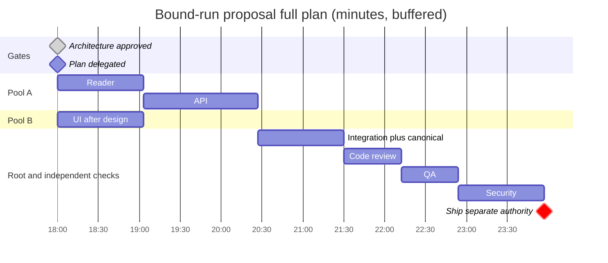

# PLAN: bound-run-proposal

Date: 2026-10-23. Mode: full (medium project, bounded additive feature).
Accepted sources: docs/architecture/ARCH-bound-run-proposal.md and docs/adr/ADR-042-explicit-run-proposal-binding.md.
PM phase: great_cto-mvt2. Parent: great_cto-ely5.15. PR201 depends on PR200.

## Why and boundaries

Allow explicit inspection of one saved controlled-run review snapshot without current-tree assessment or execution authority. Preparation can expose a supported descriptor but never a graph under projector v1. Frozen acceptance: docs/gates/bound-run-proposal.md. This plan grants no live run, paid model, merge, release or installation authority.

Goal ancestry, verbatim in every worker contract:
[archetype:devtools] [compliance:openssf,api-stability,soc2-type-2] [feature:bound-run-proposal] [phase:implementation] | Why: see docs/plans/PLAN-bound-run-proposal.md

## Summary and estimates

| Metric | Value |
|---|---|
| Implementation packets | 3, exclusive reader/API/UI |
| Remaining implementation/verification tasks | 7: reader, API, UI, root integration, code, QA, security |
| Test/verification tasks | 3 TEST (integration, code, QA), 1 CSO |
| Parallel pools / peak | 2: reader then API; UI concurrently using frozen contract and stubs |
| Critical compute path | 357–535.5 min, excludes completed architecture/PM/prechecks and human wait |
| Critical chain | reader63 + API84 + integration63 + code42 + QA42 + security63 =357 min |
| Serial compute sum | 420–630 min (adds UI63); concurrency saves63–94.5 min |
| Remaining human plan wait | 0; canonical helper excludes plan |
| Ship wait | Up to2h only if root later requests ship; no current release scope |
| Full pipeline LLM cost | Unknown actual token/routed-model usage; zero new paid invocations required |
| Human equivalent | $5,902–12,766 including architecture/PM and30% overhead |
| Savings ratio / dollars | Not asserted: full pipeline measured LLM denominator unavailable |

Times are planning estimates, not measurements. Full-mode base estimates reader45/API60/UI45/integration45/code30/QA30/security45 minutes receive40% buffer; pessimistic=optimistic×1.5. Root integration allows one canonical gate; repository gate runtime may dominate, and elapsed evidence replaces this allowance when measured. Human basis: architect4–8h×200, PM3–8h×120, reader4–8h×150, API6–12h×150, UI4–8h×130, integration4–8h×80, code3–6h×150, QA2–4h×80, security4–8h×200, all×1.3. Totals before overhead4540–9820 USD. No devops/product-owner run or spend is invented.

Cost reference only, not this run billing: cost-meter default IDs claude-opus-5(5/25), claude-sonnet-5(2/10), claude-haiku-4-5(1/5 USD perM input/output). Per-turn reader12k/3k tokens, API15k/4k, UI12k/3k with70% input cache at10% input rate gives0.03888/0.05110/0.03888 USD under sonnet-5;2–5 turns =>0.07776–0.19440 /0.10220–0.25550 /0.07776–0.19440. These arithmetic examples exclude upstream context, review, gate and model routing and MUST NOT be labeled pipeline totals or savings. Actual routed IDs/token accounting unknown; parent performs no paid router calls to fill it.

## Dependencies, waves and ownership

```text
gate:arch .15.2 CLOSED
  API/devtools .15.3 CLOSED -> reader .15.6 -> API .15.7 -------+
  design .15.4 -> UI .15.8 (frozen API fixtures; soft API dep) --+-> integration .15.9
  integration -> independent code .15.10 -> QA .15.11 -> security .15.12
  -> separate gate:ship only if later shipping is requested
gate:plan: delegated by canonical gates-only/devtools, no new human checkpoint
```

Root dispatches each wave in one message. Wave1 reader and UI after their respective prechecks; UI uses frozen envelopes and must not wait on or edit API. Wave2 API after reader; UI may still run independently. Wave3 root integration after both implementations, then independent delivery checks in sequence. Peak2 builders; human team-size does not cap LLM concurrency. No builder is started by PM.

| ID | Beads | Owner/output | Dependencies | Buffered min |
|---|---|---|---|---|
| R | great_cto-ely5.15.6 | reader packet | .15.3; PM frozen brief |63–94.5|
| A | great_cto-ely5.15.7 | API packet | R |84–126|
| U | great_cto-ely5.15.8 | UI packet | .15.4; API contract frozen |63–94.5|
| I | great_cto-ely5.15.9 | root integration/package/gate | A,U |63–94.5|
| C | great_cto-ely5.15.10 | independent code-reviewer | I |42–63|
| Q | great_cto-ely5.15.11 | independent qa-engineer | C |42–63|
| S | great_cto-ely5.15.12 | independent security-officer | Q |63–94.5|

Task .15.5 is superseded precheck aggregation, retained closed; actual .15.3/.15.4 govern start. Reader does not depend on UI design. Root owns packaging verification, cross-layer integration, fix routing and final candidate identity. Findings return to the original exclusive file owner; no shared hotfix writer. All builders are told they are not alone and must preserve others' changes.

| Packet | Exclusive allowlist |
|---|---|
| R | scripts/lib/bound-run-proposal.mjs; tests/lib/bound-run-proposal.test.mjs |
| A | packages/board/lib/routes.mjs; packages/board/server.mjs; packages/board/bound-run-proposal.test.mjs; docs/BOARD-API.md |
| U | packages/board/public/index.html; tests/e2e/focus-proposal.e2e.test.mjs; packages/board/bound-run-proposal-ui.test.mjs |

Every other packet's files are denied. All controller, pure projector, observed projection, gate/policy, catalog/pack and prior frozen acceptance files are denied. routes/server/index are shared high-connectivity files with one named owner and the narrow reason above. No PROJECT/CODEBASE available in worktree; primary checkout PROJECT verified medium/devtools/gates-only. No inferred god-node exemption. Runtime package closure is derived by bundle-board, no manifest edit authorized. If needed root first reassigns scope.

## Packet contracts

Root exclusively owns optional `tests/lib/bound-run-package.test.mjs` for the packed import probe outside checkout. No packaging manifest changes are expected. Builders deny this path.

One validated IMPL-BRIEF per builder is in docs/impl-briefs/IMPL-BRIEF-great_cto-ely5.15.6.md, .7.md and .8.md (full filenames, same prefix). These are mandatory before claim. Frozen acceptance B1–B14 is normative and supplies exact test commands; no builder edits it.

R implements trusted exact-file read, membership, all structural/policy/binding checks, closed roles/gates, response byte ceilings and pure projection. It MUST support preparation planningOnly:true descriptors and unavailable graph without mutating flag, with reader spies. Synthetic FS metadata or private trusted root only. No real operator runs or production trust bypass.

A classifies both routes as focus reads before alias resolution, with exact-origin refusal BEFORE registry/metadata/state reads in BOTH server bootstrap and direct dispatcher. It implements strict per-route query keys, fixed statuses, no-store, GET-only, explicit registered project and allowlisted envelopes. API test separately owns actual HTTP and direct-dispatch zero-read spies for all denied origins and scope failures. Existing v1 paths stay compatible.

U extends explicit UUID/phase controls and two-step descriptor/proposal selection; full binding, all request/access generations, synchronous denial/switch clear and A-B-A/race controls. VM test is uniquely named to avoid API-test collision. Real Chromium must execute, not skip. Saved proposal and observed Execution graph stay visually separate with adjacent assurance limits.

## Gantt

Relative start is illustrative, not a promised operator date. Gates are zero-duration policy markers, not extra human pauses.



ASCII fallback (minutes relative to completed prechecks):

| Work | Start | End |
|---|---:|---:|
| Reader / UI concurrently |0|63|
| API |63|147|
| Integration |147|210|
| Code review |210|252|
| QA |252|294|
| Security |294|357|

## Risks and proof check

All ARCH components map to R/A/U/I. BRP-R1 false freshness -> envelope and adjacent provenance; R2 unsafe store -> full trust metadata/ancestors before and after; R3 false historical identity -> explicit hash/ABA limitation; R4 filesystem stall -> bounded source bytes, no latency promise/retry; R5 stale/denied resurrection -> generations/full tuple/browser negatives. New integration risk: projected failure narrowing must remain fail-closed; package closure verified outside checkout.

Proof: architecture accepted; no human plan gate; exact disjoint ownership mechanically checked; three brief validators required; full40% buffer and chain arithmetic reconciled; peak2 builders; exact frozen commands; mandatory independent review retained. Actual LLM full-pipeline dollars/routing remain Unknown, not fabricated savings. Phase completion is planning only.

## Revision history

v1 2026-10-23 PM freezes new acceptance and three exclusive work packets after explicit ADR042 approval. Root commits baseline/digest and integrates; PM does not commit/push or launch builders.

