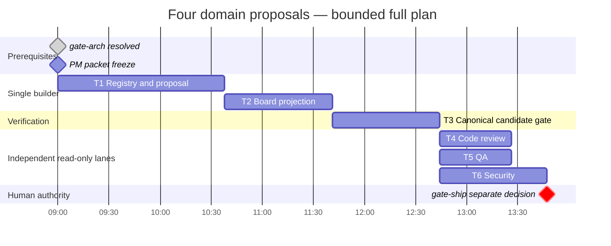

# PLAN: Four domain focus and conditional graph proposals

Date: 2026-10-23. Owner: PM, task great_cto-ely5.3. Mode: full, bounded first slice. Epic: great_cto-ely5. Sources: approved ARCH-four-domain-conditional-graphs.md, ADR-041 and DESIGN-four-domain-conditional-graphs.md. Baseline a56d1264; this plan is not implementation proof.

## Outcome and authority

Expose four focus directions and explainable advisory work proposals while preserving the full catalog, eight core contracts and mandatory independent reviewer + QA + security quorum. Exactly three production components: shared registry, pure proposal, board projection. No scheduling/default change, private source reads, paid model run, merge/release/deployment/installation.

Architecture gates great_cto-0ane and great_cto-ely5.2 are closed after explicit operator approval. Primary PROJECT declares medium/devtools/gates-only; absent worktree PROJECT is not authority. Canonical helper `node scripts/lib/approval-level.mjs gates-only --archetype devtools --json` returns product, arch, import, ship, **without plan**. A separate human gate:plan is not applicable and is not created or falsely marked approved. PM .3 closure and frozen validated packets are mandatory builder prerequisites. Ship/publication authority remains separate.

## Summary

| Metric | Value |
|---|---|
| Remaining tasks | 6: two implementation packets, one canonical verification, three independent reviews |
| Production components / pools | 3 components; one sequential builder chain, three read-only review lanes |
| Peak agents | 3 reviewers; one builder at a time; human team-size does not cap agents |
| Critical path | 287–430.5 min, excluding human waits, including 40% full-mode buffer |
| Sum agent work | 371–556.5 min; parallel reviews save 84–126 min |
| Human wait | Plan 0h, arch already resolved; applicable ship wait 0.5–4h, assumption 2h |
| Full-pipeline LLM forecast | $3.60–17.30, unmeasured API-equivalent forecast |
| Human equivalent | $5,902–14,664 with 30% coordination |
| Comparison | Nominal midpoint difference $10,272.55; ratio omitted after >500× credibility guard; no measured improvement |

## Dependency graph and ownership

```text
gate:arch [closed]
  → PM .3 frozen packets [no human plan gate by policy]
  → Wave 1 .4 registry → pure proposal (one writer)
  → Wave 2 .5 board backend → page → focused/browser/package checks
  → Wave 3 .9 canonical frozen-candidate verification
  → Wave 4 .12 code-reviewer || .11 QA || .10 security (read-only)
  → join all three verdicts, resolve findings
  → gate:ship [separate applicable human checkpoint]
Future .7 runtime activation and .8 benchmark require separate scope/authority.
```

| ID / Beads | Owner / result | Depends on | Buffered optimistic–pessimistic |
|---|---|---|---|
| T1 / great_cto-ely5.4 | senior-dev: registry + proposal | PM .3 | (30+40)×1.4 = 98–147m |
| T2 / great_cto-ely5.5 | senior-dev: board projection | T1 | 45×1.4 = 63–94.5m |
| T3 / great_cto-ely5.9 | root verifier: canonical gate receipt | T2 | 45×1.4 = 63–94.5m |
| T4 / great_cto-ely5.12 | code-reviewer: independent verdict | T3 | 30×1.4 = 42–63m |
| T5 / great_cto-ely5.11 | qa-engineer: independent verdict | T3 | 30×1.4 = 42–63m |
| T6 / great_cto-ely5.10 | security-officer: independent verdict | T3 | 45×1.4 = 63–94.5m |

Critical path T1+T2+T3+max(T4,T5,T6) = 98+63+63+63 = 287m; pessimistic ×1.5 = 430.5m. Sum 98+63+63+42+42+63 = 371m. Canonical-suite runtime is a forecast, not a ceiling: report actual duration or BLOCKED, never weaken tests to match the estimate.

T1 owns only scripts/lib/focus-registry.mjs, scripts/lib/conditional-graph-proposal.mjs and their two tests. T2 exclusively owns packages/board/lib/fleet.mjs, packages/board/lib/routes.mjs, packages/board/public/index.html, packages/board/fleet-focus.test.mjs, new packages/board/focus-proposal.test.mjs, new tests/e2e/focus-proposal.e2e.test.mjs and tests/install-as-a-stranger.test.mjs if needed. Actual HTTP routes live in routes.mjs; server.mjs is excluded. T2 serializes all shared board writes. No concurrent builder file overlap; review lanes write no source/shared report. Coordinator dispatches all three reviews in one message against one frozen candidate. Root aggregates findings and handles any fix/reverification cycle.

Briefs: docs/impl-briefs/IMPL-BRIEF-great_cto-ely5.4.md and IMPL-BRIEF-great_cto-ely5.5.md pin exports, API, allow/deny lists, tests and acceptance. Unknown CODEBASE inventory is not invented. Shared large board files receive additive focused edits only.

## Gantt and ASCII fallback

Compute-only reference timeline, zero-duration milestones exclude waits.



```text
Relative compute minutes: 0       98      161      224     266    287
T1                        [=======]
T2                                [=======]
T3                                        [=======]
T4                                                [======]
T5                                                [======]
T6                                                [===========]
gate:ship                                                      o + wait
```

## Acceptance and requirement mapping

Exact commands frozen in docs/gates/four-domain-conditional-graphs.md before builders start. Final canonical command: `bash scripts/ci-local.sh --e2e`. Builders may not edit acceptance. Root records candidate HEAD + dirty-diff identity, command/rc/duration, skips/NOT CHECKED separately. Independent review follows final canonical verification; changed candidate invalidates affected receipts. Prior 136 routing/domain and 76 documentation tests are architecture baseline only.

Registry covers REQ-1/2/9: four exact IDs mapped to five existing packs, separate two finance packs, candidate/explicit-only, unchanged public digests and three descriptive invariants each. Shared eight core IDs flow through API, unknown registry/policy preserves catalog; total inventory is not hardcoded to 72. Proposal covers REQ-3/4/5/6/7/10/11: pure supplied existing evidence, composable ordinary/architecture/sensitive/publication, current floor and specialist superset, no execution effect. Board covers REQ-1/2/6/7/8/9: explicit choice, full catalog, required/missing/retired visibility, proposed versus observed, native partial/unavailable, safe allowlist and complete response-generation fences. Frozen negative controls/reviews cover REQ-12 and all cross-component controls.

No private source scan is introduced to populate a known proposal. If existing authorized bound metadata is absent, board returns unavailable. Unknown/stale/malformed/unsupported evidence yields null fingerprint and prohibits omission. Bounds: 128 nodes, 256 edges, 65536 UTF-8 bytes; no hidden truncation of required roles. Browser and standalone-installed fixture prove UI and import closure separately from source unit tests. Clinical, compliance, custody, latency/cost and quality improvements remain unknown.

## Cost estimate

**LLM**: $3.60–17.30 (full pipeline: upstream architect/PM/design + 2 builder packets ×2–5 turns + review/QA/security; actual subscription usage unmeasured)
**Human equiv**: $5,902–14,664 (31–80 role-hours × listed rates plus 30% coordination)
**Infra delta**: $0/month (local deterministic projection; no new service/vendor/model call)
**Time to ship**: 6.18–9.28h summed agent execution, 4.78–7.18h candidate elapsed before gate wait; publication separately authorized

> Methodology: full-mode type estimates +40% buffer; pessimistic time ×1.5. Cost uses empirical invocation bands and 2–5 builder turns, not a single tiny token-only call. This is forecast, not measured savings.

| Stage | Forecast USD | Human hours / rate | Human USD |
|---|---|---|---|
| Architect (upstream) | 1–2 | 4–8h ×200 | 800–1,600 |
| PM (current) | .30–.60 | 3–8h ×120 | 360–960 |
| Design (upstream) | .40–.80 | 2–4h ×130 | 260–520 |
| T1 registry/proposal | 1–6 | 2–4h ×150 + 4–8h ×180 | 1,020–2,040 |
| T2 board | 1–6 | 4–8h ×130 | 520–1,040 |
| T3 deterministic gate | 0 | 4–8h ×80 | 320–640 |
| T4 code review | .40–.80 | 2–4h ×150 | 300–600 |
| T5 QA | .10–.30 | 2–4h ×80 | 160–320 |
| T6 security | .40–.80 | 4–16h ×200 | 800–3,200 |
| Coordination | included | +30% human | 1,362–3,384 |
| Total | 3.60–17.30 | 40.3–104h incl. coordination | 5,902–14,664 |

Each builder packet: $0.50–1.20 ×2–5 turns = $1–6. API reference rates from scripts/lib/cost-meter.mjs: claude-opus-5 $5/$25, claude-sonnet-5 $2/$10, claude-haiku-4-5 $1/$5 per million input/output. These are reference prices, not verified routing or billable usage for this Codex session. Product-owner and devops do not run in this slice. Full-mode $100 forecast threshold is not crossed; no paid experiment is authorized.

Arithmetic: direct human $4,540–11,280 ×1.3 = $5,902–14,664. Midpoints $10,283 and $10.45 imply nominal difference $10,272.55. Ratio exceeds 500× even with upstream stages included, so omitted under credibility guard. No actual quality/accepted-task benefit is claimed.

## Risks, rollout and backout

Eight risks: proposal/observed confusion; unavailable evidence narrowing; false native assurance; inferred domain expertise; shared board writer collisions; privacy/project races; installed import closure; gate runtime/tool availability. Controls respectively: advisory typed edges/no result fields; null identity + conservative floor; explicit host limits; candidate/descriptive limitation text; sequential board owner; allowlist/canaries/generation fences; standalone packaging fixture; report actual BLOCKED/NOT CHECKED without weakened checks.

Rollout is local fixture/candidate inspection. No schema/run-state migration or persistent focus policy. Backout removes additive consumers and board projection, discards derived proposals only, retains authoritative runs/receipts/admission. Root coordinates exact feature diff reversal. Future .7 execution activation and .8 matched paid benchmark require separate authority and evidence. Successful slice 1 does not activate or publish them.

## Proof check and handoff

All three components/12 requirements assigned; six task count and critical path reconciled; applicable gates represented (arch closed, plan not applicable, ship separate); builders serialized; review source writes empty; two validated briefs required; buffer/agents/full-pipeline cost stated; ratio omitted by guard; PoC/MVP cap not applicable.

HANDOFF → senior-dev, coordinator. Contract: this PLAN + both IMPL-BRIEFs + frozen gate artifact. Beads: .3/.4/.5/.9/.10/.11/.12 under great_cto-ely5. Must-not-violate: review quorum/gates, full catalog/eight shared IDs, no private reads/runtime mutation, proposed never observed, builder cannot change acceptance. Deferred to root: review aggregation and any ship/publication decision. Open questions: none. Defaults fixed: no initial focus, recorded link only if authorized destination exists, unknown reason visibly unavailable.

Revision 2026-10-23 v1: executable first-slice packets, frozen commands, actual gate-policy receipt and explicit independent review work.
