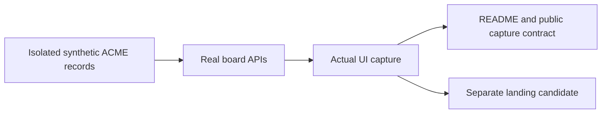

# QA: task-first public showcase

Date: 2026-10-22. Base: released 3.68.1 (`0db13a3b`).
Scope: README, isolated screenshot fixture, capture routes and public images.

## Change map

## Results

| Check | Result |
|---|---|
| Fixture, route and screenshot freshness tests | Included in 26 passed, 0 failed, 0 skipped |
| Actual admin-shell and board browser scenarios | Included in the same 26-test run |
| Rendered light/dark contrast regressions | Included in the same 26-test run |
| Real UI capture | 10 PNGs at 3.68.1; light theme; isolated registry/HOME/task/run stores |
| Selected Work and Knowledge images | Visually inspected |
| Sample linkage | Real readers resolve the task/run IDs; both hosts and retry attempts are present |
| Approval safety | No enabled task approval/resume capability; verifier-success reports remain false |
| Claims | Synthetic records disclosed; causal graph, live models, acceptance and quality uplift not asserted |

Capture stores include no operator project data. Images carry version, panel,
fixture and sample-data metadata. The social image is a separate actual UI
capture at 1200:630 aspect ratio, not a cropped or relabeled historical image.

## Boundaries

No live model calls, comparison benchmark, installed-plugin change, local operator
board replacement, merge, release or website deployment. Independent source-only
review is recorded separately from these checks and does not authorize delivery.
This is changed-area verification, not a fresh full product release gate.
The causal graph implementation is a separate source candidate; these screenshots
demonstrate the released 3.68 observation list, not that unreleased feature.

See the [public capture contract](../reference/public-showcase.md) and
[host capability boundaries](../HOST-CODEX.md).
