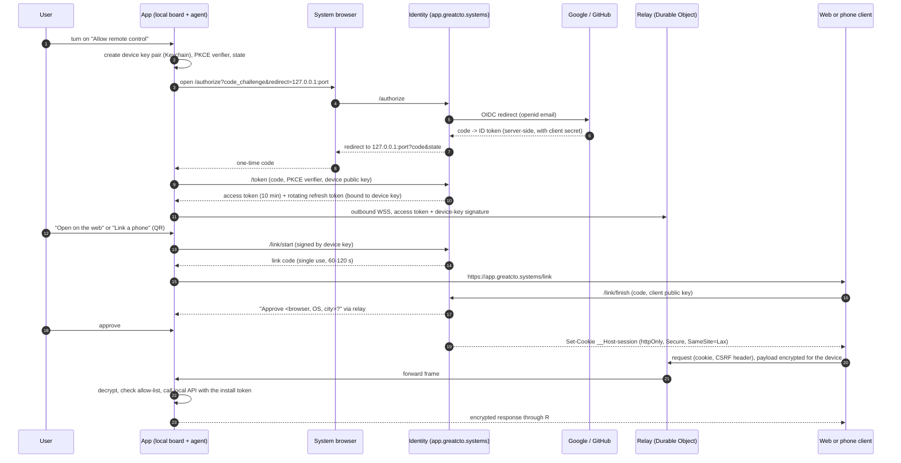

# RFC: Accounts, SSO and hosting — remote control for the local board

- Status: **draft, analysis only** — nothing here is implemented, registered or deployed
- Date: 2026-11-10
- Related: `RFC-board-desktop-app.md`, `RFC-cockpit-for-non-developers.md` (both still in
  another worktree, not on `main`), ADR-007, ADR-009, ADR-024, ADR-045, `docs/PRIVACY.md`

## Summary

The owner asked what was not thought through about registration and authorization, whether to
add Google SSO, and whether the web application should be hosted as SaaS on greatcto.systems.
During the analysis the owner set the direction: **one switch, "Allow remote control", as in
Claude Code — the program runs on the PC, the user controls it from the web or a phone.**

Recommendation:

1. **Local use needs no account, ever.** The board stays a local tool, as today.
2. **An account exists for one purpose: remote control.** Turning the switch on is the moment
   the user signs in (Google or GitHub). Turning it off returns the machine to local-only.
3. **We host a thin control plane, not a SaaS**: identity, a relay and the static web client,
   on `app.greatcto.systems`. Project data is never stored in the cloud; it passes through the
   relay end-to-end encrypted, and only while the switch is on.
4. **Before any of that, harden the local board.** Remote control multiplies the weight of
   every local gap listed in "Current state".

This is option C below in a restricted form (C′).

## Current state (verified 2026-11-10, commit `c7e1b2fb`)

| Fact | Evidence |
|---|---|
| The board has **no user, session or login concept** | no cookie, session or bearer check in `packages/board/server.mjs` or `packages/board/lib/` |
| Bind is loopback by default | `lib/config.mjs`: `GREAT_CTO_HOST` / `--host`, default `127.0.0.1` |
| DNS rebinding is blocked | `hostAllowed()` in `lib/util.mjs`; live check: `Host: evil.example` → `403` |
| Cross-origin writes are blocked | `originAllowed()` on POST/PUT/PATCH/DELETE (`server.mjs`, BH-31) |
| Gate approvals need a single-use token bound to the tree | `lib/gate-tokens.mjs` (ADR-024), store written `0600` |
| **Every response carries `Access-Control-Allow-Origin: *`** | `server.mjs` line 77; live check with a foreign `Origin` → `200` + `ACAO: *` |
| A request with **no `Origin` header is always allowed** | `originAllowed()`: `if (!o) return true` |
| A non-loopback bind logs "Operators authenticate via invite links" | `server.mjs` line 134; the board itself has **no invite code** — the word appears only in that log line (invites belong to the separate operator console) |
| greatcto.systems already runs backend code | `packages/board/cloudflare-worker/`: `/r/*` share reports and `/notify*` email alerts (Worker + KV + Resend); telemetry endpoint `telemetry.greatcto.systems` (Worker → D1) |
| Share publish is unauthenticated | `publishReport()` in `lib/share.mjs` sends no credential; `publishShareReport()` in the committed worker checks only size. The route comment says a separate R2-backed worker owns `/r/*` in production; **the deployed one was not inspected** |
| Alert email needs only a verified address, no sender credential | `/notify` in `worker.js`: looks up `verified:<email>`, then sends |
| Email addresses are already stored server-side | KV keys `verified:<email>`, `code:<email>` |
| `docs/PRIVACY.md` does not describe the email-alert or share-report data | no match for "notify" or "share report"; line 74 says email is never collected (true for telemetry only) |
| The site has no privacy policy or terms page of its own | the footer links to `docs/PRIVACY.md` on GitHub |
| Telemetry is opt-in, default off | `packages/cli/src/telemetry.ts` |

What this means:

- **Reads are open to any web page.** With `ACAO: *` and no credential on GET, a page the user
  visits can fetch `http://localhost:3141/api/...` and read task titles, verdicts and costs.
  Browser private-network protections may reduce this in some browsers; the board should not
  depend on them. Not exploited here, only read from code and confirmed by the response header.
- **Any local process can write.** The Origin check stops browsers, not a local script.
- **greatcto.systems is already a small data processor** (emails, published reports) without a
  privacy policy that says so. Accounts would make an existing gap larger, not create it.
- **User-published HTML is served from the brand apex** (`greatcto.systems/r/<hash>`). Any
  cookie scoped to the apex domain would be readable by a published report. This fixes one
  design constraint below: sessions live on a separate host with `__Host-` cookies.

## Options

| | A. Local only (today) | B. Local + cloud account | **C′. Local app + remote control (recommended)** | D. Full SaaS, cloud agents |
|---|---|---|---|---|
| What the user gains | nothing new | identity, settings sync, licence | approve gates and watch work from web or phone | no local install |
| What an account is for | nothing | little: there is no plan or licence to attach | **reaching your own machine** | everything |
| What leaves the machine | nothing (plus opt-in share, alerts) | email, settings | email, device name, public keys; board payloads **in transit, encrypted**, only while the switch is on | code, repos, secrets |
| Fit for private client code | yes | yes | yes, with end-to-end encryption and no storage | no without contracts and audits |
| Running cost | $0 | ~$5/mo | ~$5–100/mo (see Hosting) | compute per user; thousands |
| Security exposure | local gaps only | account store | account takeover could reach a machine → needs device approval and a narrow remote surface | full multi-tenant |
| Effort | 0 | 2–3 weeks, low value | 6–9 weeks after hardening | a different product |
| Effect on the open-source tool | none | account feels bolted on | core stays free and local; remote control is optional and off by default | splits the product |

Why not B alone: an account with nothing behind it is a cost with no user benefit. Why not D:
agents run in the user's own Claude Code or Codex sign-in (cockpit RFC §2); a cloud runner
would need to hold or proxy those credentials, which that RFC already rules out.

### Relation to the sibling analyses

- `RFC-board-desktop-app.md` recommends **not** building a `.dmg` (PWA + Web Push + daemon).
  The owner's later decisions in `RFC-cockpit-for-non-developers.md` accept a signed `.dmg`.
  This RFC works with either: the remote-control agent is part of the board process, so the
  switch can ship in the npm/daemon board first and in the app when it exists.
- Only the Keychain storage and the system-browser sign-in differ by shell (see "Storage").
- The cockpit RFC's rule stands: the app never asks for, stores or proxies Claude credentials.
  The great_cto account is unrelated to the Claude account.

## Recommended architecture (C′)

Components:

| Component | Where | Holds |
|---|---|---|
| Board + remote agent | user's machine | all project data; device private key; refresh token |
| Identity service | `app.greatcto.systems` (Worker + D1) | account: provider subject, email; devices: name, public key; sessions |
| Relay | Worker + one Durable Object per device | nothing durable; forwards encrypted frames |
| Web client | static assets on `app.greatcto.systems` | nothing; a PWA covers mobile first |

Rules:

1. **Off by default.** No network connection to the control plane exists until the switch is on.
2. **Outbound only.** The machine opens a WebSocket to the relay; no inbound port, no tunnel.
3. **End-to-end encrypted payloads.** Browser and machine derive a key (ECDH P-256, WebCrypto)
   from keys exchanged at pairing. The relay sees account id, device id, sizes and timing.
   Limit, stated honestly: the web client is JavaScript we serve, so E2EE protects against a
   relay or database compromise and against logs, not against a malicious client release.
4. **A new browser or phone must be approved once** from the machine or from an already linked
   device. A stolen Google session alone must not be enough to drive someone's computer.
5. **Narrow remote surface, allow-list in the agent**, in tiers:
   - v1: read views, approve/reject gates (ADR-024 tokens still apply), notifications;
   - later, each by its own decision: start work, comment, stop a run;
   - never remote: toggling remote control, adding a project by path, connecting keys,
     publishing a share report, settings that change what agents may do.
6. **Per-device, visible, revocable.** "This computer" and "Linked devices" lists on both sides.

### Sign-in providers

| Provider | When | Why |
|---|---|---|
| **Google** | v1 | the owner's request; the non-developer audience has it |
| **GitHub** | v1, alongside | developers; the cost of a second OIDC/OAuth provider is small |
| Email magic link | v1.1 | recovery path and users with neither; Resend is already in use |
| Apple | only with a native iOS app in the App Store | required there next to third-party sign-in |
| Passkeys | later | second factor for approving a new device |

Scopes: `openid email` only. No Google API access, no refresh token from the provider kept.

The app is an OAuth **public client of our identity service** (authorization code + PKCE, RFC
8252: system browser, loopback redirect on a random port; never an embedded webview, no client
secret in the app). Our service federates to Google/GitHub as a confidential web client. The
provider secrets stay server-side, and adding a provider needs no app release.

### Token flow

In plain steps:

1. The user turns the switch on. The app opens the **system browser** on our sign-in page.
2. The user picks Google (or GitHub). The provider tells our service who they are; we store
   the provider's user id and the email. First sign-in creates the account: sign-up and
   sign-in are the same step.
3. The browser hands a one-time code back to the app on a loopback address. The app exchanges
   it, together with its PKCE secret and its new device public key, for its own tokens.
4. The app keeps the refresh token and the device key in the macOS Keychain and opens an
   outbound connection to the relay. The computer now shows as "online" for this account.
5. To use the web: the user clicks **"Open on the web"** in the app. The app obtains a
   single-use link code and opens `app.greatcto.systems/link#<code>`. No second Google sign-in
   on the same computer. For a phone, the app shows the same code as a **QR**.
6. The app asks "Approve this browser?" once. After approval the web client gets a session
   cookie and the keys to talk to this computer.
7. Every remote action travels browser → relay → app, encrypted; the app checks it against the
   remote allow-list and performs it through the local API.
8. Sign-in on a browser far from the machine (plain Google sign-in on the web) lists the
   user's computers, but control waits for approval from the machine or a linked device.

Lifetimes and endings:

| Item | Lifetime | Ends when |
|---|---|---|
| Access token (app) | 10 min | expiry |
| Refresh token (app) | 60 days sliding, rotated on every use, bound to the device key | sign-out, device removed, reuse detected (revokes the family) |
| Link code | 60 s (tab) / 120 s (QR), single use | used or expired |
| Web session | 30 days sliding, 7 days idle | logout, device unlinked, account deleted |
| Relay connection | while the switch is on | switch off, sign-out, revocation (relay drops it at once) |

- **Switch off**: connection closed, relay refuses requests for the device, tokens kept so the
  next switch-on needs no sign-in. **Sign out in the app**: tokens revoked, every web session
  linked to that device ended. **Logout on the web**: that session only.
- **Recovery**: there is no password; recovery is the provider's. A second linked provider or
  a magic link covers a lost Google account. The machine itself never depends on the account.
- **Deletion**: one action in the app or the web removes account, devices and sessions within
  30 days, immediately for sessions. Nothing local is deleted.
- **Offline**: the local board works fully; the remote view shows "computer offline" and the
  time last seen. Web Push (already built) wakes the phone when a gate is waiting.

### Storage of secrets

| Secret | Place | Never |
|---|---|---|
| Device private key, refresh token | macOS Keychain (app); for the npm board, the OS keychain through a helper, else a `0600` file under a directory that is never read into model context | `~/.great_cto/preferences.md`, `decisions.md`, `lessons.md`, any project file, any log |
| Per-install local API token | same | URLs, the page HTML, logs |
| Web session | `__Host-` cookie, httpOnly, Secure, SameSite=Lax, host-only on `app.` | `localStorage`; any cookie with `Domain=greatcto.systems` |
| Browser E2EE key | non-extractable WebCrypto key in IndexedDB | server |
| Provider client secrets | Worker secrets | repository, `wrangler.toml` |

A scan test should fail the build when a token-shaped value is written under a path that
`read-global-memory` or the learner reads (same pattern as the existing secret scan).

### Local board hardening (needed with or without accounts)

| # | Change | Closes |
|---|---|---|
| H1 | Remove `Access-Control-Allow-Origin: *`; answer CORS only to the board's own origins | any web page reading the local API |
| H2 | Per-install token for the local API: minted at first start, delivered to the page as an httpOnly SameSite=Strict cookie, required on every `/api/*` and SSE request; CLI and hooks read it from the token file | other local processes and users; requests with no `Origin` |
| H3 | Refuse a non-loopback bind unless an explicit auth mode is configured; fix the "invite links" log line | a board exposed on a LAN with no auth and a false reassurance |
| H4 | Authenticate share publish and alert send (signed by the install key); stop `/notify/status` answering for arbitrary addresses | abuse of the brand domain for hosting and mail |
| H5 | Serve published reports from a separate registrable domain or a sandboxed origin (`Content-Security-Policy: sandbox`) | user HTML on the brand origin |
| H6 | `docs/PRIVACY.md` and a site privacy page describe email alerts and share reports | data already processed and not documented |

H1, H3 and H6 change no screen.

**Correction (2026-11-10, while implementing Phase 0):** H2 is deferred. A token handed to
the page on `GET /` is handed to every local process too, a same-user process can read the
token file, and the strict form needs a visible "open from the CLI" page plus changes in every
API client. H1 already stops web pages. The reasoning is in
`docs/adr/ADR-048-board-local-api-guards.md`. The Phase 0 rows below that name H2 are
superseded by that ADR.

## Multi-user and teams

Single user first. One account, several computers, several linked browsers. No organisation,
roles or shared gates in v1: a gate today is one person's decision bound to one working tree
(ADR-024), and a second approver changes that contract. If teams are wanted later, the data
model leaves room (`account` → `membership` → `workspace`), and it gets its own RFC with an
audit log as a precondition.

## What an account must not do

- No telemetry or tracking added or enabled by sign-in. Telemetry stays a separate opt-in.
- No project names, paths, task text, code or verdicts stored server-side. Device names are
  user-editable and default to a generic label, not the hostname.
- No analytics SDK in the web client. No third-party scripts on `app.greatcto.systems`.
- No use of the email for anything but sign-in and security notices without a separate opt-in.
- Any change to these needs an ADR and a `docs/PRIVACY.md` update in the same change.

## Hosting

**Do we host the web application as SaaS on greatcto.systems? No to SaaS; yes, later, to a
thin control plane on `app.greatcto.systems`.**

| Question | Recommendation |
|---|---|
| Host name | `app.greatcto.systems` for identity + web client, `relay.greatcto.systems` for the relay; **not** the marketing apex (published reports live there) |
| Platform | Cloudflare Workers + Durable Objects (WebSocket hibernation) + D1; the site, alerts and telemetry already run on Cloudflare |
| Auth implementation | OIDC built directly on Workers with a small audited library; the device-linking, device-bound tokens and relay auth are custom in every option |
| Data residency | D1 location hint and Durable Object jurisdiction set to EU; no project data at rest anywhere |

Auth provider comparison (prices to be confirmed against current pricing pages before a
decision; these are from memory, not checked today):

| | Direct OIDC on Workers | Auth.js | Clerk | WorkOS AuthKit | Supabase Auth |
|---|---|---|---|---|---|
| Cost at 10k users | $0 beyond the platform | $0 | free tier may cover it; paid per MAU above | free to a high MAU limit; enterprise SSO priced per connection | free tier or ~$25/mo |
| Lock-in | none | low | high (user store, UI) | medium | medium (brings Postgres) |
| Native-app PKCE to our own service | ours | not its use case | supported | supported | supported |
| Device linking, device-bound tokens | custom | custom | custom | custom | custom |
| Effort | ~2 weeks | ~1.5 weeks, awkward fit on Workers | ~1 week | ~1 week | ~1.5 weeks |
| Fits the zero-dependency, open-source stance | yes | yes | no | partly | partly |

WorkOS becomes the better choice only if enterprise SSO (SAML) for teams is on the roadmap.

Rough monthly running cost (estimate, not a quote; assumes ~20% of users connected at a time):

| Users | Workers / DO / D1 | Email | Total |
|---|---|---|---|
| 100 | Workers Paid base | free tier | ~$5 |
| 1,000 | base + small DO usage | free tier or ~$20 | ~$5–25 |
| 10,000 | base + DO duration and requests | ~$20 | ~$30–100 |

Fixed costs outside hosting: Apple Developer ($99/yr, already in the cockpit RFC), a policy
and terms review, and the owner's time for support and incidents.

### Obligations that start with the first account

| Area | Duty |
|---|---|
| Privacy | privacy policy on the site; lawful basis; records of processing; sub-processor list (Cloudflare, Resend, Google, GitHub); DPA with each |
| User rights | access, export and deletion within one month; a working deletion path before launch |
| Breach | notify the authority within 72 hours and affected users without undue delay; needs an incident runbook and a contact address |
| Terms | terms of service, acceptable use, liability limits — remote control of a machine that runs code is the sensitive part |
| Operations | status page, support address, on-call expectation (one person), abuse handling |
| Google | OAuth consent screen with a verified domain, a privacy policy URL and brand review; basic scopes need no security assessment — to be confirmed when registering |
| CCPA | thresholds are unlikely to be met at this size; honour the rights anyway |

Is it worth it now? The hardening is worth doing now, on its own. The control plane is worth
it only if remote approval from a phone is something the owner or early users would use
weekly. The smaller first step that keeps the option open is Phase 0 + Phase 1 below.

## Threat model summary

| Threat | Mitigation |
|---|---|
| Web page reads or drives the local board | H1, H2 |
| Local malware or another OS user calls the API | H2 (raises the bar; a same-user process that can read the token file is out of scope, as for any local tool) |
| Provider account takeover → control of a machine | device approval for every new client; narrow remote surface; notices on new link |
| Stolen app refresh token | bound to the device key in the Keychain; rotation with reuse detection |
| Stolen web session cookie | `__Host-`, httpOnly, idle timeout; E2EE key is non-extractable and not in the cookie |
| Relay or database compromise | no project data at rest; payloads encrypted end to end; device keys are public keys |
| Malicious web client release | signed release process for the web client (ADR-045 style), SRI, no third-party scripts; residual risk stated to users |
| Link code interception (QR photographed, URL leaked) | single use, short life, fragment not query, explicit approval on the machine |
| CSRF / cross-site requests to the control plane | SameSite cookie + CSRF header + Origin check |
| Published report on the apex steals a session | host-only cookies on `app.`; H5 |
| Abuse of the relay as a free tunnel | per-account rate and size limits; fixed message schema, not arbitrary TCP |
| Remote approval of a gate the user did not read | gate brief shown in full remotely; ADR-024 token still bound to the tree |
| Lost or sold computer | remove the device from the web; refresh token family revoked |

## Gaps checklist ("what was not thought through")

| Area | Today | Gap |
|---|---|---|
| Identity | none | who "the user" is has no definition; the desktop-app RFCs do not mention accounts |
| Sign-up / sign-in | none | no provider, no consent screen, no first-run step |
| Linking app ↔ web | none | no pairing design; the non-loopback bind suggests a reverse proxy the user must build |
| Logout / revocation | none | nothing to revoke today; needed per device and per browser |
| Account recovery | none | provider-based; second factor undecided |
| Account deletion | none for alerts either | verified emails in KV have no documented deletion path |
| Multiple devices | one board per machine, project registry local | no device list, no naming |
| Offline use | works | must stay fully working with the switch on and the network down |
| Licence / plan | none | nothing to sell is defined; an account must not imply one |
| Teams / roles | none | gates are single-approver by contract |
| Audit log | local decision log | no record of *which device* approved; needed before remote approval |
| Privacy policy | telemetry only | alerts, share reports and accounts undocumented; no site page |
| Secrets handling | rules exist | no home for tokens in the npm-installed board; Keychain only with the app |
| Threat model | none for the board as a network service | this RFC's table is the first |
| Local API auth | Host + Origin checks, gate tokens | open reads (`ACAO: *`), no install token |
| Hosted endpoints | share, alerts, telemetry | share and alerts unauthenticated; reports on the brand origin |

## Screens that need an owner-approved Claude Design mockup before any code

Described only; none built. Each shows current next to proposed, desktop and mobile.

1. Settings: the "Allow remote control" switch, its explanation, signed-in state, sign out.
2. Sign-in page on `app.greatcto.systems` (Google, GitHub).
3. "Open on the web" / "Link a phone" with QR and countdown.
4. "Approve this device?" prompt on the machine.
5. Linked devices list (app and web): name, last seen, remove.
6. Remote web client: computer picker, online/offline state, read-only markers on views that
   are not remote-enabled, gate approval on a phone.
7. Account page: email, providers, delete account.
8. Site: privacy policy and terms pages (layout only; text needs legal review).

**Approved 2026-11-11.** The owner approved the mockups for screens 1–6 as published in
Claude Design: https://claude.ai/artifact/PQUJSgqmoMUJGmPAPfMpwH (version 7: settings
switch off/on, sign-in, link a phone and approve it, linked devices, the phone web client).
Screens 7 (account page) and 8 (site privacy and terms pages) have no mockup yet. The
approval covers how those six screens look; building remote control still needs the open
decisions below.

## Phased plan (Beads-ready; no task created yet)

| Phase | Task | Done when |
|---|---|---|
| 0 | ADR: local board API authentication (H1–H3) | ADR accepted by the owner |
| 0 | H1 remove wildcard CORS | test: foreign `Origin` gets no `ACAO`; board E2E green |
| 0 | H2 per-install token for `/api/*` and SSE | test: request without the token → 401; CLI, hooks and MCP server still work; board E2E green |
| 0 | H3 refuse unauthenticated non-loopback bind; fix log line | test: `--host 0.0.0.0` without auth mode exits with a clear message |
| 0 | H6 document alerts and share reports in `docs/PRIVACY.md` | doc merged; site page mockup approved separately |
| 1 | ADR: hosted endpoints authentication (H4, H5) | accepted |
| 1 | H4 sign share publish and alert send with the install key | worker rejects unsigned requests; old clients get a clear upgrade message |
| 1 | H5 move published reports off the brand origin | report URL on the new origin; old links redirect |
| 2 | ADR: accounts and remote control (this RFC's C′) + `docs/PRIVACY.md` update | accepted; privacy policy and terms approved |
| 2 | Mockups 1–7 in Claude Design | each approved by the owner |
| 2 | Identity service: OIDC federation, PKCE token endpoint, device registry, deletion | integration tests incl. refresh-reuse revocation; deletion verified in D1 |
| 2 | Relay: Durable Object per device, limits, no persistence | test: no payload at rest; load test at 1k connections |
| 2 | Agent in the board: switch, Keychain storage, allow-list, E2EE | E2E: link → read → approve a gate → switch off drops the session |
| 2 | Web client (PWA), read + gate approval | Playwright E2E against the deployed build, desktop and mobile |
| 2 | Audit log: device id on every remote decision | visible in the decision log |
| 3 | Decide by evidence: start work remotely, magic link, passkey step-up, teams | separate RFCs |

Phase 0 and Phase 1 have value with no account at all and commit to nothing.

## Open decisions (ADR-009: each escapes the machine, costs money or crosses a boundary)

1. **Direction**: accept C′ (local-first, account only for remote control), or stay at A after
   hardening.
2. **Hardening now**: go-ahead for Phase 0 (H1–H3, H6) independently of everything else.
3. **Hosted endpoints**: go-ahead for Phase 1 (H4, H5); H5 needs a second domain or subdomain.
4. **Becoming an account operator**: privacy policy, terms, support address, incident duty.
   Who is the legal operator (person or company) and under which jurisdiction.
5. **Providers in v1**: Google + GitHub (recommended), or Google only.
6. **Device approval**: every new browser approved from the machine or a linked device
   (recommended), or account sign-in alone is enough (as simple as Claude Code, weaker).
7. **Remote scope in v1**: read + gate approval (recommended), or also start work.
8. **End-to-end encryption in v1** (recommended) or TLS-to-relay first, E2EE later (2–3 weeks
   sooner, relay sees payloads in memory).
9. **Auth implementation**: direct OIDC on Workers (recommended) or a vendor.
10. **OAuth clients**: registering a Google Cloud project and a GitHub OAuth app — owner's
    accounts, owner's action.
11. **Hosts**: `app.greatcto.systems` and `relay.greatcto.systems`; EU data location.
12. **Cost**: Workers Paid plan and the monthly ceiling the owner accepts.
13. **Where the switch ships first**: npm/daemon board, or only in the `.dmg` app.
14. **Mobile**: PWA first (recommended) or a native app (adds Apple sign-in and store review).
15. **Free or paid**: whether remote control is ever a paid feature; today nothing is.
