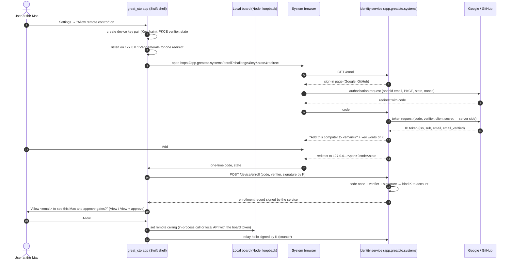

# RFC: Sign-up, sign-in and local authorization for the macOS app

- Status: **draft, analysis only** — nothing here is implemented, registered or created
- Date: 2026-11-11
- Builds on: [RFC-accounts-sso-and-hosting.md](RFC-accounts-sso-and-hosting.md) (option C′,
  "account only for remote control"), the cockpit drafts (`RFC-cockpit-for-non-developers.md`,
  `ADR-DRAFT-desktop-app-channel.md`, `ADR-DRAFT-app-updater.md`, still on a feature branch),
  [ADR-045](../adr/ADR-045-verified-distribution.md),
  [ADR-048](../adr/ADR-048-board-local-api-guards.md), [`docs/PRIVACY.md`](../PRIVACY.md)

This RFC does not redo the accounts RFC. It answers four narrower questions for the `.dmg`
app: does v1 need an account, how the app talks to the local board, how sign-in should work
when an account arrives, and what the owner should do with the Google developer account now.

## Summary

| Question | Recommendation |
|---|---|
| Account in v1? | **No.** The app is a single-user, local tool. First run detects Claude Code / Codex, picks a folder, opens the board. Everything works offline. |
| When does an account appear? | Only with the "Allow remote control" switch (accounts RFC C′). Never required for local use. |
| Who is the Google OAuth client? | **Our identity service, not the app.** The app opens the system browser on `app.greatcto.systems`; the service signs the person in with Google or GitHub as a confidential web client. The app receives a binding of its **device key** to the account, not a Google token and not a long-lived bearer token. |
| How does the app talk to the local board? | v1: the ADR-048 guards as they are, loopback only, random port, the app owns the process. With the `.dmg` (or at the latest with remote control): a **per-launch API token** in a `0600` file plus a one-time ticket that the app hands to its own window — the pattern the reference app already runs. Needs its own ADR, as ADR-048 says. |
| Providers | Google + GitHub at the website; email magic link later as recovery; Sign in with Apple only if a Mac App Store or iOS app ever ships. |
| Google developer account | Secure it and verify the domain **now**; create the Cloud project with billing off now; create OAuth clients and submit the consent screen **only when the identity service is being built**, because both need a live callback URL and a live privacy policy. Google Play and Chrome Web Store accounts are **not needed**. |
| Apple | Apple Developer Program is a separate, required step for Developer ID signing and notarization. Unrelated to sign-in in this design. |

## 1. Does the app need accounts at v1?

No. Reasons, in order of weight:

1. **Nothing to attach an account to.** The board, projects, tasks and verdicts live on the
   machine. Agents run in the user's own Claude Code or Codex sign-in, which great_cto never
   asks for, stores or proxies (cockpit RFC §2). There is no licence, plan or sync.
2. **Offline must keep working.** A sign-in wall breaks first run without network and makes
   the product depend on a service we would have to operate.
3. **An account makes us a data processor** (accounts RFC, "Obligations that start with the
   first account"): privacy policy, deletion path, breach duty, terms. None of it buys a v1
   user anything.
4. **Trust order.** A non-developer asked to "Sign in with Google" by an app that Gatekeeper
   still warns about learns the wrong habit. The reference app wrote the same rule down: no
   public registration before notarization, legal documents and an external security review.

**Minimum that works offline (v1):** install from `.dmg`, open, readiness checks (Claude CLI
signed in via `claude auth status`, project folder, git), board in the app window. No network
call except the documented update check (`docs/PRIVACY.md` "Update check", the updater ADR
draft). No identifier of any kind leaves the machine.

**What changes later:** the remote-control switch (web or phone approves gates) is the first
feature that needs to know *who* is on the other side. That is where sign-in starts.

## 2. How the reference app does it

The owner's other macOS app (a sibling private project, `<private-project>`) is a Swift
menu-bar app plus a local daemon and a self-hostable relay. It has no cloud account yet; its
accounts plan was accepted by the owner on 2026-11-10 and matches option C′ closely. File
references point into that private repository and are listed in the session's private notes;
here they are described by component.

| Area | What it does | Where (component) | Reusable for great_cto? |
|---|---|---|---|
| App → local daemon | Daemon binds `127.0.0.1` only; every `/api/*` except health needs `Authorization: Bearer`; constant-time compare | daemon local API module (bind, auth middleware) | **Yes, the pattern.** great_cto's board is Node; the same shape is ~40 lines |
| Where the local token lives | 32 random bytes per daemon start, written to `<data>/api.json` with mode `0600` via temp file + fsync + rename; a host self-check fails if the file is not `0600` or the directory is group-writable | CLI daemon start, token store helper, security host check | **Yes.** Per-launch, not per-install: a restart rotates it |
| Who reads that token | the Swift app (ephemeral `URLSession`, no proxy, no cache), the CLI, the local MCP server | app API client, CLI, MCP crate | Yes: board page, CLI, hooks, MCP server would read the same file |
| App → its own window/browser | App asks the daemon for a **one-time ticket** (10 min, single use, memory only), opens `…/#ticket`; the page trades it for its own token **only on the loopback listener**, strips it from the URL with `history.replaceState` | sign-in module, app "open dashboard", web UI | **Yes, this is exactly what ADR-048 lacked** (out-of-band delivery to the page). Store the result in an `HttpOnly; SameSite=Strict` cookie, not `localStorage` |
| Remote/browser tokens | `prefix_<id>_<secret>`, only SHA-256 of the secret stored (`0600`), scopes + expiry + last use, revocable, per-IP failure limiter, file lock so CLI/app/daemon revoke instantly | token store | Later, for remote control |
| Roles | viewer / operator / manager; "manage" granted only on the Mac itself, never by a link from the web; role re-read at trade time | sign-in module | **Yes, the principle**: remote surface is capped on the machine |
| Phone pairing | QR with a one-time code in the URL fragment | phone / relay panes | Yes, same as accounts RFC "Link a phone" |
| Relay | Mac long-polls outward, no inbound port; relay checks the person and ownership, the Mac caps what a tunnelled request may do; nothing stored | relay crate, daemon relay module | Matches accounts RFC; great_cto plans a Worker + Durable Object instead |
| Relay identities today | people: admin-issued token, no expiry; Mac: device id + secret in a `0600` file | relay crate | **No** — that is what its accounts plan replaces |
| Keychain | Only the signing vault (App Store Connect keys, certificates) uses the Keychain (generic passwords, per-vault service name); file backend `0600` on Linux/tests; temporary per-job keychains for `codesign` | signing crate (vault, tools) | Yes, the two-backend shape |
| Device key for accounts (plan) | Daemon key in a `0600` file: a LaunchAgent without a provisioning profile cannot use the data-protection keychain or the Secure Enclave (Apple TN3137). A second "approval key" in the Secure Enclave, held by the app, after Developer ID | accounts plan, section C3 | **Yes — the honest answer for a background process** |
| Sign-in (plan) | Account created on the website in the system browser; the app is never a Google client; Mac gets "device key K bound to account A" and authenticates by signature; loopback redirect now, `ASWebAuthenticationSession` with an `https` callback after notarization; device-code flow for headless Macs; clone detection by counter; web session = opaque `__Host-` cookie, hashed at rest | accounts plan, sections C2–C4 | **Yes, adopt** — it refines the accounts RFC (see §4) |
| What the Mac confirms | enrollment, a new person, dangerous actions — not every web sign-in (prompt fatigue) | accounts plan A5 | Yes |
| Signing / notarization | Ad-hoc `codesign` with hardened runtime, universal binary, no Developer ID yet; users click "Open anyway" | bundle script, install doc | Lesson only: `SMAppService.agent` failed under ad-hoc signing, so the login item fell back to a hand-written LaunchAgent |
| Updater | none yet; Sparkle planned together with Developer ID; update-signing key kept outside the service infrastructure (its ADR-A6) | installer plan, accounts plan | **Yes, the principle** — matches ADR-045 and the updater draft |

What is **not** worth copying: tokens in `localStorage` for the web UI (fine on a single-origin
local dashboard, wrong for a shared hosted origin), admin-issued relay user tokens without
expiry, and secrets in plaintext JSON where a Keychain is available to a GUI process.

## 3. App ↔ local board authentication

### Today (main)

ADR-048 is implemented: CORS only for the board's own origins, cross-site `/api/*` refused
(403), bind beyond loopback refused without `--behind-auth`. Gate approvals still need the
ADR-024 single-use token. There is no credential on `/api/*`; any local process of any user
can call it. ADR-048 deferred a per-install token because the page had no out-of-band way to
receive it, about ninety tests and every client would change, and a same-user process can read
a token file anyway.

### What the app changes

The app removes the first objection: **the app starts the board and opens its window**, so it
can hand the window a one-time ticket the same way the reference app does. No "open the board
from the CLI" page is needed inside the app.

| Stage | Board auth | Gain | Cost |
|---|---|---|---|
| v1 `.dmg` (recommended minimum) | ADR-048 as is; app spawns `server.mjs` on `127.0.0.1:<random>`; window loads that origin | nothing new to break; E2E suite unchanged | other OS users / sandboxed apps on the same Mac can still call the API |
| v1.x (recommended before remote control) | **per-launch token**: board writes `~/.great_cto/run/board-api.json` (`0600`, temp + rename; directory never read into model context); `Authorization: Bearer` for CLI, hooks, MCP; the app passes the window a `#ticket=` traded once on loopback for an `HttpOnly; SameSite=Strict; Path=/` cookie; warn-then-enforce | closes other-user and sandboxed-app access; gives the remote agent a credential model to extend | new ADR (ADR-048 follow-up), every client reads the file, PWA/browser users need a "open from the app or CLI" path → **design change, mockup first** |
| Not recommended | token in the Keychain for the board | — | Node cannot read the Keychain without a helper; the threat (same-user process) is not stopped by it either |

The token file is no stronger than a same-user process — stated plainly, as the reference app
and ADR-048 both do. Its value is against other OS users, sandboxed apps with network access,
and as the base for remote control.

## 4. When accounts arrive: the sign-in design

### Options compared

| | A. Google SDK inside the app | B. App as a Google "Desktop app" client (loopback + PKCE) | **C. App → our identity service (system browser, loopback + PKCE), service → Google/GitHub** | D. Email magic link only |
|---|---|---|---|---|
| Google client type | iOS-type client + reverse-client-ID scheme (GoogleSignIn SDK; from memory, not checked today) | Desktop app | **Web application** (server side only) | none |
| Google artefact in the binary | client id + SDK | client id + "secret" that Google itself says is not secret | **nothing** | nothing |
| Add GitHub / passkey / magic link | new app release | new app release | **server change only** | — |
| Same flow for phone and web | no | no | **yes** | yes |
| Embedded webview risk | SDK handles | must not use WKWebView (Google refuses embedded user agents) | must not use WKWebView; system browser | n/a |
| Needs our service | still yes for remote control | still yes | yes | yes + email sending |
| Verdict | no | no | **recommended** | later, as recovery |

Checked against Google's native-app guide on 2026-11-11: desktop apps use the **Desktop app**
client type; loopback `http://127.0.0.1:<random port>` is the supported redirect for macOS;
custom URI schemes and copy/paste are no longer supported for that flow; "Always use PKCE";
"Desktop apps are public clients and cannot keep secrets confidential"; embedded user agents
are refused (`disallowed_useragent`). These facts make B workable but show why C is better:
the app gains nothing from being a Google client.

### Recommended flow (C, refined with the reference app's device-key binding)

The accounts RFC proposed an access token plus a rotating refresh token for the app. The
reference app's plan is stronger and simpler: the machine holds a **device key pair**; the
service records "public key K belongs to account A"; every relay hello and API call is
**signed**. No bearer secret crosses the network after enrollment, there is nothing to refresh,
and a stolen database row is a public key.

In plain steps:

1. Turning the switch on opens the system browser. Sign-up and sign-in are the same step.
2. Google or GitHub tells **our service** who the person is. We keep `(iss, sub)` and the email;
   no provider token is kept (no offline access requested).
3. The browser hands a one-time code back to the app on a loopback port chosen for this one
   request (`127.0.0.1`, not `localhost`). The code is useless without the PKCE verifier and
   the device private key.
4. The **Mac** decides what remote access may do; the service only says who it is (reference
   app ADR-A1/A2; accounts RFC rule 5). A compromised service can stop routing, never grant more.
5. Switch off = connection closed, binding kept. "Sign out of this Mac" = key destroyed,
   service told; works offline too (the binding then expires on the server).
6. Linking a browser or phone: accounts RFC "Open on the web" / QR flow, unchanged.

After Developer ID + notarization, step 3 can use `ASWebAuthenticationSession` with an `https`
callback on our domain (macOS 14.4+; whether it needs an associated domain is unverified).
Until then, loopback + PKCE is the RFC 8252 answer and works without a provisioning profile.

### Where secrets live

| Secret | Place | Why |
|---|---|---|
| Device private key (P-256) | **Keychain item owned by the app**; Secure Enclave when the app has Developer ID and a provisioning profile and the Mac supports it; fallback `0600` file under `~/.great_cto/run/` for the npm board | the remote agent runs while the app runs (menu-bar login item). If it must run with the app closed, the reference app's finding applies: a LaunchAgent cannot use the data-protection keychain → file `0600` |
| Enrollment record (account id, service public keys, counter) | next to the key | not secret, integrity matters |
| Board API token (§3) | `0600` file, rotated per launch | read by CLI, hooks, MCP |
| Anything from Google or GitHub | **nowhere on the Mac** | not requested |
| Provider client secrets | Worker secrets, set by the owner | never in the repo, chat, `wrangler.toml` or `~/.great_cto/*.md` |
| Web session | `__Host-` cookie, opaque id, SHA-256 at rest, idle 30 d / absolute 90 d | revocable instantly; no `localStorage` on a shared origin |

Never in `~/.great_cto/{preferences,decisions,lessons}.md`, any project file, any log, any
transcript. A scan test should fail the build when a token-shaped value is written under a path
that `read-global-memory` or the learner reads.

### Sessions, refresh, sign-out, revocation

| Item | Lifetime | Ends when |
|---|---|---|
| Device binding | until revoked; idle expiry on the server (e.g. 90 days unseen) | sign out on the Mac, remove device on the web, clone detected (same counter twice) |
| Enrollment code | ~60 s, single use | used or expired |
| Loopback listener | one request, ≤ 10 min | first redirect or timeout |
| Web session | idle 30 d, absolute 90 d, rotated at sign-in and step-up | logout, device unlinked, account deleted |
| Google / GitHub tokens | used once server-side, then discarded | — |
| Board API token | one board launch | board restart |

Revoking a Google grant (myaccount.google.com → third-party access) does not lock the Mac out:
it only stops new sign-ins with Google. Account deletion removes account, devices and sessions;
nothing local is deleted.

### Providers and Apple's rules

| Provider | When | Note |
|---|---|---|
| Google | with remote control | `openid email` (add `profile` only if a display name is shown; not needed) |
| GitHub | with remote control | `read:user user:email`; take only a verified email; key on numeric user id |
| Email magic link | later | recovery when a provider account is lost; Resend already used for alerts |
| Passkey | later | step-up for approving a new device on the web |
| Sign in with Apple | only if an App Store app ships | see below |

Apple App Store Review Guideline 4.8 (read 2026-11-11): an app that uses a third-party login for
the user's primary account must also offer a login that limits data to name and email, lets the
user hide the email, and does not track for ads. Sign in with Apple satisfies it. The guidelines
govern App Store apps (and notarized iOS/iPadOS apps on alternative marketplaces); they say
nothing about Developer ID macOS apps. Sign in with Apple as a native capability is **not
available to Developer ID macOS apps** (Apple DTS answer on the developer forums; confirm in
"Supported capabilities (macOS)" before relying on it). Consequences:

- `.dmg` distribution with sign-in on our website: 4.8 does not apply; Google + GitHub is fine.
- A future Mac App Store or iOS app that offers Google sign-in for the primary account: add
  Sign in with Apple (web-based via a Services ID works across platforms).
- Mac App Store distribution is unlikely anyway: the sandbox conflicts with spawning
  `claude`/`codex`, git and a Node server in user folders.

## 5. Google developer account: what to set up, and when

The owner does every console click, account creation, consent submission and anything with
2FA. Agents only prepare text and check results.

### Now (no account feature needed, no risk)

| # | Step | Who | Done when |
|---|---|---|---|
| 1 | Decide whose identity owns the Google Cloud project: the owner's own Google account (recommended), not a shared or team mailbox. Optional: a free Cloud Identity organisation on `greatcto.systems` so the project belongs to the domain, not to one personal account | owner | decision recorded |
| 2 | Harden that Google account: 2-Step Verification with a passkey or hardware security key (not SMS only), recovery email and phone current, backup codes stored offline, review third-party access | owner | Security Checkup green |
| 3 | Add a second owner for recovery (a second account of the owner's, also with strong 2FA) to the project created in step 5 | owner | two owners listed in IAM |
| 4 | Verify `greatcto.systems` in Google Search Console (DNS TXT record in Cloudflare) | owner | domain shows "verified"; this is what brand verification needs later |
| 5 | Create one Cloud project, e.g. `great-cto-identity`. **Do not link billing.** Set Essential Contacts to a role address | owner | project exists, Billing: "no billing account" |
| 6 | Create a support address on the domain (e.g. `support@greatcto.systems`, forwarding) for the consent screen and the privacy policy | owner | mail arrives |

### When the identity service is being built (accounts RFC Phase 2), not before

| # | Step | Who | Done when |
|---|---|---|---|
| 7 | Publish the site privacy policy and terms on `greatcto.systems` (Phase 0 H6 + legal review); homepage must describe the product and not be only a login page | agent drafts, owner approves; page layout needs a Claude Design mockup | pages live |
| 8 | Google Auth Platform → Branding: app name, logo (square ~120 px), support email, homepage, privacy policy, terms links, authorized domain `greatcto.systems` | owner | saved |
| 9 | Audience: **External**, publishing status **In production** (requests limited to `openid email profile` skip the test-user list, the warning screen and the 7-day expiry) | owner | status "In production" |
| 10 | Data access: scopes `openid`, `.../auth/userinfo.email` only (add `profile` only if used). Nothing sensitive or restricted → no security assessment | owner | scope list matches |
| 11 | Submit brand verification ("usually completes in a few minutes"; publish within 7 days of a compliant result) | owner | "Verified" |
| 12 | Clients → **Web application** client "identity-prod": authorized redirect URI `https://app.greatcto.systems/auth/google/callback`, JavaScript origins none | owner | client id noted |
| 13 | A separate client (or project) for staging with its own callback; never share prod credentials with dev | owner | second client id |
| 14 | Store each client secret as a Worker secret (`wrangler secret put`) in the owner's own terminal; never paste it into chat, a file, or an agent prompt | owner | secret listed by name only |
| 15 | GitHub OAuth app (owner's account or an organisation), callback on the same host | owner | client id noted |

No **Desktop app** or **iOS** OAuth client is needed in the recommended design. Create a
Desktop client only if the owner chooses option B later.

### What not to enable

- Billing, paid Identity Platform / Firebase Auth, Google Analytics, Firebase, Maps or any API
  (OIDC sign-in needs no API enabled).
- API keys, service accounts and service-account keys; domain-wide delegation.
- Sensitive or restricted scopes (Drive, Gmail, Calendar, `offline_access` style refresh).
- "Internal" user type (needs Workspace; would lock everyone else out).
- Sharing the project with assistants, contractors or a shared mailbox.

### Other developer accounts

| Account | Needed? |
|---|---|
| **Apple Developer Program** ($99/yr) | **Yes, separately**: Developer ID Application certificate, notarization, stapling; owner's personal account (cockpit decision 5). Independent of sign-in. |
| Google Play Console | **No** — there is no Android app. |
| Chrome Web Store developer | **No** — there is no browser extension. |
| Google Workspace | **No** — Cloud Identity Free (optional) is enough to own the project by domain. |

## 6. Privacy and telemetry

- v1 (no account): no change to `docs/PRIVACY.md` beyond what the updater ADR already brings.
- Accounts: an ADR **and** a `docs/PRIVACY.md` update in the same change (CLAUDE.md). New data:
  provider subject, email, device names (generic default, not the hostname), device public
  keys, session records, relay metadata (sizes, timing). Sub-processors: Cloudflare, Google,
  GitHub, Resend.
- Sign-in must not enable, imply or join telemetry. Telemetry stays a separate opt-in and is
  never linked to the account id.
- No analytics or third-party script on `app.greatcto.systems` or on the sign-in page.
- The update check and the updater send no account or device identifier, and the
  update-signing key never lives in the identity service's infrastructure (ADR-045; reference
  app ADR-A6): a compromised service must not be a path to code on every Mac.

## 7. Risks

| Risk | Mitigation |
|---|---|
| Embedded sign-in (WKWebView) — Google refuses it, and users cannot verify the address bar | always the system browser; a test that the app never loads a provider host in its own window |
| Loopback port race (another local process listens first) | PKCE + state + code bound to the device key; a stolen code is useless |
| Provider account takeover → control of a Mac | Mac approves enrollment and new people; remote ceiling View + approve; "Not me" notices |
| Service compromise | rights live on the Mac; no provider tokens stored; device keys are public keys; E2EE later |
| Cloned disk (Migration Assistant, backup restore) duplicates the device key | counter in every hello; second use revokes; hardware id check on the Mac |
| Same-user malware reads the board token or device key file | stated residual risk; Secure Enclave key for approvals once Developer ID exists |
| Google project lost with the owner's personal account | second owner; optional Cloud Identity organisation; documented recovery codes |
| Brand verification blocked (privacy policy missing, homepage only a login page) | site pages first (step 7) |
| Asking for sign-in before notarization erodes trust | no public registration before Developer ID, legal pages and an external security review |
| Scope creep ("let's also read Drive") forces verification and a security assessment | `openid email` only; any other scope = new ADR |
| Apple rule change, or an App Store build later | revisit 4.8; add Sign in with Apple via Services ID |

## 8. Screens (described only; each needs an owner-approved Claude Design mockup before code)

1. Settings: "Allow remote control" switch, explanation, signed-in state, "Sign out of this Mac".
2. Browser page "Add this computer to <email>?" with key words.
3. In-app prompt "Allow <email> to see this Mac and approve gates?" with the ceiling choice.
4. Linked devices and people list, in the app and on the web.
5. Board in a browser without the ticket cookie (§3 v1.x): "Open the board from the app or with
   `great-cto board`".

## 9. Open decisions for the owner

1. **v1 without accounts** (recommended) — confirm.
2. **Board API token** (§3): ship the per-launch token with the `.dmg` (recommended, as an
   ADR-048 follow-up) or keep ADR-048 only until remote control.
3. **App is not a Google client** (option C, recommended) vs a Desktop client in the app (B).
4. **Device-key binding** instead of the accounts RFC's refresh token (recommended).
5. **Who owns the Google Cloud project**: personal Google account (recommended) or a Cloud
   Identity organisation on `greatcto.systems`.
6. **Timing**: steps 1–6 now; 7–15 only with accounts Phase 2 (recommended).
7. **Scopes**: `openid email` only, or also `profile` for a display name.
8. **Remote agent runtime**: only while the app runs (key in Keychain) or also with the app
   closed (key in a `0600` file, as in the reference app).
9. **Sign in with Apple**: not now; revisit only with an App Store or iOS app.

## Owner's decisions (2026-11-11)

The owner accepted every recommendation above. In detail:

| # | Question | Decision | Consequence |
|---|---|---|---|
| 1 | Account in v1 | **None.** The app is local and single-user | No `docs/PRIVACY.md` change for accounts in v1 |
| 2 | Board API token | **Ship with the `.dmg`**, as its own ADR, warn-then-enforce | Draft: [ADR-DRAFT-board-api-token.md](ADR-DRAFT-board-api-token.md). The browser page "open the board from the app" needs an approved Claude Design mockup before code |
| 3 | Google client | **Our identity service is the client (option C)**; the app ships nothing from Google | No Desktop or iOS OAuth client is created |
| 4 | Machine credential | **Device-key binding** instead of a refresh token | Amends the token flow in `RFC-accounts-sso-and-hosting.md` when its ADR is written |
| 5 | Google Cloud project owner | **The owner's personal Google account**, strong 2FA, plus a second owner for recovery | §5 steps 1–6 are the owner's to do now |
| 6 | Remote agent runtime | **Only while the app runs**; device key in the Keychain | A key in a `0600` file is revisited only if running with the app closed is requested |
| 7 | Timing of Google steps | Steps 1–6 now; 7–15 only with accounts Phase 2 | No consent screen or OAuth client before the identity service and the privacy policy exist |
| 8 | Scopes | `openid email` only | `profile` only with a new decision |
| 9 | Sign in with Apple | Not now | Revisit with an App Store or iOS app |

These decisions fix the direction. They do not authorize code: the board-token ADR and the
accounts ADR each need acceptance of their own text, and every screen needs its mockup.

## Sources checked on 2026-11-11

- Google, "OAuth 2.0 for iOS & Desktop Apps": `developers.google.com/identity/protocols/oauth2/native-app`
- Google Cloud Help, brand verification: `support.google.com/cloud/answer/15549049`
- Google Cloud Help, audience and publishing status: `support.google.com/cloud/answer/15549945`
- Google Cloud Help, OAuth app verification: `support.google.com/cloud/answer/13463073`
- Apple App Store Review Guidelines 4.8: `developer.apple.com/app-store/review/guidelines/`
- Apple developer forums, Sign in with Apple and Developer ID (threads 129263, 707074)

Not checked today: GoogleSignIn SDK client type on macOS (from memory); whether
`ASWebAuthenticationSession` `https` callbacks require an associated domain; keychain
availability for a LaunchAgent with no logged-in GUI session (reference app marks it as an
assumption to test on hardware).
