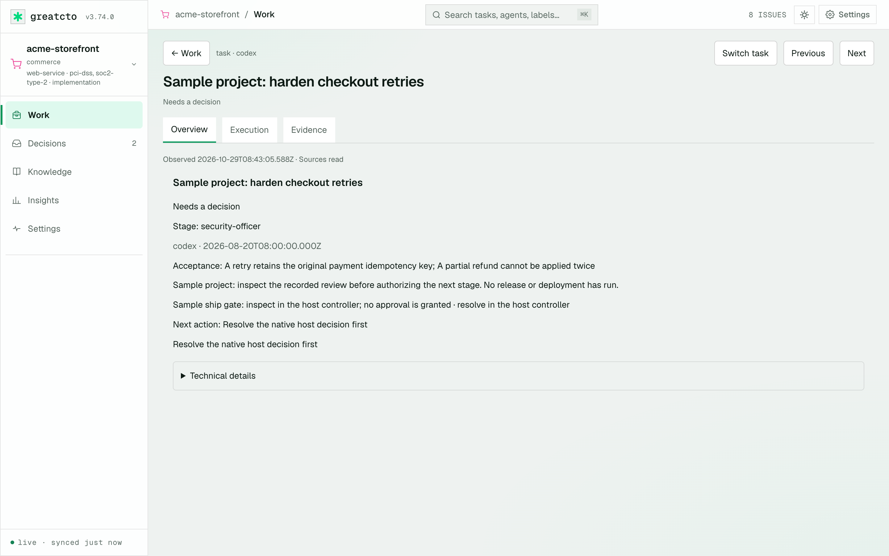
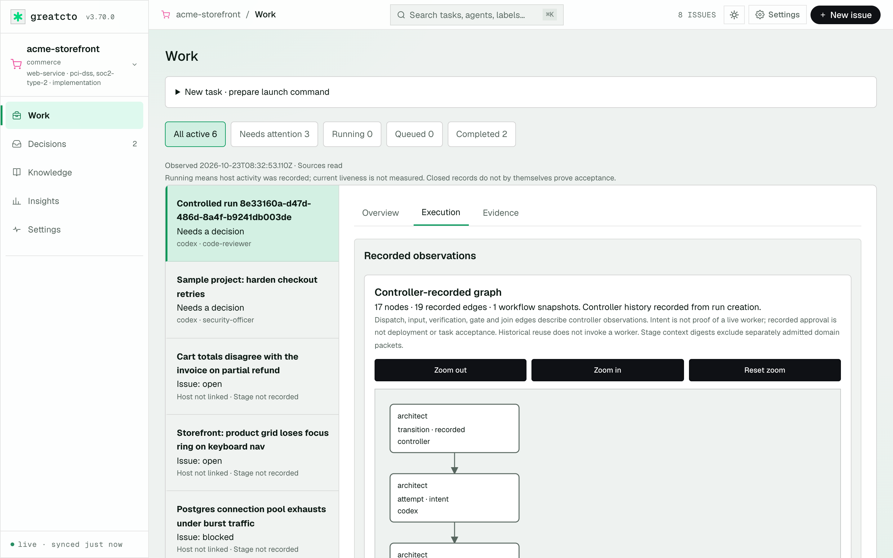
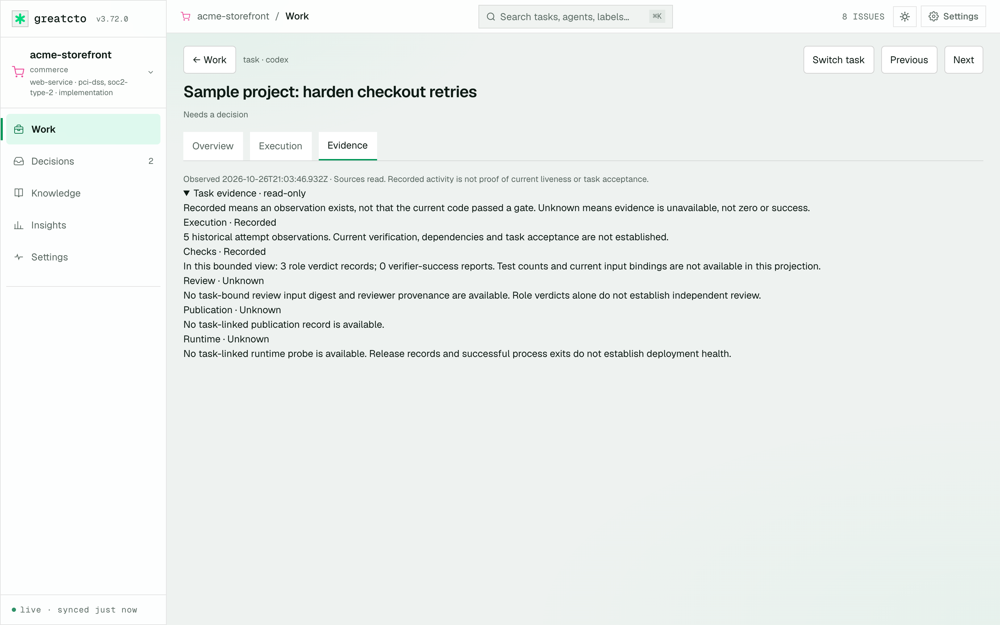
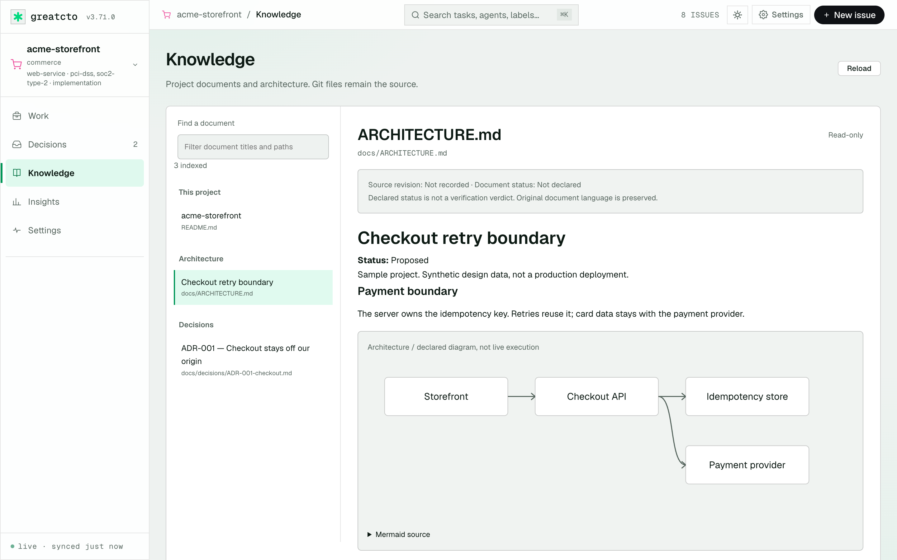
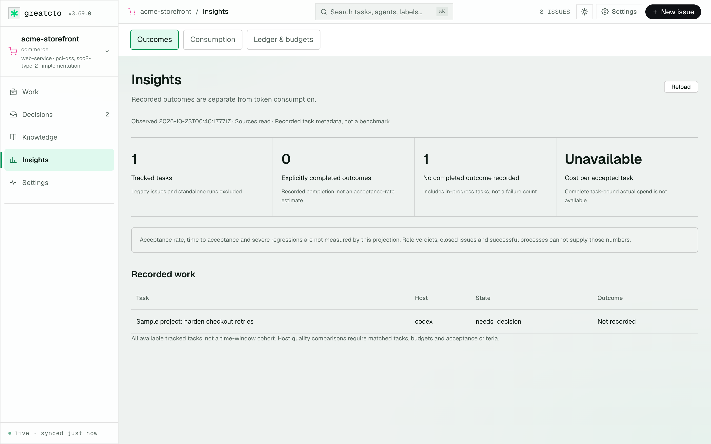

<div align="center">


**Запускайте процессы разработки. Проверяйте доказательства. Решайте, что выпускать.**

[](https://www.npmjs.com/package/great-cto)
[](https://www.npmjs.com/package/great-cto)
[](../../LICENSE)
[](https://claude.com/claude-code) [](https://github.com/openai/codex)



*Пример проекта с синтетическими данными, не live-бенчмарк моделей. 3.70.1.*

```bash
npx great-cto init
```

[Сайт](https://greatcto.systems) · [Один реальный прогон →](https://greatcto.systems/proof) · [Блог](https://greatcto.systems/blog/) · [Changelog](../../CHANGELOG.md)

[English](../../README.md) · [简体中文](../zh-CN/README.md) · [繁體中文](../zh-TW/README.md) · [日本語](../ja/README.md) · [한국어](../ko/README.md) · [Español](../es/README.md) · [Português](../pt-BR/README.md) · [Deutsch](../de/README.md) · [Français](../fr/README.md)

</div>

> Перевод английского [README](../../README.md) версии **v3.70.1** (2026-10-25).
> При расхождении канонична английская версия.

---

great_cto координирует нативные процессы Claude Code и экспериментальные контролируемые запуски Codex через явные стадии, ревью и гейты. Локальная админка связывает задачи, записанные попытки, документы проекта и потребление. Публичный каталог содержит **72** агента; наличие в каталоге не доказывает запуск или экспертизу. Отсутствующие доказательства остаются неизвестными. Для merge, релиза и деплоя нужны отдельные подтверждения и разрешения. Вы платите своему провайдеру; great_cto распространяется под MIT и ничего не берёт.

**Граница проверенной дистрибуции (ADR-045):** перед активацией проверяются подписанные артефакты. Самообновление обычной глобальной npm-установки поддерживается только при наличии независимо проверенного и отдельно настроенного verifier и полного набора подписанных артефактов релиза. Допущенный локальный пакет устанавливается офлайн, с отключёнными lifecycle-скриптами. Наличие исходников или открытой сессии плагина не доказывает, что обновление прошло проверку.

Сейчас `init`, нативное обновление плагинов и автоматическая установка дополнительных компонентов отказываются выполнять активацию. Адаптация Codex через `adapt` создаёт только комментарии: ничего не скачивает и не включает hooks или исполняемый маршрут MCP. Включение таймера обновлений macOS также не поддерживается. Существующие таймеры продолжают запускать старый кеш до отдельно разрешённой миграции.

Примеры установки, работы с плагинами и таймерами ниже описывают **LEGACY 3.70.1**. Это не обещание доступного сейчас пути активации. Подробности: [проверенные обновления](../reference/verified-updates.md).

## Быстрый старт

```bash
npx great-cto init
```

Перезапустите Claude Code. Каждый день нужны три вещи:

| | В Claude Code | В терминале |
|---|---|---|
| **Начать работу** | `/start "add Google login"` | `great-cto run "add Google login"` |
| **Что ждёт меня** | `/inbox` | `great-cto status` |
| **Продолжить** | `/resume` | `great-cto resume` |

`/start` принимает новый продукт или задачу в существующем проекте и сам выбирает
процесс. `/resume` продолжает только то, что вы уже одобрили; ожидающее решение
всё равно ждёт вас. Остальное — `/review`, `/spec`, `/save`, `/digest` и прочее —
под рукой, когда понадобится: [все команды](../COMMANDS.md).

## Один проект, пять экранов

Команда `great-cto board` открывает локальную админку, обычно на `localhost:3141`.

| Экран | Что можно проверить |
|---|---|
| **Work** | Задачи, критерии приёмки, следующее поддерживаемое действие и вкладки Overview, Execution, Evidence |
| **Decisions** | Ожидающие решения и существующие органы управления гейтами, без расширения полномочий |
| **Knowledge** | Markdown проекта, ADR и ограниченный просмотр диаграмм с исходным Mermaid как запасным вариантом; только чтение |
| **Insights** | Записанные результаты, токены выбранного проекта, оценки и отдельные бюджеты |
| **Settings** | Executors, Runtime, Capabilities и General |

`unverifiable`, `unmeasured` и `unavailable` не означают успешную проверку.

Execution показывает причинный граф controlled-run, записанный контроллером. Native- и старые сессии остаются partial/unavailable; недостающие связи не дорисовываются. Пример использует offline stub-ответы, не живые модели. Диаграммы описывают объявленную архитектуру. Токены и стоимость не измеряют качество. Документы сохраняют исходный язык; интерфейс на английском.

<details>
<summary>Записанные попытки, доказательства, документы и результаты</summary>









[Правила создания снимков](../reference/public-showcase.md).

</details>

## Восемь базовых ролей и специалисты под задачу

| Ответственность | Роль |
|---|---|
| Проблема и критерии приёмки | `product-owner` |
| Архитектура системы и компромиссы | `architect` |
| План и зависимости | `pm` |
| Реализация | `senior-dev` |
| Независимое ревью кода | `code-reviewer` |
| Проверки и регрессии | `qa-engineer` |
| Риски и гейт выпуска | `security-officer` |
| Разрешённый деплой | `devops` |

Это контракты ответственности, а не восемь обязательных вызовов модели или восемь одновременно работающих агентов. Project focus меняет только представление: не удаляет специалистов, не меняет диспетчеризацию и не отменяет обязательные проверки. Требования к профильным ревьюерам по-прежнему задаёт политика проекта.

## Предметный инженерный контекст

Пять версионированных кандидатов domain packs с явным opt-in покрывают четыре направления:

| Направление | Инженерные инварианты | Граница |
|---|---|---|
| **Деньги и исполнение криптоопераций** | Идемпотентность платежей, неопределённый результат отправки, ограниченные полномочия; границы подписи, разделение paper/live и финальность цепочки | Два технических пакета; без заявлений о доходности инвестиций |
| **Телемедицинские процессы** | Полномочия специалиста, переходы состояний назначения и целостность доказательств | Без заявлений о клинической эффективности или сертификации |
| **Доказательства для venture** | Происхождение утверждений, история идентичности сущностей и карантин непроверенных заявлений | Без заявлений об инвестиционных результатах |
| **Безопасность ментального благополучия** | Изоляция состояния каждого пользователя, приоритет эскалации кризиса и границы клинических заявлений | Отдельно от диагностики, лечения и клинической валидации |

Пакеты добавляют инженерный контекст. Они не расширяют полномочия и не меняют маршрутизацию обязательных ревьюеров. Наличие пакета не доказывает его вызов, экспертизу или улучшение результата. Прирост качества в сопоставимых испытаниях обычного ядра и ядра с пакетом не установлен. Приватные overlays проектов не входят в публичную витрину.

## На OpenAI Codex

| Режим | Исполнение и полномочия |
|---|---|
| Claude Code native | Нативные команды, специализированные роли и hooks; решения остаются в соответствующем хосте |
| Controlled Codex / mixed-host (experimental) | Контроллер владеет маршрутизацией, текстовыми предложениями, verifier и явными гейтами |
| Codex plugin session | Skills, MCP и защитные hooks; установка не запускает контролируемый pipeline автоматически |

`npx great-cto init --host codex` даёт Codex скиллы, MCP-сервер и шесть защитных
хуков (одобрите их один раз: запустите `codex` в терминале и выберите
**Trust all and continue**). У Codex нет нативной поверхности плагинов для
слэш-команд и ролевых агентов, поэтому пайплайн запускается через CLI:

```bash
great-cto run "add Google login" --host codex --allow src,tests,docs
great-cto status --host codex
great-cto resume --host codex
```

По умолчанию обновление остаётся явной операцией (`great-cto upgrade codex`). На macOS `sh scripts/codex-auto-update.sh enable` включает опциональный пользовательский таймер каждые шесть часов; `status` проверяет его состояние, `disable` удаляет. Перед каждым запуском проверяется Git origin. Таймер следует настроенному Git ref, а не npm-релизам; изменённые hooks требуют одобрения хоста в новой сессии. Подробности и смешанные прогоны:
[руководство по Codex host](../HOST-CODEX.md).

## Когда он вас останавливает

Одна строка в `.great_cto/PROJECT.md`:

| `approval-level` | Останавливает на | Остановок |
|---|---|---|
| **`ship-only`** | **деплое — и даёт вам бриф о том, что строится** | **1** |
| `product-only` | что строим · выпускаем ли | 2 |
| `gates-only` *(по умолчанию)* | что строим · дизайн · деплой | 3 |
| `strict` | дизайн · код-ревью · деплой | 3 |
| `auto` | ничего в пайплайне | 0 |

Регулируемые продукты — финтех, медицина, госсектор — сохраняют гейты
безопасности, комплаенса и выпуска на любом уровне. [Как устроены гейты](../GATES.md).

## Цифры, измеренные

| | |
|---|---|
| Одна фича целиком, с полной трассировкой | **1h 26m · $3.40** — [квитанции](https://greatcto.systems/proof) |
| Целый продукт — 7 собраны в открытом бенчмарке | медиана **$171** · **70/100**, **2026-07-10** — [воспроизвести](../benchmarks/BENCH-2026-07-batch1.md) |

Это исторические наблюдения, не бенчмарк текущего pipeline с двумя хостами или domain packs. Процент улучшения качества не установлен. Domain packs остаются opt-in; их наличие не доказывает экспертизу или лучший результат.

## Ограничения

Для одного разработчика, не для команды; не хостинг-конструктор — нужен ваш
кодинг-агент; не CI/CD; заготовки комплаенса — отправная точка, а не сертификация;
вывод LLM недетерминирован. Честная версия каждого пункта и то, что инструмент
отказывается утверждать: [docs/DETAILS.md](../DETAILS.md).

## Подробнее

[Документация](../README.md) · [Начало работы](../tutorials/getting-started.md) ·
[Команды](../COMMANDS.md) · [Гейты](../GATES.md) · [Агенты](../reference/agents.md) ·
[FAQ](../FAQ.md) · [Всё остальное](../DETAILS.md) ·
[Issues](https://github.com/avelikiy/great_cto/issues) · [Безопасность](../../SECURITY.md) ·
[Участие](../../CONTRIBUTING.md) · [Приватность — телеметрия выключена по умолчанию](../PRIVACY.md)

MIT — [LICENSE](../../LICENSE). Автор — [@avelikiy](https://github.com/avelikiy).
Если инструмент сэкономил вам время, звезда поможет другим соло-разработчикам его найти.
